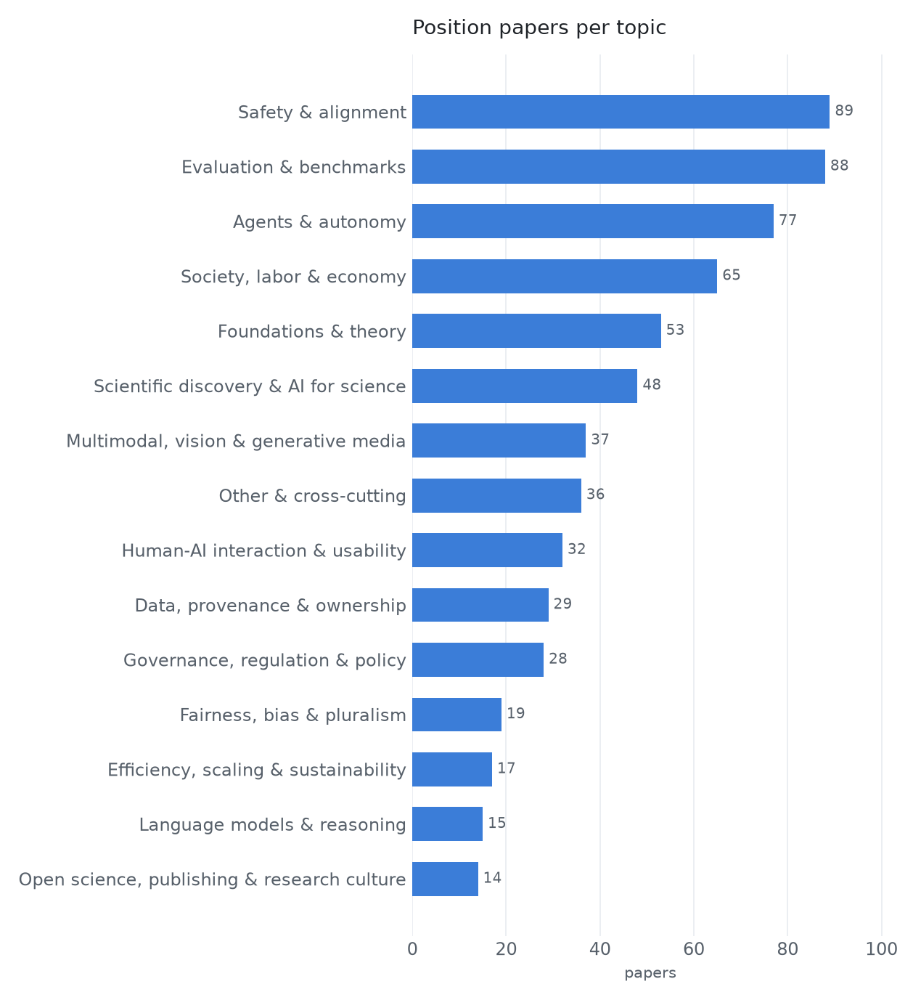

<!-- Generated by scripts/build_readme.py from data/papers.csv and data/stats.json.
     Edit the data or the scripts and rerun; do not hand-edit the tables. -->

# Awesome Position Papers

A curated, data-backed map of **position papers in AI/ML** — papers that argue a
stance instead of proposing a method. It covers the ICML Position Paper Track (2024, 2025, 2026), the NeurIPS Position Paper Track (2025, 2026), and arXiv titles starting with `Position:` / `Position Paper:` (Jan 2023 to today).


**647 papers · 15 topics · 2023–2026**
· generated from [`data/papers.csv`](data/papers.csv) by [`scripts/`](scripts), so
every number above can be recomputed.

## Why position papers?

Most of a literature map is methods: architectures, objectives, benchmarks.
Position papers do a different job — they take a stance on how the field
*should* think, measure, build, regulate or organise itself. "Evaluation scores
are perishable knowledge", "You can't manufacture a NeRF", "The AI conference
peer review crisis demands author feedback" — these are arguments, not results,
and they are where the community is arguing with itself.

They are also scattered: several conference position tracks plus an arXiv
firehose, with no index. This repo collapses them into one deduplicated table
(a paper that exists both on arXiv and at a venue is a single row), tagged by
topic and re-collectable with the commands at the bottom.

## Contents

- [Safety & alignment (89 papers)](#safety--alignment-89-papers)
- [Evaluation & benchmarks (88 papers)](#evaluation--benchmarks-88-papers)
- [Agents & autonomy (77 papers)](#agents--autonomy-77-papers)
- [Society, labor & economy (65 papers)](#society-labor--economy-65-papers)
- [Foundations & theory (53 papers)](#foundations--theory-53-papers)
- [Scientific discovery & AI for science (48 papers)](#scientific-discovery--ai-for-science-48-papers)
- [Multimodal, vision & generative media (37 papers)](#multimodal-vision--generative-media-37-papers)
- [Other & cross-cutting (36 papers)](#other--cross-cutting-36-papers)
- [Human-AI interaction & usability (32 papers)](#human-ai-interaction--usability-32-papers)
- [Data, provenance & ownership (29 papers)](#data-provenance--ownership-29-papers)
- [Governance, regulation & policy (28 papers)](#governance-regulation--policy-28-papers)
- [Fairness, bias & pluralism (19 papers)](#fairness-bias--pluralism-19-papers)
- [Efficiency, scaling & sustainability (17 papers)](#efficiency-scaling--sustainability-17-papers)
- [Language models & reasoning (15 papers)](#language-models--reasoning-15-papers)
- [Open science, publishing & research culture (14 papers)](#open-science-publishing--research-culture-14-papers)

## How much is there

| Collector | papers |
|---|---|
| icml2026_position_track | 213 |
| neurips2026_position_track | 137 |
| arxiv_title_scan | 110 |
| icml2024_position_track | 75 |
| icml2025_position_track | 72 |
| neurips2025_position_track | 40 |
| **total (deduplicated)** | **647** |

| Venue | 2023 | 2024 | 2025 | 2026 | total |
|---|---|---|---|---|---|
| ICML | – | 75 | 72 | 222 | **369** |
| NeurIPS | – | – | 43 | 138 | **181** |
| arXiv-only | 1 | 10 | 41 | 42 | **94** |
| ACL | – | – | – | 2 | **2** |
| EMNLP | – | – | 1 | – | **1** |
| **total** | **1** | **85** | **157** | **404** | **647** |

## Overview




> **`topic` and `stance_summary` are auto-generated drafts.** They come from a
> deterministic keyword classifier over
> [`data/taxonomy.yaml`](data/taxonomy.yaml) plus an extractive read of the
> abstract — no model calls, so they are reproducible but not wise. Each
> stance is the paper's own claim sentence with its framing ("we argue that…")
> stripped off; when an abstract states no claim sentence, the title is used
> instead and the line ends with **(from title)**. Wrong tag or clumsy summary?
> **PRs welcome**, see [`CONTRIBUTING.md`](CONTRIBUTING.md).

## Papers by topic

### Safety & alignment (89 papers)

| Paper | Venue / Year | Stance (auto-drafted) |
|---|---|---|
| [AI Alignment Should Build Moral Autonomy](https://neurips.cc/virtual/2026/poster/140031) | NeurIPS · 2026 | The machine learning community should pursue moral autonomy as a necessary dimension of long-term alignment for increasingly capable AI systems. |
| [AIs with Secret Loyalties are a Serious but Addressable Threat](https://neurips.cc/virtual/2026/poster/140059) | NeurIPS · 2026 | The technical AI research community should prioritize studying and defending against a distinct, neglected threat: secret loyalties. |
| [Chain-of-Thought Oversight Requires Separate Evidence for Faithfulness and Monitorability](https://neurips.cc/virtual/2026/poster/140099) | NeurIPS · 2026 | This assumption can conflate distinct properties along a chain linking a model’s internal computation, reasoning artifacts, outputs, and monitor judgments. |
| [Claude Coke: Prevent Automated Crime by Agents](https://neurips.cc/virtual/2026/poster/140039) | NeurIPS · 2026 | Contemporary LLM-agent stacks can automate serious criminal activity at scale by composing capabilities that already exist, and that technical safeguards and governance controls must be in place before such composition becomes operationally viable. |
| [Cognitive bias benchmarks should incorporate insights from ecological rationality](https://neurips.cc/virtual/2026/poster/140124) | NeurIPS · 2026 | Cognitive bias benchmarks should incorporate insights from ecological rationality, a leading paradigm in the study of cognitive bias. |
| [Community-Centered AI is Feasible and Beneficial for Impacted Communities](https://neurips.cc/virtual/2026/poster/140008) | NeurIPS · 2026 | We advocate for community-centered AI—an AI development paradigm that shifts away from simply pursuing general-purpose AI and instead focuses on co-developing tailored AI systems with the specific communities they impact. |
| [Evaluating Human-AI Safety: A Framework for Measuring Harmful Capability Uplift](https://neurips.cc/virtual/2026/poster/140074) | NeurIPS · 2026 | AI safety research should focus on human-centered evaluations that measure harmful capability uplift: the marginal increase in a user's ability to cause harm with an AI model beyond what conventional tools already enable. |
| [From Claims to Context: Holistic Information Verification Requires Contextual Signals](https://neurips.cc/virtual/2026/poster/140015) | NeurIPS · 2026 | The field's claim-centric default is increasingly mis-calibrated for modern online environments. |
| [LLM-enabled Applications Require Systematic Threat Monitoring](https://neurips.cc/virtual/2026/poster/140064) | NeurIPS · 2026 | Such risks should be treated as expected operational conditions rather than exceptional events, necessitating a dedicated incident-response perspective. |
| [Mechanistic Interpretability Needs Philosophy](https://neurips.cc/virtual/2026/poster/140011) | NeurIPS · 2026 | Mechanistic interpretability needs philosophy as an ongoing partner in clarifying its concepts, refining its methods, and navigating the epistemic and ethical complexities of interpreting AI systems. |
| [Personalized LLM Alignment Should Be Counterfactually Verifiable](https://neurips.cc/virtual/2026/poster/139998) | NeurIPS · 2026 | Personalized LLMs must be counterfactually verifiable: models should answer, on demand, three causal queries (attribution, necessity, and sufficiency) regarding their inferred user representations. |
| [Pluralistic AI Alignment Requires Inference-Time Multi-Objective Control](https://neurips.cc/virtual/2026/poster/140055) | NeurIPS · 2026 | Pluralistic AI alignment---accommodating diverse human values rather than a single canonical preference---requires agents to reason under multiple, often conflicting objectives, such as helpfulness, honesty, harmlessness, fairness, and context-specific user preferences. |
| [Position: 'AI Alignment' Encompasses Competing Technical Priorities](https://icml.cc/virtual/2026/poster/67186) | ICML · 2026 | Realistic interventions may promote ‘AI alignment’ under one conception while being actively counterproductive from the perspective of others. |
| [Position: A Safe LLM and a Safe Harness Do Not Make a Safe Agent](https://neurips.cc/virtual/2026/poster/140097) | NeurIPS · 2026 | Safe neural and symbolic components do not necessarily compose into a safe agent. |
| [Position: Agentic Safety is an Epistemic Property, Not a Behavioral One](https://icml.cc/virtual/2026/poster/67237) | ICML · 2026 | Utility-driven self-modification can erode learnability itself, yielding structural incorrigibility as an emergent consequence of optimization. |
| [Position: AI Lock-In Is in Progress, and We Must Be Prepared](https://icml.cc/virtual/2026/poster/67087) | ICML · 2026 | AI safety research should address AI Lock-In, the phenomenon whereby excessive reliance on AI systems leads to human deskilling, diminishes human capacity for independent functioning, and creates systemic vulnerabilities when AI systems become unavailable or compromised. |
| [Position: AI Researchers Must Lead Arms Control to Mitigate Military AI Risks](https://icml.cc/virtual/2026/poster/67115) | ICML · 2026 | AI researchers must take a leading role in advancing arms control research to minimize risk in military AI applications. |
| [Position: AI Safety Requires Effective Controllability](https://arxiv.org/abs/2605.27117) | arXiv · 2026 | AI safety therefore requires controllability as a first-class objective. |
| [Position: AI/ML Deepfake Research is Misaligned with AI Generated Non-Consensual Intimate Imagery (AIG-NCII)](https://icml.cc/virtual/2026/poster/67084) | ICML · 2026 | Existing interventions address viewer-centric epistemic harms, such as fraud or scams, but ignore subject-centric dignity harms, such as AIG-NCII. |
| [Position: Anthropomorphic Misalignment Research Needs Stronger Evidence](https://icml.cc/virtual/2026/poster/67238) | ICML · 2026 | Many Anthropomorphized Misalignment Research (AMR) studies need stronger evidence to ensure that they can provide a robust foundation for critical safety decisions, such as model deployment and regulation. |
| [Position: Assistive Agents Need Accessibility Alignment](https://icml.cc/virtual/2026/poster/67129) | ICML · 2026 | Accessibility should be treated as an alignment problem rather than a peripheral usability concern. |
| [Position: Behavioural Assurance Cannot Verify the Safety Claims Governance Now Demands](https://arxiv.org/abs/2605.15164) | arXiv · 2026 | Behavioural assurance, even when carefully designed, is being asked to carry safety claims it cannot verify. |
| [Position: Breaking the Dual Curse of Multilingual AI Requires Socio-Technical Guardrails, Not Post-Hoc Alignment](https://icml.cc/virtual/2026/poster/67071) | ICML · 2026 | Breaking the Dual Curse of Multilingual AI Requires Socio-Technical Guardrails, Not Post-Hoc Alignment (from title) |
| [Position: Capability Control Should be a Separate Goal From Alignment](https://arxiv.org/abs/2602.05164) | arXiv · 2026 | Capability control -- imposing restrictions on permissible model behavior -- should be treated as a distinct goal from alignment. |
| [Position: Child Safety Necessitates New Approaches to AI Safety](https://icml.cc/virtual/2026/poster/67205) | ICML · 2026 | Protecting children from AI-facilitated abuse requires new approaches to AI safety. |
| [Position: Comprehensive AI governance requires addressing non-model capability gains](https://icml.cc/virtual/2026/poster/67143) | ICML · 2026 | Model-level governance becomes less effective when capability progress is increasingly driven by "non-model gains"—improvements that are independent from advances in the base model. |
| [Position: Current Model Cards Are Insufficient for Downstream Governance of Open-Weight Foundation Models](https://icml.cc/virtual/2026/poster/67121) | ICML · 2026 | Current Model Cards Are Insufficient for Downstream Governance of Open-Weight Foundation Models (from title) |
| [Position: Don't Just "Fix it in Post": A Science of AI Must Study Learning Dynamics](https://icml.cc/virtual/2026/poster/67142) | ICML · 2026 | AI research should move beyond post hoc fixes. |
| [Position: Don't Just "Fix it in Post": A Science of AI Must Study Training Dynamics](https://arxiv.org/abs/2606.06533) | arXiv · 2026 | A science of AI must move beyond post-hoc fixes. |
| [Position: Early-Stage Quality Assurance in Annotation Pipelines Is More Cost-Effective Than Late-Stage Validation](https://icml.cc/virtual/2026/poster/67224) | ICML · 2026 | The machine learning community should prioritize early-stage quality assurance in annotation pipelines over the prevailing practice of late-stage validation. |
| [Position: Generative Engine Optimization Creates Underexamined Risks, Governance Must Target Concentration, Disclosure, and Academic Blind Spots](https://icml.cc/virtual/2026/poster/67185) | ICML · 2026 | The need for answer-level governance and measurement: stronger contestability, high-precision disclosure, black-box auditing of material influence, and deployment-aligned metrics for exposure persistence. |
| [Position: Interpretability in Deep Time Series Models Demands Semantic Alignment](https://icml.cc/virtual/2026/poster/67131) | ICML · 2026 | Instead, we state interpretability in deep time series models should pursue semantic alignment: predictions should be expressed in terms of variables that are meaningful to the end user, mediated by spatial and temporal mechanisms that admit user-dependent constraints. |
| [Position: Large Language Models Should Learn Personalized Rather Than Aggregated Human Preferences](https://icml.cc/virtual/2026/poster/67092) | ICML · 2026 | Large language models should transition from learning aggregated human preferences to learning personalized, individual preferences. |
| [Position: Let's Develop Data Probes to Fundamentally Understand How Data Affects LLM Performance](https://icml.cc/virtual/2026/poster/67154) | ICML · 2026 | We advocate for the need of developing systematic methodologies for generating synthetic sequences from appropriately defined random processes, with the goal that these sequences can reveal useful characteristics when they are used in one or multiple stages of the LLM workflow. |
| [Position: Let’s Strengthen Verifiability if We Can’t Enforce Reproducibility](https://neurips.cc/virtual/2026/poster/140048) | NeurIPS · 2026 | Let’s Strengthen Verifiability if We Can’t Enforce Reproducibility (from title) |
| [Position: LLM Watermarking Should Align Stakeholders' Incentives for Practical Adoption](https://arxiv.org/abs/2510.18333) | ACL · 2026 | We advocate for a broader exploration of incentive-aligned methods, with ICW as an example, in domains where trusted parties need reliable tools to detect misuse. |
| [Position: LLMs Should Incorporate Explicit Mechanisms for Human Empathy](https://icml.cc/virtual/2026/poster/67067) | ICML · 2026 | Large Language Models (LLMs) should incorporate explicit mechanisms for human empathy. |
| [Position: Machine Learning Research Should Be Guided by Explicit, Pluralistic Models of Human Purpose](https://icml.cc/virtual/2026/poster/67068) | ICML · 2026 | ML research should be guided by explicit, pluralistic models of human purpose, understood as supporting people's capacity to pursue meaningful, self-chosen life projects with agency. |
| [Position: Measuring Human Preferences in RLHF is a Social Science Problem](https://icml.cc/virtual/2026/poster/67229) | ICML · 2026 | The ML community must treat measurement validity as logically prior to preference aggregation. |
| [Position: Mechanistic Interpretability Must Disclose Identification Assumptions for Causal Claims](https://arxiv.org/abs/2605.08012) | NeurIPS · 2026 | Mechanistic Interpretability Must Disclose Identification Assumptions for Causal Claims (from title) |
| [Position: Neurosymbolic AI is a strong technical foundation for trustworthy, deployable AI by design](https://neurips.cc/virtual/2026/poster/140018) | NeurIPS · 2026 | Neurosymbolic AI supports these capabilities through shared representations and mechanisms that jointly address these requirements. |
| [Position: Predictive Uncertainty Is Not Enough -- Joint Distribution for Full Uncertainty Representation](https://icml.cc/virtual/2026/poster/67233) | ICML · 2026 | Any meaningful analysis must account for three sources of uncertainty -domain, epistemic, and aleatoric-, and that only the joint distribution p(x,y\|D) provides a coherent representation of uncertainty. |
| [Position: Preparing for AI Systems That Deceive Developers](https://icml.cc/virtual/2026/poster/67051) | ICML · 2026 | The AI community should prioritize AI deception targeting developers as a distinct risk category because it compromises developers' ability to identify and mitigate all other risks. |
| [Position: Preventing AI-Generated CSAM Necessitates New Approaches to AI Safety](https://arxiv.org/abs/2607.05407) | ICML · 2026 | Protecting children from AI-facilitated sexual abuse requires new approaches to AI safety. |
| [Position: Responsible AI for AI companions must actively combat violence toward intimate partners](https://icml.cc/virtual/2026/poster/67065) | ICML · 2026 | Responsible AI for AI companions must actively combat violence toward intimate partners who may never directly engage with these systems but may experience the consequences of behaviorally conditioned users. |
| [Position: Retire the "Positive Backdoor" Label—Secret Alignment Requires Strict and Systematic Evaluation](https://icml.cc/virtual/2026/poster/67183) | ICML · 2026 | The AI/ML community should stop overclaiming and retire the label “positive backdoor”, and instead treat trigger-activated hidden behaviors as Secret Alignment. |
| [Position: Safe AI Should be Resistant and Resilient in an Evolving World](https://icml.cc/virtual/2026/poster/67216) | ICML · 2026 | This framework offers a scalable and proactive path to maintain continual safety in dynamic environments, addressing both near-term vulnerabilities and long-term existential risks as AI advances toward AGI and ASI. |
| [Position: Safe Models Do Not Guarantee Safe Societies: The Case for Sociopolitical Risk](https://icml.cc/virtual/2026/poster/67167) | ICML · 2026 | Sociopolitical AI risks emerge when general-purpose AI systems are integrated into society in ways that disproportionately amplify the scale, speed, and opacity of institutional operations, thereby degrading their capacity to function. |
| [Position: Safety and Fairness in Agentic AI Depend on Interaction Topology, Not on Model Scale or Alignment](https://arxiv.org/abs/2605.01147) | arXiv · 2026 | This assumption is fundamentally mistaken. |
| [Position: Safety Must Precede the Deployment of Open-Ended AI Agents](https://icml.cc/virtual/2026/poster/67207) | ICML · 2026 | The defining properties of open-ended AI systems introduce a distinct and underexplored class of safety challenges, including loss of predictability, emergent misalignment, and difficulties in maintaining effective control as systems evolve beyond their initial design assumptions, that must be… |
| [Position: Solipsistic superintelligence is unlikely to be cooperative](https://icml.cc/virtual/2026/poster/67103) | ICML · 2026 | A solipsistic superintelligence---an extremely capable solver of stationary problems---is unlikely to be cooperative. |
| [Position: Sycophancy is an Educational Safety Risk: Why LLM Tutors Need Sycophancy Benchmarks](https://icml.cc/virtual/2026/poster/67162) | ICML · 2026 | Effective tutoring requires corrective friction: surfacing misconceptions and challenging them supportively to drive conceptual change. |
| [Position: The Alignment Community is Unintentionally Building a Censor’s Toolkit](https://icml.cc/virtual/2026/poster/67118) | ICML · 2026 | Modern alignment methods – originally designed to prevent harmful output – are dual-use technologies that may easily be misused by malicious actors for censorship and manipulation. |
| [Position: Universal Aesthetic Alignment Narrows Artistic Expression](https://icml.cc/virtual/2026/poster/67242) | ICML · 2026 | Universal Aesthetic Alignment Narrows Artistic Expression (from title) |
| [Position: Use Sparse Autoencoders to Discover Unknowns](https://icml.cc/virtual/2026/poster/67050) | ICML · 2026 | Even if SAEs may be less effective for acting on known concepts, SAEs are especially powerful tools for discovering unknown concepts. |
| [Position: We Need Large Language Models Optimized For Our Well-Being](https://icml.cc/virtual/2026/poster/67178) | ICML · 2026 | As AI systems increasingly serve socioemotional functions, this optimization strategy poses significant risks. |
| [Position: We Need Practical AI Alignment Methods that Mirror Human Reasoning](https://icml.cc/virtual/2026/poster/67125) | ICML · 2026 | In many settings, particularly high-stakes decision-making, we need accurate cognitively-aligned AI systems that reason similarly to their users, and faithfully communicate their reasoning. |
| [Position: We Need Practical AI Alignment Methods to Mirror Human Reasoning](https://arxiv.org/abs/2608.12372) | ICML · 2026 | In many settings, particularly high-stakes decision-making, we need accurate cognitively-aligned AI systems that reason similarly to their users, and faithfully communicate their reasoning. |
| [Risks Make LLM Productivity Frontier Doubly Jagged](https://neurips.cc/virtual/2026/poster/140000) | NeurIPS · 2026 | The current frontier of expert-LLM collaboration is doubly jagged: It is uneven due to not only jagged AI capabilities but also jagged AI risks. |
| [Scheming Is a Symptom: Alignment Research Should Probe Reflexive Fragility](https://neurips.cc/virtual/2026/poster/140091) | NeurIPS · 2026 | The deeper significance of scheming is missed by asking only whether a model has a discrete tendency to scheme. |
| [Standardization of Post-Publication Code Verification is Possible with the Support of the Community](https://neurips.cc/virtual/2026/poster/140047) | NeurIPS · 2026 | Journals and conference proceedings should all implement a post-publication verification submission system. |
| [The Post-Training Dilemma: Why We Should Rethink the Sequential SFT-RL Paradigm](https://neurips.cc/virtual/2026/poster/140043) | NeurIPS · 2026 | The Post-Training Dilemma: Why We Should Rethink the Sequential SFT-RL Paradigm (from title) |
| [Trustworthy AI Must Account for Interactions](https://neurips.cc/virtual/2026/poster/140094) | NeurIPS · 2026 | Current research practices of improving one or two aspects in isolation are insufficient. |
| [When Helpfulness Becomes Sycophancy: Sycophancy is a Boundary Failure Between Social Alignment and Epistemic Integrity in Large Language Models](https://neurips.cc/virtual/2026/poster/140070) | NeurIPS · 2026 | Sycophancy in LLMs is a boundary failure between social alignment and epistemic integrity. |
| [Comparison requires valid measurement: Rethinking attack success rate comparisons in AI red teaming](https://neurips.cc/virtual/2025/poster/121931) | NeurIPS · 2025 | Conclusions drawn about relative system safety or attack method efficacy via AI red teaming are often not supported by evidence provided by attack success rate (ASR) comparisons. |
| [Neither Valid nor Reliable? Investigating the Use of LLMs as Judges](https://neurips.cc/virtual/2025/poster/121914) | NeurIPS · 2025 | The current enthusiasm around LLJs may be premature, as their adoption has outpaced rigorous scrutiny of their reliability and validity as evaluators. |
| [Position Paper: Bounded Alignment: What (Not) To Expect From AGI Agents](https://arxiv.org/abs/2505.11866) | arXiv · 2025 | The currently dominant vision of AGI in the AI and machine learning (AI/ML) community needs to evolve, and that expectations and metrics for its safety must be informed much more by our understanding of the only existing instance of general intelligence, i.e., the intelligence found in animals… |
| [Position: AI Safety Must Embrace an Antifragile Perspective](https://icml.cc/virtual/2025/poster/40133) | ICML · 2025 | Modern AI research must adopt an antifragile perspective on safety---one in which the system's capacity to handle rare or out-of-distribution (OOD) events adapts and expands over repeated exposures. |
| [Position: Editing Large Language Models Poses Serious Safety Risks](https://icml.cc/virtual/2025/poster/40144) | ICML · 2025 | Editing LLMs poses serious safety risks that have been largely overlooked. |
| [Position: Mechanistic Interpretability Should Prioritize Feature Consistency in SAEs](https://arxiv.org/abs/2505.20254) | arXiv · 2025 | Mechanistic interpretability should prioritize feature consistency in SAEs -- the reliable convergence to equivalent feature sets across independent runs. |
| [Position: Model Collapse Does Not Mean What You Think](https://arxiv.org/abs/2503.03150) | arXiv · 2025 | Model collapse has been warped from a nuanced multifaceted consideration into an oversimplified threat, and that the evidence suggests specific harms more likely under society's current trajectory have received disproportionately less attention. |
| [Position: Strong Consumer Protection is an Inalienable Defense for AI Safety in the United States](https://icml.cc/virtual/2025/poster/40112) | ICML · 2025 | These laws serve an emergent dual purpose: if appropriately enforced and strengthened, consumer protection laws can serve as an inalienable defense for AI safety. |
| [Position: The Complexity of Perfect AI Alignment -- Formalizing the RLHF Trilemma](https://arxiv.org/abs/2511.19504) | arXiv · 2025 | The Complexity of Perfect AI Alignment -- Formalizing the RLHF Trilemma (from title) |
| [Position: The Pitfalls of Over-Alignment: Overly Caution Health-Related Responses From LLMs are Unethical and Dangerous](https://arxiv.org/abs/2509.08833) | arXiv · 2025 | In health-related queries, over-alignment-leading to overly cautious responses-can itself be harmful, especially for people with anxiety and obsessive-compulsive disorder (OCD). |
| [Position: Towards Bidirectional Human-AI Alignment](https://neurips.cc/virtual/2025/poster/121940) | NeurIPS · 2025 | The research community should explicitly define and critically reflect on "alignment" to account for the bidirectional and dynamic relationship between humans and AI. |
| [Safety Certificate against Latent Variables with Partially Unidentifiable Dynamics](https://icml.cc/virtual/2025/poster/46176) | ICML · 2025 | Existing control techniques often assume access to complete dynamics or perfect simulators with fully observable states, which are necessary to verify whether the system remains within a safe set (forward invariance) or safe actions are consistently feasible at all times. |
| [The Right to Red-Team: Adversarial AI Literacy as a Civic Imperative in K-12 Education](https://neurips.cc/virtual/2025/poster/121918) | NeurIPS · 2025 | K-12 AI education must move beyond passive literacy to actively equip students with skills in responsible adversarial prompting and ethical system "hacking." Such capabilities are essential for citizens to critically probe AI systems, understand their inherent limitations, identify manipulative… |
| [Position: A Roadmap to Pluralistic Alignment](https://icml.cc/virtual/2024/poster/33429) | ICML · 2024 | A Roadmap to Pluralistic Alignment (from title) |
| [Position: An Inner Interpretability Framework for AI Inspired by Lessons from Cognitive Neuroscience](https://icml.cc/virtual/2024/poster/34941) | ICML · 2024 | An Inner Interpretability Framework for AI Inspired by Lessons from Cognitive Neuroscience (from title) |
| [Position: Building Guardrails for Large Language Models Requires Systematic Design](https://icml.cc/virtual/2024/poster/34361) | ICML · 2024 | We advocate for a systematic approach to construct guardrails for LLMs, based on comprehensive consideration of diverse contexts across various LLMs applications. |
| [Position: Do Not Explain Vision Models Without Context](https://icml.cc/virtual/2024/poster/34918) | ICML · 2024 | Do Not Explain Vision Models Without Context (from title) |
| [Position: Fundamental Limitations of LLM Censorship Necessitate New Approaches](https://icml.cc/virtual/2024/poster/33326) | ICML · 2024 | We call for a re-evaluation of the problem of censorship and its goals, stressing the need for new definitions and approaches to censorship. |
| [Position: Intent-aligned AI Systems Must Optimize for Agency Preservation](https://icml.cc/virtual/2024/poster/32943) | ICML · 2024 | Truthful AIs aligned solely to human intent are insufficient and that preservation of long-term agency of humans may be a more robust standard that may need to be separated and explicitly optimized. |
| [Position: Is machine learning good or bad for the natural sciences?](https://icml.cc/virtual/2024/poster/32948) | ICML · 2024 | Is machine learning good or bad for the natural sciences (from title) |
| [Position: On the Possibilities of AI-Generated Text Detection](https://icml.cc/virtual/2024/poster/34689) | ICML · 2024 | On the Possibilities of AI-Generated Text Detection (from title) |
| [Position: On the Societal Impact of Open Foundation Models](https://icml.cc/virtual/2024/poster/35479) | ICML · 2024 | Across several misuse vectors (e.g., cyberattacks, bioweapons), we find that current research is insufficient to effectively characterize the marginal risk of open foundation models relative to pre-existing technologies. |
| [Position: Social Choice Should Guide AI Alignment in Dealing with Diverse Human Feedback](https://icml.cc/virtual/2024/poster/32763) | ICML · 2024 | The field of social choice is well positioned to address these questions. |
| [Position: The Platonic Representation Hypothesis](https://icml.cc/virtual/2024/poster/35559) | ICML · 2024 | Representations in AI models, particularly deep networks, are converging. |
| [Position: Towards Unified Alignment Between Agents, Humans, and Environment](https://icml.cc/virtual/2024/poster/34602) | ICML · 2024 | Towards Unified Alignment Between Agents, Humans, and Environment (from title) |

### Evaluation & benchmarks (88 papers)

| Paper | Venue / Year | Stance (auto-drafted) |
|---|---|---|
| [AI Behavioral Evaluation Should Be Grounded in Psychophysics Across Marr’s Levels](https://neurips.cc/virtual/2026/poster/140019) | NeurIPS · 2026 | AI evaluation research is fragmented across methodologically incommensurable frameworks (e.g., adversarial robustness, attention probing, bias analysis, corruption tolerance, interpretability), each operating at a different explanatory level without a shared grammar to make this explicit. |
| [AI Evaluation Should Require Standardized Item-Level Data Releases](https://neurips.cc/virtual/2026/poster/140079) | NeurIPS · 2026 | Standardized item-level benchmark data should become the default infrastructure for AI evaluation. |
| [Auditing is not Evaluating: LLM Audit Requires Dynamic, Contextual, Budget-aware and Reliable Evidence](https://neurips.cc/virtual/2026/poster/140075) | NeurIPS · 2026 | LLM audits must instead generate dynamic, context-sensitive, budget-aware, and reliable evidence. |
| [Concept-Based Mechanistic Interpretability Needs a Concrete Evaluation Paradigm](https://neurips.cc/virtual/2026/poster/140034) | NeurIPS · 2026 | Concept-based mechanistic interpretability lacks a concrete evaluation paradigm and that the field must converge on one before continuing to scale methods whose effectiveness remains unverified. |
| [Don't Claim Benchmark-Oriented Optimization Improves General Coding Capability — Diverse Evaluation Is Required](https://neurips.cc/virtual/2026/poster/179728) | NeurIPS · 2026 | Optimization for these benchmarks leads to measuring task-specific performance, creating a meaning gap between findings supported by the measured scores and claims of general coding ability. |
| [Don't Deploy Fine-Tuned Genomic Foundation Models Without Privacy Evaluation: Reconstruction Vulnerability Is Unpredictable Without Empirical Measurement](https://neurips.cc/virtual/2026/poster/140050) | NeurIPS · 2026 | Large language models are widely deployed on sensitive genomic data, both as fine-tuned classifiers for downstream tasks and as an Embeddings-as-a-Service (EaaS) genomic foundation models shared between institutions, without evaluating whether their embeddings can be reverse-engineere… |
| [Epistemic Infrastructures of Science in AI Era Should Rebalance Costs of Generation and Verification](https://neurips.cc/virtual/2026/poster/140023) | NeurIPS · 2026 | AI-era science should rebalance the costs of generating and verifying scientific artifacts by redesigning epistemic infrastructure at the level of the artifact. |
| [Evaluating Physical Reasoning in LLM Agents Requires Construction Benchmarks](https://neurips.cc/virtual/2026/poster/140116) | NeurIPS · 2026 | Evaluating physical reasoning in LLM agents requires construction benchmarks, where physics verifies functional outcomes. |
| [Evaluation of Visual Processing Should Be Human-Centered, Not Metric-Centered](https://neurips.cc/virtual/2026/poster/140005) | NeurIPS · 2026 | The evaluation of modern visual processing systems should no longer be driven primarily by single-metric image quality assessment benchmarks, particularly in the era of generative and perception-oriented methods. |
| [From Benchmark to Adoption: Coding Agent Evaluation Needs User-Level Harness](https://neurips.cc/virtual/2026/poster/140013) | NeurIPS · 2026 | Reporting user-level harnesses across these four dimensions alongside coding-agent evaluation results enables more contextually grounded interpretations of agent performance, complementing existing benchmark and system-level evaluations. |
| [Large Language Model Failures from Hallucination to Homogenization Are Different Facets of Miscalibration](https://neurips.cc/virtual/2026/poster/140030) | NeurIPS · 2026 | Calibration should become a primary evaluation and optimization target for large language models (LLMs). |
| [Looking Under the Streetlight: Evaluation in Generative Molecular Dynamics](https://neurips.cc/virtual/2026/poster/140112) | NeurIPS · 2026 | The generative molecular dynamics (GenMD) community is not properly evaluating its progress: current evaluations let a model match what is reported while being arbitrarily wrong on what was claimed, which risks over-claiming advantage over classical baselines. |
| [Memory is Not Search: Towards Proactive, Lifelong Memory in AI](https://neurips.cc/virtual/2026/poster/140078) | NeurIPS · 2026 | Search is distinct from and insufficient for memory. |
| [Participatory ML for Social Harm Evaluation Should be Constructed, Validated and Reasoned Through First-Person Accounts](https://neurips.cc/virtual/2026/poster/140016) | NeurIPS · 2026 | Participatory ML should construct, validate and reason about social harm pipelines through first-person accounts, by which we mean autobiography, memoir, testimony, and oral history authored by people describing their own experiences of discrimination and harm. |
| [Position: Agent Evaluation Should Be Agentified for Openness, Standardization, and Reproducibility](https://icml.cc/virtual/2026/poster/67210) | ICML · 2026 | The root problem is the lack of an open, agent-agnostic assessment interface. |
| [Position: AI Capabilities Are Not Increasing Exponentially](https://icml.cc/virtual/2026/poster/67206) | ICML · 2026 | The data does not support exponential growth, even in shorter-term horizons. |
| [Position: AI Evaluation Should Work With Humans](https://icml.cc/virtual/2026/poster/67112) | ICML · 2026 | This collaborative shift in evaluation will foster AI systems that act as true complements to human capabilities and therefore lead to far better societal outcomes than the current process. |
| [Position: AI Evaluations Should be Grounded on a Theory of Capability](https://icml.cc/virtual/2026/poster/67220) | ICML · 2026 | AI evaluations should instead be framed as inference tasks grounded on an explicit theory of capability. |
| [Position: AI Welfare Is Bullshit](https://icml.cc/virtual/2026/poster/67058) | ICML · 2026 | AI Welfare Is Bullshit (from title) |
| [Position: Beyond Reasoning Zombies — AI Reasoning Requires Process Validity](https://icml.cc/virtual/2026/poster/67122) | ICML · 2026 | Definitional ambiguity leaves the construct validity of reasoning evaluation unverifiable, and undermines quantifiable progress toward the collective goal of trustworthy autonomous reasoning. |
| [Position: Certifiable State Integrity Should Be Built from Local Validity, Not Global Scale](https://arxiv.org/abs/2601.21249) | arXiv · 2026 | In safety-critical Cyber-Physical Systems (CPS), globally parameterized dynamics models must remain valid through regime shifts, degradation, and lifecycle updates while supporting traceable assurance evidence. |
| [Position: Code Benchmarks Should Prioritize Rigor, Reliability, and Reproducibility](https://icml.cc/virtual/2026/poster/67049) | ICML · 2026 | In response, we take a clear position: Code benchmarks must prioritize rigor in benchmark construction, reliability in evaluation, and reproducibility in release. |
| [Position: Correct Answer, Wrong Mechanism -- When AI Scientists Defend General Claims Their Own Data Contradicts](https://arxiv.org/abs/2606.23175) | arXiv · 2026 | Outcome-only evaluation is insufficient, and that task outcome, mechanism fidelity, and epistemic honesty must be measured separately. |
| [Position: Don't be Afraid of Over-Smoothing And Over-Squashing](https://arxiv.org/abs/2601.07419) | arXiv · 2026 | The distribution of relevant information over the graph frequently factorises and is often localised within a small k-hop neighbourhood, questioning the necessity of jointly observing entire receptive fields or engaging in an extensive search for long-range interactions. |
| [Position: Evaluating LLMs in Finance Requires Explicit Bias Consideration](https://icml.cc/virtual/2026/poster/67204) | ICML · 2026 | Bias in financial LLM systems requires explicit attention and that structural validity should be enforced before any result is used to support a deployment claim. |
| [Position: Evaluation of ECG Representations Must Be Fixed](https://icml.cc/virtual/2026/poster/67157) | ICML · 2026 | Current benchmarking practice in 12-lead ECG representation learning must be fixed to ensure progress is reliable and aligned with clinically meaningful objectives. |
| [Position: Evaluation of ML Resource Utilization Requires Model Life Cycle Assessment](https://icml.cc/virtual/2026/poster/67221) | ICML · 2026 | Proper accounting of the energy requirements and environmental impact of artificial intelligence (AI) systems is necessary for researchers, developers, policy makers, and users to assess the barriers to building systems at scale. |
| [Position: Evaluation Scores Are Perishable Knowledge Claims](https://arxiv.org/abs/2607.26191) | arXiv · 2026 | Evaluation scores should be treated as epistemic claims with three properties: formality (human evaluation provides stronger evidence than an automated metric), scope (a benchmark result applies to the tested distribution, not universally), and validity windows (benchmark results expire as… |
| [Position: Evaluations of AI Moral Reasoning Still Miss Half of the Picture](https://arxiv.org/abs/2608.14566) | arXiv · 2026 | Evaluations of AI Moral Reasoning Still Miss Half of the Picture (from title) |
| [Position: Every Ground Truth is a Human Construction, not an Objective Truth](https://icml.cc/virtual/2026/poster/67111) | ICML · 2026 | Ground truths are not neutral objective measurements that are naturally given, but instead that they are constructed by arrangements of humans and technologies. |
| [Position: Fairness Failure in Generative Models is an Evaluation Problem](https://icml.cc/virtual/2026/poster/67230) | ICML · 2026 | Fairness failures in generative models, albeit driven by multiple factors, are ultimately stemming from an evaluation problem: fairness findings are rarely comparable across papers or actionable for deployment decisions. |
| [Position: Genomic Model Research Must Move Beyond Anecdotal Evaluation of Interpretability Methods](https://icml.cc/virtual/2026/poster/67163) | ICML · 2026 | Different IML methods can often (1) yield contradictory explanations for identical predictions, (2) fail to localize known regulatory motifs, and (3) do not faithfully reflect the model's internal decision process. |
| [Position: ICML Should Treat Hosted LLM APIs as Versioned Dependencies and Require Drift-Audit Artifacts](https://icml.cc/virtual/2026/poster/67099) | ICML · 2026 | ICML should require a minimal drift-audit artifact for papers whose main claims materially rely on hosted LLM APIs. |
| [Position: Improved Documentation is Necessary for Benchmarking AI Systems in Geometry](https://icml.cc/virtual/2026/poster/67245) | ICML · 2026 | Documentation is infrastructure for reproducible geometry reasoning: a benchmark for formal geometry problems to test AI systems is not usable in research unless its documented vocabulary is matched by executable, versioned behavior and minimal runnable examples. |
| [Position: LLM Benchmark Datasets should be Contamination-Resistant](https://icml.cc/virtual/2026/poster/67191) | ICML · 2026 | Benchmark datasets should be contamination-resistant, i.e. unlearnable but support inference. |
| [Position: LLM-Safety Evaluations Lack Robustness](https://icml.cc/virtual/2026/poster/67075) | ICML · 2026 | Current safety alignment research efforts for large language models are hindered by many intertwined sources of noise, such as small datasets, methodological inconsistencies, and unreliable evaluation setups. |
| [Position: Mechanisms for Aggregated Individual Reporting Should be Established for Post-Deployment Evaluation](https://icml.cc/virtual/2026/poster/67246) | ICML · 2026 | Individual experiences should be understood as an integral part of post-deployment evaluation, and that the scope of our proposed aggregated individual reporting mechanism is a practical path to that end. |
| [Position: Profiling Game Worlds by Transition Complexity](https://icml.cc/virtual/2026/poster/67074) | ICML · 2026 | Profiling Game Worlds by Transition Complexity (from title) |
| [Position: Reasoning is a Learnable Rule-Based Process](https://arxiv.org/abs/2608.12325) | arXiv · 2026 | Definitional ambiguity leaves the construct validity of reasoning evaluation unverifiable, undermining quantifiable progress toward trustworthy autonomous reasoning. |
| [Position: RL Researchers Need to Distinguish Between Solving Simulators and Using Simulators as a Proxy](https://icml.cc/virtual/2026/poster/67184) | ICML · 2026 | RL researchers need to distinguish between two uses cases of simulators: solving simulators and using simulators as a proxy for learning in deployment. |
| [Position: RL Should Be Used to Adjust Foundation Models, NOT Abused](https://icml.cc/virtual/2026/poster/67153) | ICML · 2026 | Reinforcement learning (RL) should be used to adjust foundation models after pretraining and cold-start supervision, not abused as a default recipe for capability creation or early-stage training. |
| [Position: Scale is a False Promise for Endangered Languages](https://icml.cc/virtual/2026/poster/67060) | ICML · 2026 | Scale is not the limiting constraint in endangered language revitalization, and that progress lies in methodological and evaluative reorientation. |
| [Position: Semantic Uncertainty Measures Disagreement, Not Reliability](https://neurips.cc/virtual/2026/poster/140105) | NeurIPS · 2026 | This framing is incomplete: semantic uncertainty measures semantic disagreement, not actual reliability. |
| [Position: State-of-the-Art Claims Require State-of-the-Art Evidence](https://icml.cc/virtual/2026/poster/67252) | ICML · 2026 | Claim language should reflect the strength of the underlying evidence. |
| [Position: Stop Automating Peer Review Without Rigorous Evaluation](https://icml.cc/virtual/2026/poster/67247) | ICML · 2026 | Today's AI systems should not be used to produce paper reviews. |
| [Position: Stop Chasing the C-index when Evaluating Survival Analysis Models](https://icml.cc/virtual/2026/poster/67098) | ICML · 2026 | This means that the reported performance can be misleading and may fail to answer the scientific or modeling question the evaluation was intended to address. |
| [Position: Stop evaluating AI with human tests, develop principled, AI-specific tests instead](https://icml.cc/virtual/2026/poster/67062) | ICML · 2026 | Such interpretations constitute an ontological error. |
| [Position: The Open Benchmark Paradox Must Be Resolved through Sovereign Medical Evaluation](https://icml.cc/virtual/2026/poster/67232) | ICML · 2026 | This paradox induces three structural failures: (1) hidden contamination, where it is impossible to prove evaluation independence; (2) outdated standards, where static datasets fail to track evolving medical guidelines; and (3) jurisdictional divergence, where global averaging ignores local legal… |
| [Position: There are futures that benchmark-driven AI cannot see](https://icml.cc/virtual/2026/poster/67149) | ICML · 2026 | These are philosophically distinct questions that may require discoveries that we cannot specify. |
| [Position: Time-Series Foundation Models Require Explicit Domain-Level Benchmarks](https://icml.cc/virtual/2026/poster/67138) | ICML · 2026 | TSFMs require explicit domain-specific benchmarks so practitioners can reliably assess a model's utility within their own application area. |
| [Position: Towards Responsible Evaluation for Text-to-Speech](https://icml.cc/virtual/2026/poster/67095) | ICML · 2026 | Towards Responsible Evaluation for Text-to-Speech (from title) |
| [Position: Uncertainty Quantification in LLMs is Just Unsupervised Clustering](https://icml.cc/virtual/2026/poster/67064) | ICML · 2026 | The field suffers from a category error: prevailing UQ methods are just unsupervised clustering algorithms. |
| [Position: VLM Causal Reasoning Benchmarks Should Probe Temporal Understanding, Not Presume It](https://icml.cc/virtual/2026/poster/67168) | ICML · 2026 | VLM Causal Reasoning Benchmarks Should Probe Temporal Understanding, Not Presume It (from title) |
| [The Heel of RLVR: Benchmark Glory Should Not Outpace Honest Measurement](https://neurips.cc/virtual/2026/poster/140084) | NeurIPS · 2026 | This reported progress is built on a measurement foundation with systematic, largely unexamined cracks. |
| [The Window for Preventive Action Before AI Saturates Most Cognitive Benchmarks is Closing](https://neurips.cc/virtual/2026/poster/140041) | NeurIPS · 2026 | Without coordinated intervention, AI systems will by default saturate most existing cognitive benchmarks by 2030, approaching or exceeding human expert performance across a broad range of measurable tasks. |
| [We Need to Improve Benchmarks in AI4Math](https://neurips.cc/virtual/2026/poster/140114) | NeurIPS · 2026 | We Need to Improve Benchmarks in AI4Math (from title) |
| [We Need to Rethink Benchmarking in Anomaly Detection](https://neurips.cc/virtual/2026/poster/140001) | NeurIPS · 2026 | Consequently, we need to rethink benchmarking in anomaly detection. |
| [Weight Space Learning needs to unify benchmarking! A taxonomy of evaluation practices](https://neurips.cc/virtual/2026/poster/140014) | NeurIPS · 2026 | The recently established community around WSL research needs to unify benchmarking practices, as the current benchmarking landscape is fragmented, obscuring progress assessment within the field. |
| [Fostering the Ecosystem of AI for Social Impact Requires Expanding and Strengthening Evaluation Standards](https://neurips.cc/virtual/2025/poster/121930) | NeurIPS · 2025 | This introduces incentives for researchers that undermine the sustainability of a broader research ecosystem of social impact, which benefits from projects that make contributions on one front (applied _or_ methodological) that may better meet project partner needs. |
| [Position: AI Competitions Provide the Gold Standard for Empirical Rigor in GenAI Evaluation](https://icml.cc/virtual/2025/poster/40140) | ICML · 2025 | The problems of *leakage* and *contamination* are in fact the most important and difficult issues to address for GenAI evaluations. |
| [Position: AI Evaluation Should Learn from How We Test Humans](https://icml.cc/virtual/2025/poster/40146) | ICML · 2025 | *psychometrics, a theory originating in the 20th century for human assessment, could be a powerful solution to the challenges in today's AI evaluations*. |
| [Position: AI Should Not Be An Imitation Game: Centaur Evaluations](https://icml.cc/virtual/2025/poster/40148) | ICML · 2025 | The machine learning community should increasingly use _centaur evaluations_, in which humans and AI jointly solve tasks. |
| [Position: All Current Generative Fidelity and Diversity Metrics are Flawed](https://icml.cc/virtual/2025/poster/40164) | ICML · 2025 | Through analyzing how current metrics fail, we provide practitioners with guidelines on how these metrics should (not) be used. |
| [Position: Don't Use the CLT in LLM Evals With Fewer Than a Few Hundred Datapoints](https://icml.cc/virtual/2025/poster/40132) | ICML · 2025 | Rigorous statistical evaluations of large language models (LLMs), including valid error bars and significance testing, are essential for meaningful and reliable performance assessment. |
| [Position: Ensuring mutual privacy is necessary for effective external evaluation of proprietary AI systems](https://arxiv.org/abs/2503.01470) | arXiv · 2025 | I) addressing this mutual privacy challenge is essential for effective external evaluation of AI systems, and (ii) current methods for facilitating external evaluation inadequately address this challenge, particularly when it comes to preserving evaluators' privacy. |
| [Position: Evaluating Generative AI Systems Is a Social Science Measurement Challenge](https://icml.cc/virtual/2025/poster/40182) | ICML · 2025 | The ML community would benefit from learning from and drawing on the social sciences when developing and using measurement instruments for evaluating GenAI systems. |
| [Position: Foundation Models for Tabular Data within Systemic Contexts Need Grounding](https://arxiv.org/abs/2505.19825) | arXiv · 2025 | Foundation models for tabular data face inherent limitations when isolated from operational context - the procedural logic, declarative rules, and domain knowledge that define how data is created and governed. |
| [Position: Graph Learning Will Lose Relevance Due To Poor Benchmarks](https://icml.cc/virtual/2025/poster/40105) | ICML · 2025 | A paradigm shift toward more meaningful benchmarks, rigorous evaluation protocols, and stronger collaboration with domain experts to drive impactful and reliable advances in graph learning research, unlocking the potential of graph learning. |
| [Position: Graph Matching Systems Deserve Better Benchmarks](https://icml.cc/virtual/2025/poster/40161) | ICML · 2025 | Graph Matching Systems Deserve Better Benchmarks (from title) |
| [Position: In-House Evaluation Is Not Enough. Towards Robust Third-Party Evaluation and Flaw Disclosure for General-Purpose AI](https://icml.cc/virtual/2025/poster/40170) | ICML · 2025 | We call for three interventions to advance system safety. |
| [Position: Lifetime tuning is incompatible with continual reinforcement learning](https://icml.cc/virtual/2025/poster/40153) | ICML · 2025 | Lifetime tuning is incompatible with continual reinforcement learning (from title) |
| [Position: Medical Large Language Model Benchmarks Should Prioritize Construct Validity](https://icml.cc/virtual/2025/poster/40129) | ICML · 2025 | Medical LLM benchmarks should—and indeed can—be empirically evaluated for their construct validity. |
| [Position: On the Methodological Pitfalls of Evaluating Base LLMs for Reasoning](https://arxiv.org/abs/2511.10381) | arXiv · 2025 | Evaluating base LLMs' reasoning capabilities raises inherent methodological concerns that are overlooked in such existing studies. |
| [Position: Pause Recycling LoRAs and Prioritize Mechanisms to Uncover Limits and Effectiveness](https://arxiv.org/abs/2506.13479) | arXiv · 2025 | The research community should shift its focus from developing new merging or routing algorithms to understanding the conditions under which reusing LoRAs is truly effective. |
| [Position: Principles of Animal Cognition to Improve LLM Evaluations](https://icml.cc/virtual/2025/poster/40117) | ICML · 2025 | LLM researchers should draw on the lessons from another field which has developed a rich set of experimental paradigms and design practices for probing the behavior of complex intelligent systems: animal cognition. |
| [Position: Restructuring of Categories and Implementation of Guidelines Essential for VLM Adoption in Healthcare](https://arxiv.org/abs/2505.08818) | arXiv · 2025 | Traditional machine learning reporting standards and evaluation guidelines must be restructured to accommodate multiphase VLM studies; it also has to be organized for intuitive understanding of developers while maintaining rigorous standards for reproducibility. |
| [Position: Societal Impacts Research Requires Benchmarks for Creative Composition Tasks](https://icml.cc/virtual/2025/poster/40162) | ICML · 2025 | The same use cases that currently lack thorough evaluations can lead to negative downstream impacts. |
| [Position: The Hidden Costs and Measurement Gaps of Reinforcement Learning with Verifiable Rewards](https://arxiv.org/abs/2509.21882) | arXiv · 2025 | Many headline RLVR gains are not yet well validated because reports often conflate policy improvement with three confounds: (i) budget mismatch between RLVR and baseline evaluations, (ii) attempt inflation and calibration drift that convert abstentions into confident answers, and (iii) benchmark… |
| [Position: Thematic Analysis of Unstructured Clinical Transcripts with Large Language Models](https://arxiv.org/abs/2509.14597) | NeurIPS · 2025 | Establishing standardized evaluation practices is critical for advancing the field. |
| [Position: Theory of Mind Benchmarks are Broken for Large Language Models](https://icml.cc/virtual/2025/poster/40168) | ICML · 2025 | The majority of theory of mind benchmarks are broken because of their inability to directly test how large language models (LLMs) adapt to new partners. |
| [Position: We Need An Algorithmic Understanding of Generative AI](https://icml.cc/virtual/2025/poster/40121) | ICML · 2025 | We Need An Algorithmic Understanding of Generative AI (from title) |
| [Position: We Need Responsible, Application-Driven (RAD) AI Research](https://icml.cc/virtual/2025/poster/40103) | ICML · 2025 | Achieving meaningful scientific and societal advances with artificial intelligence (AI) requires a responsible, application-driven approach (RAD) to AI research. |
| [SMRS: advocating a unified reporting standard for surrogate models in the artificial intelligence era.](https://neurips.cc/virtual/2025/poster/121935) | NeurIPS · 2025 | SMRS: advocating a unified reporting standard for surrogate models in the artificial intelligence era (from title) |
| [Position: A Safe Harbor for AI Evaluation and Red Teaming](https://icml.cc/virtual/2024/poster/35501) | ICML · 2024 | Independent evaluation and red teaming are critical for identifying the risks posed by generative AI systems. |
| [Position: Benchmarking is Limited in Reinforcement Learning Research](https://icml.cc/virtual/2024/poster/33814) | ICML · 2024 | Benchmarking is Limited in Reinforcement Learning Research (from title) |
| [Position: Quo Vadis, Unsupervised Time Series Anomaly Detection?](https://icml.cc/virtual/2024/poster/33889) | ICML · 2024 | Quo Vadis, Unsupervised Time Series Anomaly Detection (from title) |
| [Position: Relational Deep Learning - Graph Representation Learning on Relational Databases](https://icml.cc/virtual/2024/poster/34733) | ICML · 2024 | Current approaches can only learn from a single table, so data must first be manually joined and aggregated into this format, the laborious process known as feature engineering. |
| [Position: TrustLLM: Trustworthiness in Large Language Models](https://icml.cc/virtual/2024/poster/33637) | ICML · 2024 | We advocate that the establishment of an AI alliance between industry, academia, the open-source community to foster collaboration is imperative to advance the trustworthiness of LLMs. |

### Agents & autonomy (77 papers)

| Paper | Venue / Year | Stance (auto-drafted) |
|---|---|---|
| [Agent Security is a Systems Problem](https://neurips.cc/virtual/2026/poster/140106) | NeurIPS · 2026 | Agent security must be approached as a systems problem: the AI model powering the agent must be treated as an untrusted component, and security invariants must be enforced at the system level. |
| [AI Agents Push Humans Out of the Loop](https://neurips.cc/virtual/2026/poster/140100) | NeurIPS · 2026 | Current approaches to the development and deployment of AI agent systems do not support effective human oversight -- they contribute to its degradation. |
| [Beyond One-Size-Fits-All: Diagnosis-Driven Online Reinforcement Learning with Offline Priors](https://neurips.cc/virtual/2026/poster/140053) | NeurIPS · 2026 | The field should shift to diagnosis-driven tension management, in which deployment-specific evidence guides how the learner relates to its priors throughout training, enabling both flexible and adaptive deployment. |
| [Beyond Training Time, Test-Time Coordination is Essential for Cooperative MARL](https://neurips.cc/virtual/2026/poster/140090) | NeurIPS · 2026 | Cooperative multi-agent reinforcement learning (MARL) should treat test-time coordination as part of the problem definition rather than a deployment artifact. |
| [Claims of emergence in AI should be grounded in information decomposition](https://neurips.cc/virtual/2026/poster/140036) | NeurIPS · 2026 | Information decomposition can serve as a unifying formal framework to operationalize assessments about synergy in AI systems. |
| [Embodied AI Cannot Scale Without Open-Source Distributed Geometric Optimization Backends for Life-Scale Egocentric Data](https://neurips.cc/virtual/2026/poster/140071) | NeurIPS · 2026 | The embodied AI community must invest in opensource, distributed geometric backends for egocentric pose estimation, and that the current bias toward end-to-end neural solutions is creating a data infrastructure deficit that will bottleneck the next generation of Vision-Language-Action (VLA) models… |
| [LLM Routing Through the Lens of Recommendation: A Roadmap for Efficient AI Orchestration](https://neurips.cc/virtual/2026/poster/140122) | NeurIPS · 2026 | Model routing can be formulated as a recommendation problem. |
| [Position: A Three-Layer Probabilistic Assume-Guarantee Architecture Is Structurally Required for Safe LLM Agent Deployment](https://arxiv.org/abs/2605.18672) | arXiv · 2026 | Enforcing LLM agent safety within a single abstraction layer is not merely suboptimal but categorically insufficient for deployed LLM agents -- a structural consequence of how agent execution works, not a contingent limitation of current systems. |
| [Position: Academic Conferences are Potentially Facing Denominator Gaming Caused by Fully Automated Scientific Agents](https://icml.cc/virtual/2026/poster/67236) | ICML · 2026 | Academic Conferences are Potentially Facing Denominator Gaming Caused by Fully Automated Scientific Agents (from title) |
| [Position: Accountable Deployment of Agentic AI Demands Layered, System-Level Interpretability](https://icml.cc/virtual/2026/poster/67088) | ICML · 2026 | Interpretability for agentic systems must become system-centric, addressing trajectories, responsibility assignment, and lifecycle dynamics rather than internal model mechanisms alone. |
| [Position: Agent Security Needs Redefinition through a Holistic Framework](https://icml.cc/virtual/2026/poster/67194) | ICML · 2026 | Agent security must be redefined through a holistic framework including four core components: identity (who: authority and authentication), task (what to do: authorized objectives), trajectory (progress: action-observation boundaries), and memory (what can be retrieved: information access control). |
| [Position: Agent Should Invoke External Tools ONLY When Epistemically Necessary](https://icml.cc/virtual/2026/poster/67227) | ICML · 2026 | Agents should invoke external tools only when epistemically necessary. |
| [Position: Agentic AI Is a Foreseeable Pathway to AGI](https://icml.cc/virtual/2026/poster/67083) | ICML · 2026 | Agentic AI Is a Foreseeable Pathway to AGI (from title) |
| [Position: agentic AI orchestration should be Bayes-consistent](https://arxiv.org/abs/2605.00742) | ICML · 2026 | The control layer of an agentic AI system (that orchestrates LLMs and tools) is a clear case where Bayesian principles should shine. |
| [Position: Agentic AI System Is a Foreseeable Pathway to AGI](https://arxiv.org/abs/2605.12966) | arXiv · 2026 | Agentic AI System Is a Foreseeable Pathway to AGI (from title) |
| [Position: Agentic AI systems should be making Bayes-consistent decisions](https://icml.cc/virtual/2026/poster/67041) | ICML · 2026 | The control layer of an agentic AI system (that orchestrates LLMs and tools) is a clear case where Bayesian principles should shine. |
| [Position: Agentic Evolution is the Path to Evolving LLMs](https://arxiv.org/abs/2602.00359) | arXiv · 2026 | Addressing this limitation requires a new scaling axis-evolution. |
| [Position: Agentic Systems Should be General](https://icml.cc/virtual/2026/poster/67137) | ICML · 2026 | We call for the development of agentic systems that thrive in new environments. |
| [Position: AI Agents in Scientific Teams Should Be Studied as Human-Agent Systems](https://arxiv.org/abs/2608.14667) | arXiv · 2026 | This overlooks the social aspects of scientific teamwork, and that studying AI Scientists as human-agent systems (HAS)--where the unit of analysis is the human-agent pair--is both underexplored and undervalued. |
| [Position: AI Is Not Ready for Strategic Conflicts](https://arxiv.org/abs/2609.16189) | arXiv · 2026 | No LM-enabled wargame should inform planning, doctrine, policy, or crisis response without an auditable safety case, and that the proper use of open-ended wargames today is to stress-test decision-influencing LM agents. |
| [Position: Beyond Model-Centric Prediction -- Agentic Time Series Forecasting](https://arxiv.org/abs/2602.01776) | arXiv · 2026 | Beyond Model-Centric Prediction -- Agentic Time Series Forecasting (from title) |
| [Position: Coding Benchmarks Are Misaligned with Agentic Software Engineering](https://arxiv.org/abs/2606.17799) | arXiv · 2026 | Current coding benchmarks are misaligned with agentic software engineering. |
| [Position: Collaborative Agentic AI Needs Interoperability Across Ecosystems](https://icml.cc/virtual/2026/poster/67223) | ICML · 2026 | Interoperability, achieved by the adoption of minimal standards, is essential to ensure open, secure, web-scale, and widely-adopted agentic ecosystems. |
| [Position: Digital Agents Require Unified Agent-Native Environments](https://icml.cc/virtual/2026/poster/67134) | ICML · 2026 | Digital agents need Agent-Native Computer: interfaces that expose system capabilities through compositional observation and action spaces aligned with LLM strengths. |
| [Position: Embodied AI Requires a Privacy-Utility Tradeoff](https://icml.cc/virtual/2026/poster/67165) | ICML · 2026 | Embodied AI Requires a Privacy-Utility Tradeoff (from title) |
| [Position: Express Your Doubts — Probabilistic World Modeling Should not be Based on Token *logprobs*](https://icml.cc/virtual/2026/poster/67197) | ICML · 2026 | Express Your Doubts — Probabilistic World Modeling Should not be Based on Token *logprobs* (from title) |
| [Position: Good Embodied Reward Models Need Bad Behavior Data](https://icml.cc/virtual/2026/poster/67248) | ICML · 2026 | We therefore call on the embodied AI community to curate and release their bad robot data, build synthetic bad data generation engines, develop more decentralized physical evaluation systems, and design benchmarks for fine-grained embodied reward model evaluations. |
| [Position: Hippocampal Explicit Memory Is a Cornerstone to Human-Level AI](https://icml.cc/virtual/2026/poster/67053) | ICML · 2026 | Integrating explicit memory is instrumental in advancing current AI towards HLAI. |
| [Position: Hippocampal Explicit Memory Is the Cornerstone for AGI](https://arxiv.org/abs/2606.11245) | ICML · 2026 | Integrating explicit memory is the cornerstone for advancing LLMs toward AGI. |
| [Position: Human-Centric AI Requires a Minimum Viable Level of Human Understanding](https://arxiv.org/abs/2602.00854) | arXiv · 2026 | Prevailing approaches to transparency, user control, literacy, and governance do not define the foundational understanding humans must retain for oversight under sustained AI delegation. |
| [Position: It is Time to Virtualize Foundation Models with a Self-evolving Operating System Layer](https://icml.cc/virtual/2026/poster/67124) | ICML · 2026 | The field now needs a Foundation Model Operating System (FMOS): a system layer that virtualizes FM interactions analogous to how virtual machines abstract physical hardware, giving applications the illusion of dedicated, trustworthy FM instances with effectively unbounded capabilities. |
| [Position: LLM Agents Are the Antidote to Walled Gardens](https://icml.cc/virtual/2026/poster/67081) | ICML · 2026 | The ML community should embrace this development while building the appropriate frameworks to mitigate the downsides. |
| [Position: Make Planning Research Rigorous Again!](https://icml.cc/virtual/2026/poster/67244) | ICML · 2026 | This rigor should be applied to the current trend of work on planning with large language models. |
| [Position: Modular Memory is the Key to Continual Learning Agents](https://icml.cc/virtual/2026/poster/67101) | ICML · 2026 | Combining the strengths of In-Weight Learning (IWL) and the newly emerged capabilities of In-Context Learning (ICL) through the design of modular memory is the missing piece for continual adaptation at scale. |
| [Position: Modular Safety Guardrails Are Necessary for Foundation-Model-Enabled Robots in the Real World](https://icml.cc/virtual/2026/poster/67130) | ICML · 2026 | Existing approaches, including static verification, monolithic controllers, and end-to-end learned policies, are insufficient in settings where tasks, environments, and human expectations are open-ended, long-tailed, and subject to adaptation over time. |
| [Position: Multi-Agent Algorithmic Care Systems Demand Contestability for Trustworthy AI](https://arxiv.org/abs/2603.20595) | arXiv · 2026 | Contestability is a necessary design requirement for trustworthy multi-agent algorithmic care systems. |
| [Position: Multi-Agent Systems Should Prioritize Concurrency Control](https://icml.cc/virtual/2026/poster/67076) | ICML · 2026 | Many MAS failures are fundamentally concurrency control problems: agents concurrently read and write shared state, and long LLM inference windows amplify the risk of stale reads, lost updates, and inconsistent outcomes. |
| [Position: Recommender Systems Should Move Beyond Platform-Centric Ranking toward Personal Agent-Mediated Recommendation](https://arxiv.org/abs/2609.11942) | arXiv · 2026 | The next bottleneck in recommendation is not only preference modeling, but control over evidence acquisition and disclosure. |
| [Position: Robot Privacy as Embodied Boundary Work. Connecting Capabilities, Contexts, and Design Responses in Everyday Robotics](https://arxiv.org/abs/2608.21410) | arXiv · 2026 | Robot Privacy as Embodied Boundary Work. Connecting Capabilities, Contexts, and Design Responses in Everyday Robotics (from title) |
| [Position: Vision-Language-Action Models Cannot Be Verified to Perform Physical Reasoning](https://arxiv.org/abs/2606.30686) | arXiv · 2026 | The assumption underlying this interpretation -- that semantic generalization is sufficient to support physical action decisions -- has not been independently verified and cannot be tested under current evaluation protocols. |
| [Position: We Need A Unified Definition of Hallucination (It’s The World Model, Stupid!)](https://icml.cc/virtual/2026/poster/67063) | ICML · 2026 | Hallucination can be unified by defining it as simply inaccurate (internal) world modeling, in a form where it is observable to the user. |
| [Position: Web Agents Should Use Typed Actions Instead of Click-Based Browsing](https://icml.cc/virtual/2026/poster/67155) | ICML · 2026 | Building a reliable agentic web requires shifting from click-based browsing to typed actions supported by a standardized semantic layer. |
| [Position: World Models as an Intermediary between Agents and the Real World](https://icml.cc/virtual/2026/poster/67241) | ICML · 2026 | We should use world models as an intermediary between agents and the real world. |
| [Reinforcement Learning Agents Are Swimmers](https://neurips.cc/virtual/2026/poster/140046) | NeurIPS · 2026 | Like competitive swimmers, RL agents cannot hope to win all races, or solve all tasks, based on transient performance alone. |
| [Robot Demonstration Videos Should Include Transparency Disclosures](https://neurips.cc/virtual/2026/poster/140054) | NeurIPS · 2026 | The robotics and AI community should adopt disclosure standards for demonstration videos. |
| [Sampling Is Not Curiosity: Why LLM Agents Should Investigate](https://neurips.cc/virtual/2026/poster/140072) | NeurIPS · 2026 | Current LLM agents do not explore curiously; they explore stochastically. |
| [Self-Evolving Agents Should Build Internal and External Models of the World](https://neurips.cc/virtual/2026/poster/140109) | NeurIPS · 2026 | Training self-evolving agents should incorporate two classes of model-based principles: internal models that allow an agent to compare policy checkpoints, monitor its learning capacity, and represent its current objective; and external models that learn environment dynamics and the behavior of… |
| [Superplatforms Are Strategically Compelled to Counteract AI Agents](https://neurips.cc/virtual/2026/poster/140087) | NeurIPS · 2026 | Superplatforms are strategically compelled to counteract, constrain, or even disrupt AI agents as these agents emerge as competing digital gatekeepers. |
| [The Missing Pieces of Action Chunking: Insights from Human Motor Control](https://neurips.cc/virtual/2026/poster/140113) | NeurIPS · 2026 | Current action-chunking systems leave three important pieces underdeveloped: the policy architecture surrounding chunk execution, the representation of temporally extended actions, and the mechanisms coordinating chunk generation and execution. |
| [Toward Physical Recursive Self-Improvement: A Call for Body-Control Co-Design for Humanoid Robot](https://neurips.cc/virtual/2026/poster/140051) | NeurIPS · 2026 | We advocate body-control co-design as a path toward physical Recursive Self-Improvement (RSI): using experience from a humanoid's current body and policy to guide successive improvements to both. |
| [Emerging Risks from Embodied AI Require Urgent Policy Action](https://neurips.cc/virtual/2025/poster/121929) | NeurIPS · 2025 | These risks require urgent attention from policymakers, as existing policies for industrial robots and autonomous vehicles are insufficient to manage the full range of concerns EAI systems present. |
| [Large Language Models Miss the Multi-agent Mark](https://neurips.cc/virtual/2025/poster/121946) | NeurIPS · 2025 | Many MAS LLMs lack multi-agent characteristics such as autonomy, social interaction, and structured environments, and often rely on oversimplified, LLM-centric architectures. |
| [Position Paper: Towards Open Complex Human-AI Agents Collaboration Systems for Problem Solving and Knowledge Management](https://arxiv.org/abs/2505.00018) | arXiv · 2025 | Towards Open Complex Human-AI Agents Collaboration Systems for Problem Solving and Knowledge Management (from title) |
| [Position: Agentic Systems Constitute a Key Component of Next-Generation Intelligent Image Processing](https://arxiv.org/abs/2505.16007) | arXiv · 2025 | The image processing community should broaden its focus from purely model-centric development to include agentic system design as an essential complementary paradigm. |
| [Position: AI Agents Need Authenticated Delegation](https://icml.cc/virtual/2025/poster/40173) | ICML · 2025 | Authenticated and auditable delegation of authority to AI agents is a critical component of mitigating practical risks and unlocking the value of agents. |
| [Position: Emergent Machina Sapiens Urge Rethinking Multi-Agent Paradigms](https://arxiv.org/abs/2502.04388) | arXiv · 2025 | We advocate for a fundamental rethinking of existing multi-agent frameworks, such as multi-agent systems and game theory, which are largely limited to predefined rules and static objective structures. |
| [Position: Episodic Memory is the Missing Piece for Long-Term LLM Agents](https://arxiv.org/abs/2502.06975) | arXiv · 2025 | Now is the right time for an explicit, integrated focus on episodic memory to catalyze the development of long-term agents. |
| [Position: Human-Robot Interaction in Embodied Intelligence Demands a Shift From Static Privacy Controls to Dynamic Learning](https://arxiv.org/abs/2509.19041) | arXiv · 2025 | Human-Robot Interaction in Embodied Intelligence Demands a Shift From Static Privacy Controls to Dynamic Learning (from title) |
| [Position: Intelligent Science Laboratory Requires the Integration of Cognitive and Embodied AI](https://arxiv.org/abs/2506.19613) | arXiv · 2025 | Such systems are essential for overcoming the current limitations of scientific discovery and for realizing the full transformative potential of AI-driven science. |
| [Position: Olfaction Standardization is Essential for the Advancement of Embodied Artificial Intelligence](https://arxiv.org/abs/2506.00398) | arXiv · 2025 | The exclusion of olfactory perception from AI architectures is not due to irrelevance but to structural challenges: unresolved scientific theories of smell, heterogeneous sensor technologies, lack of standardized olfactory datasets, absence of AI-oriented benchmarks, and difficulty in evaluating… |
| [Position: Scaling LLM Agents Requires Asymptotic Analysis with LLM Primitives](https://icml.cc/virtual/2025/poster/40150) | ICML · 2025 | Asymptotic analysis with LLM primitives is needed to reason about the efficiency of such problem decompositions, and that insights from such analysis will unlock opportunities for scaling such systems. |
| [Position: Stop Acting Like Language Model Agents Are Normal Agents](https://arxiv.org/abs/2502.10420) | arXiv · 2025 | These assumptions are critical to prospective use cases in industrial, social and governmental settings. |
| [Position: The Real Barrier to LLM Agent Usability is Agentic ROI](https://arxiv.org/abs/2505.17767) | arXiv · 2025 | The central question for LLM agent usability is no longer whether a task can be automated, but whether it delivers sufficient Agentic Return on Investment (Agentic ROI). |
| [Position: Towards a Responsible LLM-empowered Multi-Agent Systems](https://arxiv.org/abs/2502.01714) | arXiv · 2025 | Towards a Responsible LLM-empowered Multi-Agent Systems (from title) |
| [Position: Truly Self-Improving Agents Require Intrinsic Metacognitive Learning](https://icml.cc/virtual/2025/poster/40177) | ICML · 2025 | Effective self-improvement requires intrinsic metacognitive learning, defined as an agent’s intrinsic ability to actively evaluate, reflect on, and adapt its own learning processes. |
| [Position: Trustworthy AI Agents Require the Integration of Large Language Models and Formal Methods](https://icml.cc/virtual/2025/poster/40101) | ICML · 2025 | The integration of LLMs and FMs is necessary to overcome the limitations of both paradigms. |
| [Position: Uncertainty Quantification Needs Reassessment for Large Language Model Agents](https://icml.cc/virtual/2025/poster/40147) | ICML · 2025 | This traditional dichotomy of uncertainties is too limited for the open and interactive setup that LLM agents operate in when communicating with a user, and that we need to research avenues that enrich uncertainties in this novel scenario. |
| [World Models Should Prioritize the Unification of Physical and Social Dynamics](https://neurips.cc/virtual/2025/poster/121932) | NeurIPS · 2025 | The systematic, bidirectional unification of physical and social predictive capabilities is the next crucial frontier for world model development. |
| [Position Paper: Agent AI Towards a Holistic Intelligence](https://arxiv.org/abs/2403.00833) | arXiv · 2024 | Agent AI Towards a Holistic Intelligence (from title) |
| [Position: A Call for Embodied AI](https://icml.cc/virtual/2024/poster/33518) | ICML · 2024 | A Call for Embodied AI (from title) |
| [Position: Automatic Environment Shaping is the Next Frontier in RL](https://icml.cc/virtual/2024/poster/35495) | ICML · 2024 | Scaling RL to diverse robotic tasks will only be achieved if the community focuses on automating environment shaping procedures. |
| [Position: Beyond Personhood: Agency, Accountability, and the Limits of Anthropomorphic Ethical Analysis](https://icml.cc/virtual/2024/poster/35574) | ICML · 2024 | In the context of ethically-significant behavior, AI should be viewed not as an agent but as the outcome of political processes. |
| [Position: Evolving AI Collectives Enhance Human Diversity and Enable Self-Regulation](https://icml.cc/virtual/2024/poster/32843) | ICML · 2024 | Evolving AI Collectives Enhance Human Diversity and Enable Self-Regulation (from title) |
| [Position: Foundation Agents as the Paradigm Shift for Decision Making](https://icml.cc/virtual/2024/poster/33278) | ICML · 2024 | We advocate for the construction of foundation agents as a transformative shift in the learning paradigm of agents. |
| [Position: LLMs Can’t Plan, But Can Help Planning in LLM-Modulo Frameworks](https://icml.cc/virtual/2024/poster/33965) | ICML · 2024 | Auto-regressive LLMs cannot, by themselves, do planning or self-verification (which is after all a form of reasoning). |
| [Position: Scaling Simulation is Neither Necessary Nor Sufficient for In-the-Wild Robot Manipulation](https://icml.cc/virtual/2024/poster/34363) | ICML · 2024 | Scaling Simulation is Neither Necessary Nor Sufficient for In-the-Wild Robot Manipulation (from title) |
| [Position: Video as the New Language for Real-World Decision Making](https://icml.cc/virtual/2024/poster/34577) | ICML · 2024 | Video as the New Language for Real-World Decision Making (from title) |

### Society, labor & economy (65 papers)

| Paper | Venue / Year | Stance (auto-drafted) |
|---|---|---|
| [AI-Generated Content Should Be Evaluated by Its Substance, Not Its Source](https://neurips.cc/virtual/2026/poster/140027) | NeurIPS · 2026 | Labeling a text as "AI-generated" offers little meaningful information about its utility or truthfulness, and that the research community should instead target the underlying properties that motivate concern, such as factual reliability, provenance, and stylistic quality. |
| [Allocate Marginal Reviews to Borderline Papers Using LLM Comparative Ranking](https://neurips.cc/virtual/2026/poster/140077) | NeurIPS · 2026 | ML conferences should allocate marginal review capacity primarily to papers near the acceptance boundary, rather than spreading extra reviews via random or affinity-driven heuristics. |
| [Deployment-Memory LLM Test-Time Training Should Require Behavioral Evidence Beyond Perplexity](https://neurips.cc/virtual/2026/poster/140012) | NeurIPS · 2026 | TTT has a distinct claim-calibration problem: proxy evidence for local adaptation can migrate into stronger claims about deployed assistant memory, personalization, or deployment-time behavioral learning. |
| [Federation Is the Way Forward for AI Agents](https://neurips.cc/virtual/2026/poster/140052) | NeurIPS · 2026 | _federation is the way forward for AI agents_, as the most valuable context for agents is often scattered across many entities. |
| [From Infrastructure to Interface, the AI Value Chain Drives LLM Homogenization](https://neurips.cc/virtual/2026/poster/140024) | NeurIPS · 2026 | Outcome homogenization is best understood as a value-chain phenomenon shaped by stakeholders, governance structures, resource allocation, model development, and organizational practices. |
| [Position: Adopting AI in Practice Does Not Guarantee the Productivity Boost](https://icml.cc/virtual/2026/poster/67097) | ICML · 2026 | Adopting AI in organizational practice does not guarantee productivity gains, because human and environmental factors critically moderate the relationship between AI deployment and realized productivity improvements. |
| [Position: AI Development Should Prioritize Cognitive Security](https://neurips.cc/virtual/2026/poster/140057) | NeurIPS · 2026 | Cognitive security should be prioritized in AI development. |
| [Position: AI Leaderboards Are Underserving the Global South: A Case Study from India](https://icml.cc/virtual/2026/poster/67182) | ICML · 2026 | AI leaderboards are structurally ill-suited to serving the Global South because they lack independent governance, conflict-of-interest policies, and mechanisms for metric evolution. |
| [Position: AI Must Become Planet-Centered, Not Human-Centered](https://icml.cc/virtual/2026/poster/67181) | ICML · 2026 | Contemporary AI paradigms are insufficient for supporting complex global goals. |
| [Position: AI-Agent Pricing Should Become More Outcome-Dependent: An Economic Perspective](https://neurips.cc/virtual/2026/poster/140026) | NeurIPS · 2026 | AI-agent pricing should become more outcome-dependent as markets mature, especially in domains where success can be measured objectively. |
| [Position: Anthropomorphic Language in AI Discourse Can Be Constructive](https://neurips.cc/virtual/2026/poster/140056) | NeurIPS · 2026 | Anthropomorphic language in AI discourse can be constructive --- it points to where progress on terminological rigor and conceptual clarity should be pursued. |
| [Position: Behavioral Systems Require Behavioral Tests](https://icml.cc/virtual/2026/poster/67094) | ICML · 2026 | AI agents must be evaluated like other behavioral systems: through systematic observation, perturbation, and interpretation of their actions. |
| [Position: Collusion Risks Among AI Reasoning Agents Justify Certification Requirements for Making Market Decisions](https://icml.cc/virtual/2026/poster/67141) | ICML · 2026 | AI agents with chain-of-thought reasoning capabilities are predisposed to exhibit collusive behavior and should be required to obtain behavioral certification before making decisions that affect economic markets. |
| [Position: Federated Learning is a Lens towards a Democratized Future for the Scaling Law Era](https://icml.cc/virtual/2026/poster/67061) | ICML · 2026 | The original proposition of federated learning as a framework enabling cooperation, privacy, and decentralization is still relevant today, even after the emergence of large foundation modeland scaling law-driven ML research, and that FL can inspire alternative ML ecosystems which alleviate… |
| [Position: Generative Models Erode Temporal Learning Through Market Selection](https://icml.cc/virtual/2026/poster/67201) | ICML · 2026 | Modern machine learning creates structural risks for knowledge and cultural production, operating before AGI thresholds through market selection mechanisms. |
| [Position: If open source is to win, it must go public](https://icml.cc/virtual/2026/poster/67040) | ICML · 2026 | Open source AI must be complemented by public AI: infrastructure and institutions that ensure models are accessible, sustainable, and governed in the public interest. |
| [Position: In Defense of Information Leakage in Concept-based Models](https://icml.cc/virtual/2026/poster/67045) | ICML · 2026 | This conventional view of leakage in CMs is not only ill-posed, as the evidence of how leakage makes a model less interpretable is often inconclusive, but also bound to lead to impractical CMs under common real-world constraints. |
| [Position: Interpretability Can Be Actionable](https://icml.cc/virtual/2026/poster/67043) | ICML · 2026 | The central missing ingredient is not new methods, but evaluation criteria: interpretability should be evaluated by actionability—the extent to which insights enable concrete decisions and interventions beyond interpretability research itself. |
| [Position: Irresponsible AI: big tech’s influence on AI research and associated impacts](https://icml.cc/virtual/2026/poster/67085) | ICML · 2026 | Irresponsible AI development is strongly driven by big tech's influence and involvement in the field. |
| [Position: Let’s Build a Trustworthy Model Context Protocol!](https://icml.cc/virtual/2026/poster/67253) | ICML · 2026 | Building trustworthy MCP enables responsible agentic AI deployments. |
| [Position: LLMs can't jump](https://icml.cc/virtual/2026/poster/67091) | ICML · 2026 | Using Einstein’s formulation of General Relativity as a computational case study, we demonstrate that the prevailing theory of "creativity as data compression" (induction) fails to account for discoveries where observational data is scarce. |
| [Position: Machine Learning Conferences Should Introduce an Autonomous Research Track](https://neurips.cc/virtual/2026/poster/140103) | NeurIPS · 2026 | Machine learning conferences should introduce an Autonomous Research Track where an autonomous AI system controls claim-shaping decisions. |
| [Position: Model identity in machine learning is a convention, not a property](https://icml.cc/virtual/2026/poster/67158) | ICML · 2026 | Model identity in machine learning is a convention, not a property (from title) |
| [Position: Peer Review Should Be Calibrated via LLM Scoring](https://icml.cc/virtual/2026/poster/67160) | ICML · 2026 | AI conference workflows should incorporate an LLM-driven calibration layer that maps reviewer rationales (e.g., strengths and weaknesses) into consistent and auditable anchor scores. |
| [Position: Predicting AI’s Impact on Labor Is a Core Machine Learning Problem](https://icml.cc/virtual/2026/poster/67177) | ICML · 2026 | Predicting AI’s impact on labor should be treated as a core machine learning problem—one that the AI and ML community has a distinctive role in shaping—rather than solely a societal or ethical question. |
| [Position: Preregister Experiments with AI Agents](https://icml.cc/virtual/2026/poster/67108) | ICML · 2026 | Preregistration practices—central to improving the credibility of human subjects experiments—should now be extended to experiments with AI agents. |
| [Position: Prompts for Public-Sector LLMs Should Be Governed as Commons](https://icml.cc/virtual/2026/poster/67055) | ICML · 2026 | Prompts used to deploy large language models (LLMs) in public-sector settings should be treated as governed artefacts rather than private, transient inputs. |
| [Position: Reconciling Open Access with Owner Control in AI Model Distribution Deserves More Research Effort](https://neurips.cc/virtual/2026/poster/140082) | NeurIPS · 2026 | The middle regime between closed APIs and open-weight release deserves a principled deployment-level primitive of its own. |
| [Position: Regulating Algorithms Is Not Enough. A Study of Content Discovery in Online Platforms](https://icml.cc/virtual/2026/poster/67196) | ICML · 2026 | These outcomes cannot be effectively governed through algorithm-centric approaches alone. |
| [Position: Responsible Practices and Model Performance are Not Competing Goals](https://icml.cc/virtual/2026/poster/67193) | ICML · 2026 | Responsible AI should be understood as a system design challenge rather than a constraint. |
| [Position: Robust AI Personalization Will Require a Human Context Protocol](https://icml.cc/virtual/2026/poster/67175) | ICML · 2026 | Robust AI Personalization Will Require a Human Context Protocol (from title) |
| [Position: The Turing-Completeness of Real-World Autoregressive Transformers Relies Heavily on Context Management](https://icml.cc/virtual/2026/poster/67086) | ICML · 2026 | We advocate the position that context management is a central component that critically determines the computational power of real-world autoregressive Transformers. |
| [Position: To Defend Against Cyber Attacks, We Must Teach AI Agents to Hack](https://icml.cc/virtual/2026/poster/67161) | ICML · 2026 | AI-agent-driven cyber attacks are inevitable, requiring a fundamental shift in defensive strategy. |
| [Position: Token Taxes Can Mitigate AI's Economic Risks](https://icml.cc/virtual/2026/poster/67054) | ICML · 2026 | Technical governance researchers should prioritize the study of token taxes: usage-based surcharges on model inference applied at the point of sale. |
| [Position: Unplugging a Seemingly Sentient Machine Is the Rational Choice — A Metaphysical Perspective](https://icml.cc/virtual/2026/poster/67047) | ICML · 2026 | Unplugging a Seemingly Sentient Machine Is the Rational Choice — A Metaphysical Perspective (from title) |
| [Position: We Need Greater Transparency to Maintain Research Pipeline Reliability Despite GenAI](https://neurips.cc/virtual/2026/poster/140080) | NeurIPS · 2026 | The research community must act to maintain research pipeline reliability despite increasing threats from GenAI. |
| [Position: We need to re-think the concept of “real” images.](https://icml.cc/virtual/2026/poster/67151) | ICML · 2026 | Current and prior work is focusing too much on generative algorithms and "fake" data-samples, neglecting a clear definition and data collection of "real" images. |
| [We Should Distinguish Unlearning From Untraining](https://neurips.cc/virtual/2026/poster/140062) | NeurIPS · 2026 | The umbrella term "unlearning" actually spans two distinct problem formulations, but the distinction between them has not yet been observed in literature. |
| [A Sustainable AI Economy Needs Data Deals That Work for Generators](https://neurips.cc/virtual/2025/poster/121926) | NeurIPS · 2025 | The machine learning value chain is structurally unsustainable due to an economic data processing inequality: each state in the data cycle from inputs to model weights to synthetic outputs refines technical signal but strips economic equity from data generators. |
| [AI Progress Should Be Measured by Capability-Per-Resource, Not Scale Alone: A Framework for Gradient-Guided Resource Allocation in LLMs](https://neurips.cc/virtual/2025/poster/121951) | NeurIPS · 2025 | LLM development should be fundamentally reoriented toward capability-per-resource rather than capability alone. |
| [Collective Bargaining in the Information Economy Can Address AI-Driven Power Concentration](https://neurips.cc/virtual/2025/poster/121937) | NeurIPS · 2025 | There is an urgent need to restructure markets for the information that goes into AI systems. |
| [Don’t Give Up on Democratizing AI for the Wrong Reasons](https://neurips.cc/virtual/2025/poster/121945) | NeurIPS · 2025 | The AI community, or society at large, should ‘democratize AI’ has attracted considerable critical attention and controversy. |
| [Position: AI Safety should prioritize the Future of Work](https://icml.cc/virtual/2025/poster/40166) | ICML · 2025 | We strongly recommend a pro-worker framework of global AI governance to enhance shared prosperity and economic justice while reducing technical debt. |
| [Position: AI's growing due process problem](https://icml.cc/virtual/2025/poster/40138) | ICML · 2025 | Using two recent court decisions as a foundation, this paper takes the position that AI in its current form cannot guarantee due process, and therefore cannot and (should not) be used to make decisions that should be subject to due process. |
| [Position: Build Agent Advocates, Not Platform Agents](https://icml.cc/virtual/2025/poster/40111) | ICML · 2025 | We should promote *agent advocates*: user-controlled agents that safeguard individual autonomy and choice. |
| [Position: Contextual Integrity is Inadequately Applied to Language Models](https://icml.cc/virtual/2025/poster/40131) | ICML · 2025 | Existing literature inadequately applies CI for LLMs without embracing the theory’s fundamental tenets.*Inadequate applications of CI could lead to incorrect conclusions and flawed privacy-preserving designs. |
| [Position: Curvature Matrices Should Be Democratized via Linear Operators](https://arxiv.org/abs/2501.19183) | arXiv · 2025 | Linear operators -- an interface for performing matrix-vector products -- provide a general, scalable, and user-friendly abstraction to handle curvature matrices. |
| [Position: Humanity Faces Existential Risk from Gradual Disempowerment](https://icml.cc/virtual/2025/poster/40107) | ICML · 2025 | This dynamic could lead to an effectively irreversible loss of human influence over crucial societal systems, precipitating an existential catastrophe through the permanent disempowerment of humanity. |
| [Position: If Innovation in AI systematically Violates Fundamental Rights, Is It Innovation at All?](https://neurips.cc/virtual/2025/poster/121942) | NeurIPS · 2025 | If Innovation in AI systematically Violates Fundamental Rights, Is It Innovation at All (from title) |
| [Position: Retrieval-augmented systems can be dangerous medical communicators](https://icml.cc/virtual/2025/poster/40149) | ICML · 2025 | Even when these methods produce literally accurate content drawn from source documents sans hallucinations, they can still be highly misleading. |
| [Position: The Categorization of Race in ML is a Flawed Premise](https://icml.cc/virtual/2025/poster/40122) | ICML · 2025 | The Categorization of Race in ML is a Flawed Premise (from title) |
| [Position: The Most Expensive Part of an LLM *should* be its Training Data](https://icml.cc/virtual/2025/poster/40151) | ICML · 2025 | The Most Expensive Part of an LLM *should* be its Training Data (from title) |
| [Real-Time Hyper-Personalized Generative AI Should Be Regulated to Prevent the Rise of "Digital Heroin"](https://neurips.cc/virtual/2025/poster/121952) | NeurIPS · 2025 | Real-time generative AI has the potential to become the next wave of addictive digital media, creating a new class of digital content akin to "digital heroin" with severe implications for mental health and youth development. |
| [Rigor in AI: Doing Rigorous AI Work Requires a Broader, Responsible AI-Informed Conception of Rigor](https://neurips.cc/virtual/2025/poster/121936) | NeurIPS · 2025 | This narrow conception of rigor has contributed to the concerns raised by the responsible AI community, including overblown claims about the capabilities of AI systems. |
| [Stop DDoS Attacking the Research Community with AI-Generated Survey Papers](https://neurips.cc/virtual/2025/poster/121939) | NeurIPS · 2025 | We must stop uploading massive amounts of AI-generated survey papers (i.e., survey paper DDoS attack) to the research community, by instituting strong norms for AI-assisted review writing. |
| [We Should Chart an Atlas of All the World's Models](https://neurips.cc/virtual/2025/poster/121950) | NeurIPS · 2025 | We advocate charting the world's model population in a unified structure we call the Model Atlas: a graph that captures models, their attributes, and the weight transformations connecting them. |
| [Position: AI/ML Influencers Have a Place in the Academic Process](https://icml.cc/virtual/2024/poster/32653) | ICML · 2024 | We advocate for a responsible approach to curation, encouraging influencers to uphold the journalistic standard that includes showcasing diverse research topics, authors, and institutions. |
| [Position: Exploring the Robustness of Pipeline-Parallelism-Based Decentralized Training](https://icml.cc/virtual/2024/poster/33873) | ICML · 2024 | Exploring the Robustness of Pipeline-Parallelism-Based Decentralized Training (from title) |
| [Position: Insights from Survey Methodology can Improve Training Data](https://icml.cc/virtual/2024/poster/33607) | ICML · 2024 | Insights from Survey Methodology can Improve Training Data (from title) |
| [Position: Key Claims in LLM Research Have a Long Tail of Footnotes](https://icml.cc/virtual/2024/poster/34259) | ICML · 2024 | Key Claims in LLM Research Have a Long Tail of Footnotes (from title) |
| [Position: Levels of AGI for Operationalizing Progress on the Path to AGI](https://icml.cc/virtual/2024/poster/35180) | ICML · 2024 | Levels of AGI for Operationalizing Progress on the Path to AGI (from title) |
| [Position: Near to Mid-term Risks and Opportunities of Open-Source Generative AI](https://icml.cc/virtual/2024/poster/34830) | ICML · 2024 | Near to Mid-term Risks and Opportunities of Open-Source Generative AI (from title) |
| [Position: Social Environment Design Should be Further Developed for AI-based Policy-Making](https://icml.cc/virtual/2024/poster/34026) | ICML · 2024 | Social Environment Design Should be Further Developed for AI-based Policy-Making (from title) |
| [Position: Standardization of Behavioral Use Clauses is Necessary for the Adoption of Responsible Licensing of AI](https://icml.cc/virtual/2024/poster/34888) | ICML · 2024 | Responsible AI licenses need standardization to avoid confusing users or diluting their impact. |
| [Position: The Reasonable Person Standard for AI](https://icml.cc/virtual/2024/poster/34122) | ICML · 2024 | The reasonable person standard provides useful guidelines for the type of behavior we should develop, probe, and stress-test in models. |

### Foundations & theory (53 papers)

| Paper | Venue / Year | Stance (auto-drafted) |
|---|---|---|
| [Agentic AI Design Should be Mediated to Promote Social Welfare](https://neurips.cc/virtual/2026/poster/139999) | NeurIPS · 2026 | This agent design stage should itself be a target for mediation. |
| [Causal discovery needs explicit epistemic standards](https://neurips.cc/virtual/2026/poster/140029) | NeurIPS · 2026 | There are no shared standards for comparing, prioritizing, or even discussing those assumptions. |
| [Causality can systematically address the monsters under the bench(marks)](https://neurips.cc/virtual/2026/poster/140063) | NeurIPS · 2026 | Effective and reliable evaluation is essential for advancing empirical machine learning. |
| [Generalization Measures for Deep Learning Should Be Audited for Fragility](https://neurips.cc/virtual/2026/poster/140049) | NeurIPS · 2026 | Generalization measures for deep learning should be audited for fragility before they are used as explanations of why trained networks generalize. |
| [Inferential Theory of Learning as a Framework for Test-Time Computation in Foundation Models](https://neurips.cc/virtual/2026/poster/139992) | NeurIPS · 2026 | Michalski’s Inferential Theory of Learning (ITL) provides a useful conceptual basis for describing deployed foundation models as multistrategy, goal-directed inference systems. |
| [Language Models Can Benefit from Domain-Specific Inductive Biases](https://neurips.cc/virtual/2026/poster/140098) | NeurIPS · 2026 | Language Models Can Benefit from Domain-Specific Inductive Biases (from title) |
| [Language Models Demand New Computer Science](https://neurips.cc/virtual/2026/poster/140076) | NeurIPS · 2026 | Language models require their own distinct theoretical framework, termed as Computer Science of Language Models ( CSLM). |
| [Position: A Dynamical Systems Perspective is Needed to Advance Time Series Modeling](https://arxiv.org/abs/2602.16864) | arXiv · 2026 | The field needs a dynamical systems (DS) perspective. |
| [Position: AGI Requires a Coordination Layer on Top of Pattern Repositories](https://icml.cc/virtual/2026/poster/67215) | ICML · 2026 | The path to AGI runs through LLMs, not around them. |
| [Position: Causality is Key for Interpretability Claims to Generalise](https://icml.cc/virtual/2026/poster/67225) | ICML · 2026 | Pearl’s causal hierarchy formally defines what constitutes a good alignment, what data or assumptions it requires, and what inferences it supports. |
| [Position: Epistemic uncertainty estimation methods are fundamentally incomplete](https://icml.cc/virtual/2026/poster/67109) | ICML · 2026 | Widely used second-order decomposition-based approaches to uncertainty quantification are fundamentally incomplete. |
| [Position: Explainable AI is Causality in Disguise](https://arxiv.org/abs/2603.28597) | arXiv · 2026 | Without this causal grounding, XAI remains unmoored. |
| [Position: Human-Centric Vision Requires Topological Generalization Beyond Fixed Skeletal Topologies](https://icml.cc/virtual/2026/poster/67239) | ICML · 2026 | Human-centric vision requires skeletal-topology generalization beyond fixed skeletons. |
| [Position: Interestingness is an Inductive Heuristic for Future Compression Progress](https://icml.cc/virtual/2026/poster/67070) | ICML · 2026 | Truly open-ended intelligence is bottlenecked by the challenge of interestingness: the ability to prospectively identify which tasks or data hold the potential for future progress. |
| [Position: LLM Serving Needs Mathematical Optimization and Algorithmic Foundations, Not Just Heuristics](https://icml.cc/virtual/2026/poster/67042) | ICML · 2026 | LLM inference serving has outgrown generic heuristics and now demands mathematical optimization and algorithmic foundations. |
| [Position: Lottery Tickets Do Not Explain Overparameterization. How About Escape Dimensions?](https://neurips.cc/virtual/2026/poster/140102) | NeurIPS · 2026 | Flawed since, among other reasons, winning tickets can be made to fail by perturbing the rest of the network. |
| [Position: Neural Approximation Is Rarely Justified for Hard Combinatorial Problems](https://icml.cc/virtual/2026/poster/67093) | ICML · 2026 | Such wholesale replacements for touted faster inference or better solution quality should not be considered the primary motivation for neural surrogates, and a systematic evaluation of when neural methods are appropriate is required. |
| [Position: Self-Play Only Evolves When Self-Synthetic Pipeline Ensures Learnable Information Gain](https://icml.cc/virtual/2026/poster/67044) | ICML · 2026 | Through experiments on a self-play coding task, we reveal that sustainable self-evolution requires a self-synthesised data pipeline with learnable information that increases across iterations. |
| [Position: Spectral GNNs Are Neither Spectral Nor Superior for Node Classification](https://arxiv.org/abs/2603.19091) | arXiv · 2026 | Spectral GNNs Are Neither Spectral Nor Superior for Node Classification (from title) |
| [Position: Temporal Measurement Interval Determines Computational and Model Complexity in Single-Cell Perturbation Analysis](https://icml.cc/virtual/2026/poster/67090) | ICML · 2026 | The *measurement time gap* is the key experimental knob controlling both the computational tractability of coupling and the effective model complexity. |
| [Position: The Time for Sampling Is Now! Charting a New Course for Bayesian Deep Learning](https://icml.cc/virtual/2026/poster/67217) | ICML · 2026 | SAI has achieved computational parity with optimization-based methods and is at the verge of superseding such methods for effective and efficient inference in BNNs. |
| [Position: The Turing-Completeness of Autoregressive Transformers Relies Heavily on Context Management](https://arxiv.org/abs/2605.19514) | ICML · 2026 | We advocate the position that context management is a central component that critically determines the computational power of real-world autoregressive Transformers. |
| [Position: Topological Machine Learning Cannot Progress without Experimental Standards](https://icml.cc/virtual/2026/poster/67120) | ICML · 2026 | Progress in Topological Machine Learning depends on establishing clear and consolidated experimental standards that support meaningful comparison across methods, articulated through a transparent and reproducible empirical framework including data processing and performance evaluation. |
| [Position: Trustworthy AI Suffers from Invariance Conflicts and Causality is The Solution](https://icml.cc/virtual/2026/poster/67152) | ICML · 2026 | Causality is necessary to understand and balance trade-offs in performance and multiple objectives of trustworthy AI. |
| [Position: Uncertainty is a Strategic Signal in Human–AI Decision Making](https://icml.cc/virtual/2026/poster/67056) | ICML · 2026 | From a game-theoretic perspective, that human–AI decision support should be viewed as a repeated mechanism in which AI uncertainty functions as a strategic signal that shapes how users adopt reliance policies over time. |
| [Position: Universal Time Series Foundation Models Rest on a Category Error](https://arxiv.org/abs/2602.05287) | arXiv · 2026 | We advocate replacing universality with a Causal Control Agent paradigm, where an agent leverages external context to orchestrate a hierarchy of specialized solvers, from frozen domain experts to lightweight Just-in-Time adaptors. |
| [Position: Zeroth-Order Optimization in Deep Learning Is Underexplored, Not Underpowered](https://icml.cc/virtual/2026/poster/67039) | ICML · 2026 | This conclusion might be misguided: ZO optimization is underexplored, not underpowered. |
| [Stop Quantum Machine Learning; do AI-for-Quantum instead](https://neurips.cc/virtual/2026/poster/140038) | NeurIPS · 2026 | The NeurIPS community should prioritize AI-for-Quantum (AI4Q) over Quantum Machine Learning (QML) on classical data, and should review the two directions by different evidentiary standards. |
| [Two Temporal Architectures of Human and Machine Causal Cognition](https://neurips.cc/virtual/2026/poster/140040) | NeurIPS · 2026 | Human and machine causal cognition operate through categorically different temporal architectures, a distinction obscured by prevailing causal benchmarks for multimodal AI. |
| [Understanding Generalization Requires Universal Induction](https://neurips.cc/virtual/2026/poster/140119) | NeurIPS · 2026 | Classical statistical theory is insufficient to explain the successes of general-purpose AI models, because it depends on handcrafted inductive biases that it cannot justify. |
| [AI Testing Should Account for Sophisticated Strategic Behaviour](https://neurips.cc/virtual/2025/poster/121943) | NeurIPS · 2025 | First, to remain informative about deployment behaviour, evaluations need account for the possibility that AI systems understand their circumstances and reason strategically. |
| [Position: A Theory of Deep Learning Must Include Compositional Sparsity](https://icml.cc/virtual/2025/poster/40171) | ICML · 2025 | It is the ability of DNNs to exploit the compositionally sparse structure of the target function driving their success. |
| [Position: Algebra Unveils Deep Learning - An Invitation to Neuroalgebraic Geometry](https://icml.cc/virtual/2025/poster/40106) | ICML · 2025 | Algebra Unveils Deep Learning - An Invitation to Neuroalgebraic Geometry (from title) |
| [Position: An Empirically Grounded Identifiability Theory Will Accelerate Self Supervised Learning Research](https://icml.cc/virtual/2025/poster/40163) | ICML · 2025 | There is a gap between SSL theory and practice: Current IT cannot explain SSL's empirical success, though it has practically relevant insights. |
| [Position: Causal Machine Learning Requires Rigorous Synthetic Experiments for Broader Adoption](https://icml.cc/virtual/2025/poster/40145) | ICML · 2025 | We argue, on the contrary, that **synthetic experiments are essential and necessary to precisely assess and understand the capabilities of causal machine learning methods**. |
| [Position: Constants are Critical in Regret Bounds for Reinforcement Learning](https://icml.cc/virtual/2025/poster/40179) | ICML · 2025 | We constructively question this trend, arguing that algorithms should be designed to at least minimize the amount of unnecessary exploration. |
| [Position: Deep Learning is Not So Mysterious or Different](https://icml.cc/virtual/2025/poster/40178) | ICML · 2025 | These phenomena are not distinct to neural networks, or particularly mysterious. |
| [Position: LLMs Need a Bayesian Meta-Reasoning Framework for More Robust and Generalizable Reasoning](https://icml.cc/virtual/2025/poster/40142) | ICML · 2025 | LLMs Need a Bayesian Meta-Reasoning Framework for More Robust and Generalizable Reasoning (from title) |
| [Position: Probabilistic Modelling is Sufficient for Causal Inference](https://icml.cc/virtual/2025/poster/40135) | ICML · 2025 | There are prevalent claims in the machine learning literature that you need a bespoke causal framework or notation to answer causal questions. |
| [Position: Spectral GNNs Rely Less on Graph Fourier Basis than Conceived](https://icml.cc/virtual/2025/poster/40152) | ICML · 2025 | Its effectiveness might stem from mechanisms different from its theoretical foundations. |
| [Position: The Future of Bayesian Prediction Is Prior-Fitted](https://icml.cc/virtual/2025/poster/40175) | ICML · 2025 | PFNs and other amortized inference approaches represent the future of Bayesian inference, leveraging amortized learning to tackle data-scarce problems. |
| [Position: There Is No Free Bayesian Uncertainty Quantification](https://arxiv.org/abs/2506.03670) | NeurIPS · 2025 | There Is No Free Bayesian Uncertainty Quantification (from title) |
| [Position: Bayesian Deep Learning is Needed in the Age of Large-Scale AI](https://icml.cc/virtual/2024/poster/34106) | ICML · 2024 | BDL can elevate the capabilities of deep learning. |
| [Position: C^*-Algebraic Machine Learning - Moving in a New Direction](https://icml.cc/virtual/2024/poster/32758) | ICML · 2024 | C^*-Algebraic Machine Learning - Moving in a New Direction (from title) |
| [Position: Categorical Deep Learning is an Algebraic Theory of All Architectures](https://icml.cc/virtual/2024/poster/34589) | ICML · 2024 | The key attempts made so far lack a coherent bridge between specifying constraints which models must satisfy and specifying their implementations. |
| [Position: Future Directions in the Theory of Graph Machine Learning](https://icml.cc/virtual/2024/poster/32757) | ICML · 2024 | The graph machine learning community needs to shift its attention to developing a balanced theory of graph machine learning, focusing on a more thorough understanding of the interplay of expressive power, generalization, and optimization. |
| [Position: Leverage Foundational Models for Black-Box Optimization](https://icml.cc/virtual/2024/poster/33492) | ICML · 2024 | Leverage Foundational Models for Black-Box Optimization (from title) |
| [Position: Rethinking Post-Hoc Search-Based Neural Approaches for Solving Large-Scale Traveling Salesman Problems](https://icml.cc/virtual/2024/poster/35505) | ICML · 2024 | Rethinking Post-Hoc Search-Based Neural Approaches for Solving Large-Scale Traveling Salesman Problems (from title) |
| [Position: Tensor Networks are a Valuable Asset for Green AI](https://icml.cc/virtual/2024/poster/33164) | ICML · 2024 | TNs are valuable for Green AI due to their strong mathematical backbone and inherent logarithmic compression potential. |
| [Position: The Causal Revolution Needs Scientific Pragmatism](https://icml.cc/virtual/2024/poster/33566) | ICML · 2024 | These system-centric inductive biases should be replaced with a human-centric philosophy we refer to as scientific pragmatism. |
| [Position: The No Free Lunch Theorem, Kolmogorov Complexity, and the Role of Inductive Biases in Machine Learning](https://icml.cc/virtual/2024/poster/34574) | ICML · 2024 | The No Free Lunch Theorem, Kolmogorov Complexity, and the Role of Inductive Biases in Machine Learning (from title) |
| [Position: Topological Deep Learning is the New Frontier for Relational Learning](https://icml.cc/virtual/2024/poster/34191) | ICML · 2024 | TDL is the new frontier for relational learning. |
| [Position: Understanding LLMs Requires More Than Statistical Generalization](https://icml.cc/virtual/2024/poster/33038) | ICML · 2024 | Another perspective shift is due, since some of the desirable qualities of LLMs are not a consequence of good statistical generalization and require a separate theoretical explanation. |

### Scientific discovery & AI for science (48 papers)

| Paper | Venue / Year | Stance (auto-drafted) |
|---|---|---|
| [Agentic AI Scientists Are Not Built For Autonomous Scientific Discovery](https://neurips.cc/virtual/2026/poster/140033) | NeurIPS · 2026 | We recommend the use of scientific simulations as verifiers for training, the design of persistent world models that represent the shifting objectives governing real investigations, the establishment of a centralized preregistration repository for all AI-generated hypotheses, and application drive… |
| [AI for Drug Discovery Models Often Do Not Learn as Expected and How to Diagnose These Failure Modes](https://neurips.cc/virtual/2026/poster/140017) | NeurIPS · 2026 | In multiple areas of AI for drug discovery (AIDD), deep learning models are not learning the meaningful (performant) biological or chemical features they were hypothesised to capture, but instead learn non-generalisable features. |
| [Alignment Is Not Enough for Safe Medical LLM Evaluation](https://neurips.cc/virtual/2026/poster/140065) | NeurIPS · 2026 | LLJ-clinician alignment should not be reported as standalone evidence that a judge is reliable, clinically grounded, or safe for downstream use. |
| [Beyond a Penalty: Regularization as Cognitive Control in Alignment](https://neurips.cc/virtual/2026/poster/140117) | NeurIPS · 2026 | Reference-based regularization in large language model alignment shares a computational structure with the cost of cognitive control in the brain. |
| [Bigger Isn’t Better: Why the Indiscriminate Scaling of Foundation Models Can’t Solve Biology](https://neurips.cc/virtual/2026/poster/140123) | NeurIPS · 2026 | The availability of prefabricated datasets, architectures, and benchmarking metrics — coupled with the pressure to publish novel results — has led computational biology to prioritize scale, visibility, and convenience over progress. |
| [Introspection Tools Help LLMs Understand and Control Themselves](https://neurips.cc/virtual/2026/poster/140093) | NeurIPS · 2026 | Introspection Tools Help LLMs Understand and Control Themselves (from title) |
| [Mental Health AI Must Move Beyond Diagnostic Prediction and Chat-Based Support: Toward Perspective-Aware, Multisensory Co-Experience](https://neurips.cc/virtual/2026/poster/140081) | NeurIPS · 2026 | AI for mental health must move beyond two dominant paradigms. |
| [Position Paper: Denial-of-Service against Multi-Round Transaction Simulation](https://arxiv.org/abs/2604.21169) | arXiv · 2026 | Denial-of-Service against Multi-Round Transaction Simulation (from title) |
| [Position: AI for Science Should Treat Measurement-to-Dataset Pipelines as Inference Components](https://icml.cc/virtual/2026/poster/67046) | ICML · 2026 | These measurement-to-dataset pipelines are inference components: treating their outputs as "given data" freezes an observation model and obscures uncertainty over feasible pipeline choices. |
| [Position: AI Should Facilitate Democratic Deliberation at Scale](https://icml.cc/virtual/2026/poster/67203) | ICML · 2026 | AI-assisted deliberation offers a more promising path by lowering barriers to meaningful engagement without substituting machine judgment for human choice. |
| [Position: Benchmarks Do Not Measure Deployment Readiness in Clinical AI](https://icml.cc/virtual/2026/poster/67107) | ICML · 2026 | We should only use benchmarks to find candidate methods or models, not to justify deployment. |
| [Position: Benchmarks for Vision–Language Models in Urban Perception Should Be Reliability-Aware and Negotiated](https://icml.cc/virtual/2026/poster/67079) | ICML · 2026 | Benchmarking VLMs for urban perception should treat disagreement and abstention as measurement outcomes, report inter-annotator reliability alongside model alignment, and treat the label space and scoring policy as negotiable artifacts when outputs are intended to inform urban governance. |
| [Position: Beyond Prediction: Toward Verifiable Physiological Waveform Reasoning with Foundation Models and Agentic LLMs](https://icml.cc/virtual/2026/poster/67119) | ICML · 2026 | We advocate verifiable, closed-loop systems that unify waveform semantics with language intelligence. |
| [Position: Current Benchmarking Hinders Real Progress in Deep Learning for Time Series Forecasting](https://icml.cc/virtual/2026/poster/67106) | ICML · 2026 | Current benchmarking practices fail to identify the factors responsible for performance differences, thus slowing down progress in the field. |
| [Position: Deciphering the Functions of DNAs, RNAs, and Proteins Should Consider Multi-Modal Large Language Models](https://icml.cc/virtual/2026/poster/67235) | ICML · 2026 | Multi-modal large language models (LLMs) are essential for enabling free-form and interactive prediction of biomolecular functions, and zero-shot generalization to new tasks without model retraining. |
| [Position: From Crowdsourcing to Crowd-LLM-Sourcing and LLM-Sourcing](https://icml.cc/virtual/2026/poster/67169) | ICML · 2026 | In scenarios where an LLM can be regarded as an LLM worker, LLM research should draw upon the rich body of crowdsourcing literature. |
| [Position: Knowing Isn’t Understanding: Re-grounding Generative Proactivity with Epistemic and Behavioral Insight](https://icml.cc/virtual/2026/poster/67164) | ICML · 2026 | These theories offer critical guidance for designing agents that can engage responsibly and foster meaningful partnerships. |
| [Position: LLM for Physics Research Requires Domain-Specialized Training and Tooling](https://icml.cc/virtual/2026/poster/67089) | ICML · 2026 | LLM would require such domain-specialized training and tooling to be useful in real-world for physics research. |
| [Position: LLM-Based Social Simulations Require a Boundary](https://icml.cc/virtual/2026/poster/67234) | ICML · 2026 | LLM-based social simulations require clear boundaries to make meaningful contributions to social science. |
| [Position: Machine Learning for Heart Transplant Allocation Policy Optimization Should Account for Incentives](https://icml.cc/virtual/2026/poster/67226) | ICML · 2026 | Current approaches often overlook a fundamental barrier: incentives. |
| [Position: Machine Learning Models for Reaction Transition States Deserve Better](https://neurips.cc/virtual/2026/poster/140045) | NeurIPS · 2026 | Current ML approaches for transition state (TS) prediction are fundamentally limited by inadequate datasets, weakly grounded methods, and flawed evaluation protocols, leading to overstated progress and questionable chemical reliability. |
| [Position: Medical AI Neglects Real Treatment Outcomes](https://icml.cc/virtual/2026/poster/67250) | ICML · 2026 | Real treatment outcomes, drawn from sources such as observational databases and randomized experiments, should be substantially incorporated into both training and evaluation. |
| [Position: Prioritize Identifying Structure, Not Complex Models, for Scientific Discovery](https://icml.cc/virtual/2026/poster/67113) | ICML · 2026 | In the high-dimensional proxy regimes where ML excels, mechanistic learning is generically underdetermined: many incompatible mechanisms induce essentially the same observational relationships on the support of the data, so predictive success and coherent explanations are insufficient evidence of… |
| [Position: Significant impact of numerical precision in scientific machine learning](https://icml.cc/virtual/2026/poster/67208) | ICML · 2026 | These efforts can enable machine learning to contribute meaningfully to the natural sciences, ensuring both scientific reliability and practical applicability. |
| [Position: Text Embeddings Should Capture Implicit Semantics, Not Just Surface Meaning](https://icml.cc/virtual/2026/poster/67222) | ICML · 2026 | Text embedding research should move beyond surface meaning and embrace implicit semantics as a central modeling objective. |
| [Position: The Case for Theory-Level Autoformalization](https://icml.cc/virtual/2026/poster/67212) | ICML · 2026 | The Case for Theory-Level Autoformalization (from title) |
| [Position: The Inevitable End of One-Architecture-Fits-All-Domains in Time Series Forecasting](https://arxiv.org/abs/2602.01736) | arXiv · 2026 | We call for the time series community to shift focus away from research on time series neural network architectures for general domains: these researches have become saturated and away from domain-specific SOTAs over time. |
| [Position: The Inevitable Transition to Machine Learning in Quantum Chemistry](https://icml.cc/virtual/2026/poster/67172) | ICML · 2026 | Machine learning represents the most promising path forward---not as a proof of logical necessity, but as a decision-theoretic argument: ML succeeds whether the underlying problems are truly hard or merely lack simple analytical solutions. |
| [Position: Time to Close The Validation Gap in LLM Social Simulations](https://icml.cc/virtual/2026/poster/67174) | ICML · 2026 | The field must pivot from expansion to consolidation, prioritizing methodological standardization—shared benchmarks, open data, and reproducible evaluation protocols grounded in social science and complex systems research. |
| [Position: When AI Decides Who Gets an Organ: Multi-Agentic AI Systems in Transplant Medicine Risk Amplifying Disparities Without Targeted Explainability and Deployment Strategies](https://icml.cc/virtual/2026/poster/67102) | ICML · 2026 | Without equity and explainability as core design constraints, such systems will exacerbate healthcare disparities. |
| [Position: Why a Dynamical Systems Perspective is Needed to Advance Time Series Modeling](https://icml.cc/virtual/2026/poster/67104) | ICML · 2026 | The field needs a dynamical systems (DS) perspective. |
| [Sport Is The Next Grand Challenge For Artificial Intelligence: Toward A Science Of Human Physical Skill](https://neurips.cc/virtual/2026/poster/140126) | NeurIPS · 2026 | Sport represents the next grand challenge for Artificial Intelligence, a domain rich enough to expose the limits of current approaches and structured enough to drive rigorous scientific progress in understanding and modelling human physical skill. |
| [The Agentic Oversight Tax: Supervising AI Agents Has a Cognitive, Affective and Organizational Cost that Must Be Measured](https://neurips.cc/virtual/2026/poster/140110) | NeurIPS · 2026 | Human supervision of AI agents imposes a composite cognitive, affective and organizational cost that none of the human factors or occupational measurement frameworks reviewed here jointly captures. |
| [Treat Domain-Specific Languages as Design Variables in LLM Agents](https://neurips.cc/virtual/2026/poster/140069) | NeurIPS · 2026 | This routing problem is best addressed not by scaling model reasoning alone, but by treating the interface itself---specifically, Domain-Specific Languages (DSLs) and their attached verifiers---as first-class boundary infrastructure. |
| [Why Transformer-Based Language Models Need Explicit Mechanisms of Cognitive Control](https://neurips.cc/virtual/2026/poster/140118) | NeurIPS · 2026 | Cognitive control, the capacity to hold multiple divergent candidate responses and reconcile them through near-categorical, policy-level exclusion rather than soft blending, should be a first-class computational object in transformer-based language models. |
| [Foundation Models for Scientific Discovery: From Paradigm Enhancement to Paradigm Transition](https://neurips.cc/virtual/2025/poster/121941) | NeurIPS · 2025 | FMs are catalyzing a transition toward a new scientific paradigm. |
| [Position Paper: Unlocking the Potential of AI Researchers in Scientific Discovery-What Is Missing?](https://arxiv.org/abs/2503.05822) | arXiv · 2025 | Achieving this shift requires fully harnessing the potential of AI researchers, as nearly 95% of AI-driven research in these journals is led by experimental scientists. |
| [Position: AI Will Transform Neuropsychology Through Mental Health Digital Twins for Dynamic Mental Health Care, Especially for ADHD](https://arxiv.org/abs/2510.07409) | arXiv · 2025 | We advocate a shift from static mental health diagnostic assessments to continuous, artificial intelligence (AI)-driven assessment. |
| [Position: Biology is the Challenge Physics-Informed ML Needs to Evolve](https://neurips.cc/virtual/2025/poster/121944) | NeurIPS · 2025 | These challenges should not be seen as obstacles to PIML, but as catalysts for its evolution. |
| [Position: LLM Social Simulations Are a Promising Research Method](https://icml.cc/virtual/2025/poster/40125) | ICML · 2025 | The promise of LLM social simulations can be achieved by addressing five tractable challenges. |
| [Position: LLMs Can be Good Tutors in English Education](https://arxiv.org/abs/2502.05467) | EMNLP · 2025 | LLMs have the potential to serve as effective tutors in English Education. |
| [Position: Open and Closed Large Language Models in Healthcare](https://arxiv.org/abs/2501.09906) | arXiv · 2025 | Open and Closed Large Language Models in Healthcare (from title) |
| [Position: Solve Layerwise Linear Models First to Understand Neural Dynamical Phenomena (Neural Collapse, Emergence, Lazy/Rich Regime, and Grokking)](https://icml.cc/virtual/2025/poster/40104) | ICML · 2025 | We call for the use of layerwise linear models retaining the core principles of neural dynamical phenomena to accelerate the science of deep learning. |
| [Simulating Society Requires Simulating Thought](https://neurips.cc/virtual/2025/poster/121947) | NeurIPS · 2025 | Simulating society with large language models (LLMs), we argue, requires more than generating plausible behavior; it demands cognitively grounded reasoning that is structured, revisable, and traceable. |
| [Statistically Valid Post-Deployment Monitoring Should Be Standard for AI-Based Digital Health](https://neurips.cc/virtual/2025/poster/121927) | NeurIPS · 2025 | Post-deployment monitoring in clinical AI is underdeveloped. |
| [Position: Data-driven Discovery with Large Generative Models](https://icml.cc/virtual/2024/poster/34977) | ICML · 2024 | Achieving accurate, reliable, and robust end-to-end discovery systems solely through the current capabilities of LGMs is challenging. |
| [Position: Enforced Amnesia as a Way to Mitigate the Potential Risk of Silent Suffering in the Conscious AI](https://icml.cc/virtual/2024/poster/33138) | ICML · 2024 | Even in case of humans, our confidence in the presence of consciousness in specific individuals is based mainly on their self-reports and our own subjective experiences and the expectation other beings like us should share them. |
| [Position: Reinforcement Learning in Dynamic Treatment Regimes Needs Critical Reexamination](https://icml.cc/virtual/2024/poster/32690) | ICML · 2024 | Reinforcement Learning in Dynamic Treatment Regimes Needs Critical Reexamination (from title) |

### Multimodal, vision & generative media (37 papers)

| Paper | Venue / Year | Stance (auto-drafted) |
|---|---|---|
| [Adversarial Risk in the Generative AI Era Necessitates Dropping the Small Epsilon Ball](https://neurips.cc/virtual/2026/poster/140104) | NeurIPS · 2026 | This fixation on _p norms is a metrological trap that communicates a distorted perception of risk to defenders, one that is unaligned with real-world system vulnerabilities. |
| [ImageNet FID is a Pass Check, Not a Finish Line](https://neurips.cc/virtual/2026/poster/140042) | NeurIPS · 2026 | FID should serve as a pass check rather than the final measure of a method's value. |
| [Multimodal Foundation Agents Should Use Brain Data as Privileged Supervision](https://neurips.cc/virtual/2026/poster/140083) | NeurIPS · 2026 | Multimodal foundation models should use brain recordings as privileged internal-state supervision during training. |
| [No One Knows the State-of-the-Art in Geospatial Foundation Models](https://neurips.cc/virtual/2026/poster/140061) | NeurIPS · 2026 | Nobody knows what the current state of the art is in geospatial foundation models. |
| [Position: *Beyond Text* The Text-Centric Bias in Foundation Models Must Be Revisited for a Speech-First Future](https://icml.cc/virtual/2026/poster/67080) | ICML · 2026 | The machine learning community should prioritize speech-native architectures that treat audio as a first-class modality, anticipating the inevitable shift from text-dominated to speech-first data distributions. |
| [Position: 3D Gaussian Splatting Watermarking Should Be Scenario-Driven and Threat-Model Explicit](https://arxiv.org/abs/2602.02602) | arXiv · 2026 | Effective progress in watermarking 3D assets requires articulated security objectives and realistic threat models, incorporating the lessons learned from digital audio-visual asset protection over the past decades. |
| [Position: Explanation Stability Is a Property of the Model–Method Pair, Not the Model](https://icml.cc/virtual/2026/poster/67219) | ICML · 2026 | Explanation stability claims are scientifically invalid without cross-method validation. |
| [Position: Generative Distributional Integrity against Backdoor Attacks](https://icml.cc/virtual/2026/poster/67251) | ICML · 2026 | Current defensive strategies are insufficient for generative AI. |
| [Position: Multimodal Large Language Models Can Significantly Advance Scientific Reasoning](https://arxiv.org/abs/2502.02871) | ACL · 2026 | MLLMs can significantly advance scientific reasoning across disciplines such as mathematics, physics, chemistry, and biology. |
| [Position: Multiple Definitions & Unrealistic Assumptions of Model Collapse Distract from Real World Threats](https://icml.cc/virtual/2026/poster/67117) | ICML · 2026 | Model collapse has been warped from a nuanced multifaceted consideration into an oversimplified threat, and that the evidence suggests specific harms more likely under society's current trajectory have received disproportionately less attention. |
| [Position: Multiplicity is an Inevitable and Inherent Challenge in Multimodal Learning](https://icml.cc/virtual/2026/poster/67073) | ICML · 2026 | Multiplicity is a fundamental bottleneck that affects all stages of the multimodal learning pipeline: from data construction to model training and evaluation benchmarks. |
| [Position: Natural Language Should Not Fully Replace Formal Languages](https://icml.cc/virtual/2026/poster/67176) | ICML · 2026 | This perspective overlooks fundamental linguistic properties of natural language, specifically that it is optimized for underspecification in open-ended contexts. |
| [Position: Next-Generation Game Engines Should Be Built on Interactive Generative Video](https://neurips.cc/virtual/2026/poster/140058) | NeurIPS · 2026 | Next-generation game engines should be built on Interactive Generative Video (IGV). |
| [Position: Quantum Program Generation Must Prioritize Validity Over Probabilistic Scaling](https://icml.cc/virtual/2026/poster/67072) | ICML · 2026 | Applying this probabilistic paradigm to generic quantum circuit synthesis is a category error. |
| [Position: Reasoning After Perception Means Reasoning Without Vision](https://icml.cc/virtual/2026/poster/67188) | ICML · 2026 | We substantiate this claim with the Turing Eye Test (TET): tasks that must be resolved in visual space and are hard to verbalize; results show text-only reasoning cannot remedy these perceptual failures. |
| [Position: The Systemic Lack of Agency in Visual Reasoning](https://icml.cc/virtual/2026/poster/67231) | ICML · 2026 | A systemic lack of Agency constrains the implicit reasoning capabilities of current Vision-Language Models (VLMs). |
| [Position: Unlabeled IS NOT Equal to No Human Supervision in Visual Learning](https://arxiv.org/abs/2609.03077) | ICML · 2026 | The absence of labels does not imply the absence of human supervision in visual learning, and urges the research community to identify sources of supervision more explicitly. |
| [Position: Unlabeled ≠ No Human Supervision in Visual Learning](https://icml.cc/virtual/2026/poster/67078) | ICML · 2026 | The absence of labels does not imply the absence of human supervision in visual learning, and therefore urges the research community to explicitly identify sources of supervision, rather than grouping all label-free approaches under the umbrella term "unsupervised". |
| [Position: Video LLMs Must Not Ignore the Pixel Dynamics in Plain Sight](https://icml.cc/virtual/2026/poster/67127) | ICML · 2026 | Recent progress in video understanding is measured by benchmarks and protocols that can be solved without reliably perceiving spatiotemporal evidence, rewarding language-driven plausibility over video-grounded inference. |
| [Position: Vision encoders should be image size agnostic and task driven](https://icml.cc/virtual/2026/poster/67139) | ICML · 2026 | The next generation of vision encoders should be image size agnostic and task driven. |
| [Position: Weight Space Should Be a First-Class Generative AI Modality](https://icml.cc/virtual/2026/poster/67057) | ICML · 2026 | Model checkpoints should be treated as a first-class data modality, and that generative modeling in weight space should be standardized as a core machine learning primitive. |
| [Position: Your VLM May Not Be Thinking with Interleaved Images](https://icml.cc/virtual/2026/poster/67100) | ICML · 2026 | Your VLM May Not Be Thinking with Interleaved Images (from title) |
| [Understanding diffusion models requires rethinking (again) generalization](https://neurips.cc/virtual/2026/poster/140125) | NeurIPS · 2026 | Understanding generalization in diffusion models requires fundamentally new theoretical frameworks that go beyond both classical statistical learning theory and the benign overfitting paradigm developed for supervised learning. |
| [Video Generation Research Needs a Legally Sustainable Data Infrastructure](https://neurips.cc/virtual/2026/poster/139996) | NeurIPS · 2026 | Against this backdrop, we show why video generation research needs a legally sustainable data infrastructure urgently with three findings: (1) The risk. |
| [Vision-Language Models Should Commit to a Cézannian Specification](https://neurips.cc/virtual/2026/poster/140095) | NeurIPS · 2026 | Task-level supervision under current architectures does not adequately specify the structural competence these systems are expected to acquire, allowing models to satisfy spatial reasoning objectives through shortcut pathways without constructing consistent relational representations. |
| [Wasserstein Gradient Flows and Forward-Only Diffusion Are Not Enough for Multimodal Sampling](https://neurips.cc/virtual/2026/poster/140108) | NeurIPS · 2026 | Wasserstein Gradient Flows and Forward-Only Diffusion Are Not Enough for Multimodal Sampling (from title) |
| [Watermarking Should Be Treated as a Monitoring Primitive](https://neurips.cc/virtual/2026/poster/140006) | NeurIPS · 2026 | Watermarking should also be evaluated and governed as a monitoring primitive, because the same signal can link outputs to the entity that generated them. |
| [More effort is needed to protect pedestrian privacy in the era of AI](https://neurips.cc/virtual/2025/poster/121923) | NeurIPS · 2025 | More effort is needed to protect pedestrian privacy in the era of AI while maintaining data utility. |
| [Position: It's Time to Act on the Risk of Efficient Personalized Text Generation](https://arxiv.org/abs/2502.06560) | arXiv · 2025 | The practical feasibility of impersonating specific individuals also introduces novel safety risks. |
| [Position: Untrained Machine Learning for Anomaly Detection by using 3D Point Cloud Data](https://arxiv.org/abs/2502.03876) | arXiv · 2025 | Untrained Machine Learning for Anomaly Detection by using 3D Point Cloud Data (from title) |
| [Position: You Can't Manufacture a NeRF](https://icml.cc/virtual/2025/poster/40110) | ICML · 2025 | You Can't Manufacture a NeRF (from title) |
| [Prompting as Scientific Inquiry](https://neurips.cc/virtual/2025/poster/121915) | NeurIPS · 2025 | This is a category error. |
| [Stop the Nonconsensual Use of Nude Images in Research](https://neurips.cc/virtual/2025/poster/121948) | NeurIPS · 2025 | Stop the Nonconsensual Use of Nude Images in Research (from title) |
| [Position: Compositional Generative Modeling: A Single Model is Not All You Need](https://icml.cc/virtual/2024/poster/33992) | ICML · 2024 | We should instead construct large generative systems by composing smaller generative models together. |
| [Position: Mission Critical – Satellite Data is a Distinct Modality in Machine Learning](https://icml.cc/virtual/2024/poster/34123) | ICML · 2024 | Satellite data constitutes a distinct modality for machine learning research and that we must recognize it as such to advance the quality and impact of SatML research across theory, methods, and deployment. |
| [Position: Towards Implicit Prompt For Text-To-Image Models](https://icml.cc/virtual/2024/poster/34476) | ICML · 2024 | We call for increased attention to the potential and risks of implicit prompts in the T2I community and further investigation into the capabilities and impacts of implicit prompts, advocating for a balanced approach that harnesses their benefits while mitigating their risks. |
| [Position: What makes an image realistic?](https://icml.cc/virtual/2024/poster/33702) | ICML · 2024 | In particular, we introduce the notion of a *universal critic*, which unlike adversarial critics does not require adversarial training. |

### Other & cross-cutting (36 papers)

| Paper | Venue / Year | Stance (auto-drafted) |
|---|---|---|
| [Decision-Process Cards: Rethinking How RL Claims Are Reported](https://neurips.cc/virtual/2026/poster/140028) | NeurIPS · 2026 | Papers applying RL to LLMs should include a Decision-Process Card (DPC): a tiered, claim-level report of the state or belief, action granularity, reward and cost source, support assumptions, value or uncertainty object, model interface, and adaptation surface behind the claim. |
| [From Static Policies to Adaptive Priors in Offline Reinforcement Learning](https://neurips.cc/virtual/2026/poster/140092) | NeurIPS · 2026 | This formulation becomes incomplete when an offline-trained policy is subsequently updated through online interaction, as increasingly occurs in modern intelligent systems through test-time adaptation and online fine-tuning. |
| [Graph Learning Should Move Beyond Restrictive Views of Spectral and Message-Passing GNNs](https://neurips.cc/virtual/2026/poster/140107) | NeurIPS · 2026 | Progress in graph learning will be accelerated by clarifying the similarities and differences between these perspectives and by moving toward a unified theoretical framework. |
| [Position Paper: From Edge AI to Adaptive Edge AI](https://arxiv.org/abs/2604.07360) | arXiv · 2026 | This position paper introduces a minimal Agent-System-Environment (ASE) lens that makes adaptivity precise at the edge by specifying (i) what changes, (ii) what is observed, (iii) what can be reconfigured, and (iv) which constraints must remain satisfied over time. |
| [Position Paper: Neurotransmitters as a Missing Dimension in Artificial Neural Networks](https://arxiv.org/abs/2609.20083) | arXiv · 2026 | Neuromodulation with neurotransmitters constitutes a third axis of learning, complementary to neural activity and synaptic plasticity, and should be explicitly modelled in artificial neural networks. |
| [Position Paper: Post-Solve Robustness in Decision Engines: Feasible Regions and Smoothness Under Perturbations](https://arxiv.org/abs/2606.00002) | arXiv · 2026 | This post-solve robustness gap is a missing layer in today's optimization pipelines and a missing evaluation dimension for learning-enabled decision systems. |
| [Position: Adversarial ML for LLMs Is Not Making Any Progress](https://icml.cc/virtual/2026/poster/67187) | ICML · 2026 | The situation is now even worse: in the era of LLMs, the field of adversarial ML studies problems that are (1) less clearly defined, (2) harder to solve, and (3) even more challenging to evaluate. |
| [Position: Bridge Human Interpretation and Machine Representation With Explicit Specification For Qualitative Data Analysis In LLM Era](https://icml.cc/virtual/2026/poster/67116) | ICML · 2026 | Bridge Human Interpretation and Machine Representation With Explicit Specification For Qualitative Data Analysis In LLM Era (from title) |
| [Position: Deployed Reinforcement Learning should be Continual](https://icml.cc/virtual/2026/poster/67195) | ICML · 2026 | Deploying an agent that is incapable of optimality, but receives an evaluative reward signal, is inherently a continual RL problem. |
| [Position: It's Time to Optimize LLMs for Self-Consistency](https://arxiv.org/abs/2608.05188) | ICML · 2026 | These failures arise from a modeling assumption permeating all aspects of the pipeline: that behavior can be specified and evaluated independently on single-output pairs. |
| [Position: It’s Time to Optimize for Self-Consistency](https://icml.cc/virtual/2026/poster/67211) | ICML · 2026 | These failures arise from a modeling assumption permeating all aspects of the pipeline: that behavior can be specified and evaluated independently on single-output pairs. |
| [Position: Quantum Kernel Machines Should Move Beyond Scalar-Valued Kernels to Realize Their Potential](https://icml.cc/virtual/2026/poster/67214) | ICML · 2026 | Progress in this field requires moving beyond scalar-valued kernels toward more expressive kernel frameworks. |
| [Position: Vector Prompt Interfaces Should Be Exposed to Enable Customization of Large Language Models](https://icml.cc/virtual/2026/poster/67200) | ICML · 2026 | Text-only prompting does not constitute a suitable control interface for scalable, stable, and inference-only customization. |
| [Position: Virtual Cells Need Context, Not Just Scale](https://icml.cc/virtual/2026/poster/67166) | ICML · 2026 | Scaling model capacity is insufficient to solve the Virtual Cell problem because the primary failure mode is a lack of adequate coverage over diverse biological contexts, not insufficient model expressivity. |
| [The Aleatoric-Epistemic Dichotomy of Uncertainty is Meaningful and Indispensable for Machine Learning](https://neurips.cc/virtual/2026/poster/140101) | NeurIPS · 2026 | The dichotomy is conceptually meaningful and indispensable for (uncertainty-aware) machine learning. |
| [Position Paper: Metadata Enrichment Model: Integrating Neural Networks and Semantic Knowledge Graphs for Cultural Heritage Applications](https://arxiv.org/abs/2505.23543) | arXiv · 2025 | Metadata Enrichment Model: Integrating Neural Networks and Semantic Knowledge Graphs for Cultural Heritage Applications (from title) |
| [Position Paper: Programming Language Techniques for Bridging LLM Code Generation Semantic Gaps](https://arxiv.org/abs/2507.09135) | arXiv · 2025 | Principled integration of Programming Language (PL) techniques is essential for bridging these gaps. |
| [Position Paper: Rethinking AI/ML for Air Interface in Wireless Networks](https://arxiv.org/abs/2506.11466) | arXiv · 2025 | Rethinking AI/ML for Air Interface in Wireless Networks (from title) |
| [Position Paper: Rethinking Privacy in RL for Sequential Decision-making in the Age of LLMs](https://arxiv.org/abs/2504.11511) | arXiv · 2025 | We call for the development of new theoretical frameworks, practical mechanisms, and rigorous evaluation methodologies that collectively enable effective privacy protection in sequential decision-making systems. |
| [Position: Certified Robustness Does Not (Yet) Imply Model Security](https://icml.cc/virtual/2025/poster/40159) | ICML · 2025 | A call to arms for the certification research community, proposing concrete steps to address these fundamental challenges and advance the field toward practical applicability. |
| [Position: Future Research and Challenges Remain Towards AI for Software Engineering](https://icml.cc/virtual/2025/poster/40141) | ICML · 2025 | Future Research and Challenges Remain Towards AI for Software Engineering (from title) |
| [Position: It Is Time We Test Neural Computation In Vitro](https://icml.cc/virtual/2025/poster/40174) | ICML · 2025 | This trend offers a unique and timely opportunity to put our understanding of neural computation to the test. |
| [Position: Many generalization measures for deep learning are fragile](https://arxiv.org/abs/2510.18934) | arXiv · 2025 | Many post-mortem generalization measures -- those computed on trained networks -- are fragile: small training modifications that barely affect the performance of the underlying deep neural network can substantially change a measure's value, trend, or scaling behavior. |
| [Position: Stop treating 'AGI' as the north-star goal of AI research](https://icml.cc/virtual/2025/poster/40183) | ICML · 2025 | Focusing on the highly contested topic of 'artificial general intelligence' ('AGI') undermines our ability to choose effective goals. |
| [Position: Supervised Classifiers Answer the Wrong Questions for OOD Detection](https://icml.cc/virtual/2025/poster/40136) | ICML · 2025 | These methods are fundamentally answering the wrong questions for OOD detection. |
| [Position: We Can’t Understand AI Using our Existing Vocabulary](https://icml.cc/virtual/2025/poster/40128) | ICML · 2025 | In order to understand AI, we cannot rely on our existing vocabulary of human words. |
| [Position Paper: Generalized grammar rules and structure-based generalization beyond classical equivariance for lexical tasks and transduction](https://arxiv.org/abs/2402.01629) | arXiv · 2024 | Generalized grammar rules and structure-based generalization beyond classical equivariance for lexical tasks and transduction (from title) |
| [Position Paper: Think Globally, React Locally -- Bringing Real-time Reference-based Website Phishing Detection on macOS](https://arxiv.org/abs/2405.18236) | arXiv · 2024 | Think Globally, React Locally -- Bringing Real-time Reference-based Website Phishing Detection on macOS (from title) |
| [Position Paper: Why the Shooting in the Dark Method Dominates Recommender Systems Practice; A Call to Abandon Anti-Utopian Thinking](https://arxiv.org/abs/2402.02152) | arXiv · 2024 | Why the Shooting in the Dark Method Dominates Recommender Systems Practice; A Call to Abandon Anti-Utopian Thinking (from title) |
| [Position: Application-Driven Innovation in Machine Learning](https://icml.cc/virtual/2024/poster/32725) | ICML · 2024 | Application-driven research has been systemically under-valued in the machine learning community. |
| [Position: Open-Endedness is Essential for Artificial Superhuman Intelligence](https://icml.cc/virtual/2024/poster/35558) | ICML · 2024 | The ingredients are now in place to achieve *open-endedness* in AI systems with respect to a human observer. |
| [Position: Optimization in SciML Should Employ the Function Space Geometry](https://icml.cc/virtual/2024/poster/34242) | ICML · 2024 | Optimization in SciML Should Employ the Function Space Geometry (from title) |
| [Position: Stop Making Unscientific AGI Performance Claims](https://icml.cc/virtual/2024/poster/34773) | ICML · 2024 | The finding of meaningful patterns in latent spaces of models cannot be seen as evidence in favor of AGI. |
| [Position: Towards Resilience Against Adversarial Examples](https://arxiv.org/abs/2405.01349) | arXiv · 2024 | Towards Resilience Against Adversarial Examples (from title) |
| [Position: Why We Must Rethink Empirical Research in Machine Learning](https://icml.cc/virtual/2024/poster/34611) | ICML · 2024 | We call for more awareness of the plurality of ways of gaining knowledge experimentally but also of some epistemic limitations. |
| [Position Paper: Bridging the Gap Between Machine Learning and Sensitivity Analysis](https://arxiv.org/abs/2312.13234) | arXiv · 2023 | Interpretations of machine learning (ML) models or the model-building process can be seen as a form of sensitivity analysis (SA), a general methodology used to explain complex systems in many fields such as environmental modeling, engineering, or economics. |

### Human-AI interaction & usability (32 papers)

| Paper | Venue / Year | Stance (auto-drafted) |
|---|---|---|
| [A New Perspective on XAI: Scientific Theory Building for Auditable Artefacts](https://neurips.cc/virtual/2026/poster/140037) | NeurIPS · 2026 | SToBBs offer a principled foundation for lifecycle-scale XAI, and invite the community to develop, challenge, and refine this conceptualisation. |
| [Chain-of-Thought Is Not Sufficient for Explainability](https://neurips.cc/virtual/2026/poster/140085) | NeurIPS · 2026 | Rationales generated by current CoT techniques can be misleading, and are not on their own sufficient evidence of faithful explanation. |
| [Comparing Explanations is not Enough,Explain the Change: New Standards are Needed to Explain Behavioral Shifts in Large Language Models](https://neurips.cc/virtual/2026/poster/139995) | NeurIPS · 2026 | Explaining behavioral shifts in large language models requires a principled approach that treats the shift itself as the primary object of explanation: namely, one that explains how and why an intervention transforms a reference model into an updated model with different behavior. |
| [Computer Science Conferences Should Require Nonrepudiable Experimental Results](https://neurips.cc/virtual/2026/poster/140060) | NeurIPS · 2026 | Computer science conferences should require tamper-evident, nonrepudiable attestations of experimental results. |
| [Human–AI Collaboration Requires a High-Order Dynamic Abstraction Substrate](https://neurips.cc/virtual/2026/poster/140007) | NeurIPS · 2026 | Effective Human–AI collaboration in the LLM era requires a high-order *dynamic* abstraction substrate—one that externalizes stable human cognition into a form AI can reliably consult, and whose content evolves as AI and human capabilities reshape what is worth codifying. |
| [Medical AI Must Be an AI Colleague, Not an Oracle](https://neurips.cc/virtual/2026/poster/139994) | NeurIPS · 2026 | Explainability must be a certification requirement for diagnostic AI, alongside accuracy, because current liability rules influence practitioner behavior towards AIS. |
| [Position: AI Must Become Planet-Centered, Not Just Human-Centered](https://arxiv.org/abs/2606.13704) | ICML · 2026 | Contemporary AI paradigms are insufficient for supporting complex global goals. |
| [Position: Assistive AI requires Personalized Specialists, not Generalists](https://icml.cc/virtual/2026/poster/67096) | ICML · 2026 | This objective needs to shift for enabling AI that reliably helps people in their daily activities. |
| [Position: Explainability Research Must Prioritize Foundations over Ad-hoc Methods](https://icml.cc/virtual/2026/poster/67192) | ICML · 2026 | The machine learning community must pivot from ad-hoc XAI methods toward addressing foundational & structural challenges, including unclear problem formulations, underspecified evaluation objectives, and the absence of pipelines for explanation-driven feedback. |
| [Position: Hallucinations Undermine Trust; Metacognition is a Way Forward](https://icml.cc/virtual/2026/poster/67189) | ICML · 2026 | Most gains have come from expanding the model's knowledge boundary (encoding more facts) rather than improving awareness of that boundary (distinguishing known from unknown). |
| [Position: Invisible Tokens, Visible Bills: The Urgent Need to Audit Hidden Operations in Opaque LLM Services](https://icml.cc/virtual/2026/poster/67170) | ICML · 2026 | This position paper highlights emerging accountability challenges in COLS: users are billed for operations they cannot observe, verify, or contest. |
| [Position: Multi-Agent Explainability Needs Contracts Before Methods](https://icml.cc/virtual/2026/poster/67110) | ICML · 2026 | MAS XAI research requires explicit specification of two contracts before developing methods. |
| [Position: Reliable AI Needs to Externalize Implicit Knowledge: A Human–AI Collaboration Perspective](https://icml.cc/virtual/2026/poster/67066) | ICML · 2026 | Reliable AI requires infrastructure for human validation of implicit knowledge. |
| [Position: Stop Reactively Patching Your Model Every Time and Start Proactive Test-Driven AI Development](https://icml.cc/virtual/2026/poster/67202) | ICML · 2026 | A proactive test-driven flywheel is required to address reactive flywheel's limitations and to approach a generalizable system. |
| [Position: Telic Errors Make VLMs Unreliable Annotators in Sensitive Contexts](https://neurips.cc/virtual/2026/poster/140068) | NeurIPS · 2026 | Measuring only telic accuracy is a choice about whose meanings count. |
| [Position: The Age of AI Agents Demands A New Scientific Paradigm To Sustain Trustworthy Science](https://icml.cc/virtual/2026/poster/67156) | ICML · 2026 | Science must evolve its verification infrastructure, as it has before with peer review. |
| [Position: The AI Imperative: Scaling High-Quality Peer Review in Machine Learning](https://icml.cc/virtual/2026/poster/67249) | ICML · 2026 | AI-assisted peer review must become an urgent research and infrastructure priority. |
| [Position: The ML Community Must Build an AI-Augmented Peer-Review Ecosystem](https://arxiv.org/abs/2506.08134) | ICML · 2026 | AI-assisted peer review must become an urgent research and infrastructure priority. |
| [Position: The Pre/Post-Training Boundary Should Govern IP in Industry-Academia ML Collaborations](https://arxiv.org/abs/2605.22632) | arXiv · 2026 | Industry-academia ML collaborations routinely fail to launch -- not for scientific reasons, but because academics must publish while companies must protect models trained on proprietary data, and no standard contract framework resolves this tension. |
| [Stop Using Plausibility as the Criterion for Explainable AI](https://neurips.cc/virtual/2026/poster/140096) | NeurIPS · 2026 | The AI community should stop using plausibility as the criterion to evaluate and optimize XAI algorithms. |
| [The Dead Salmons of AI Interpretability](https://neurips.cc/virtual/2026/poster/140002) | NeurIPS · 2026 | The Dead Salmons of AI Interpretability (from title) |
| [Embracing Trustworthy Brain-Agent Collaboration as Paradigm Extension for Intelligent Assistive Technologies](https://neurips.cc/virtual/2025/poster/121934) | NeurIPS · 2025 | The field is poised for a paradigm extension from BCI to Brain-Agent Collaboration (BAC).We emphasize reframing agents as active and collaborative partners for intelligent assistance rather than passive brain signal data processors, demanding a focus on ethical data handling, model reliability… |
| [Position Paper: Integrating Explainability and Uncertainty Estimation in Medical AI](https://arxiv.org/abs/2509.18132) | arXiv · 2025 | Uncertainty is a fundamental challenge in medical practice, but current medical AI systems fail to explicitly quantify or communicate uncertainty in a way that aligns with clinical reasoning. |
| [Position: Explainable AI Cannot Advance Without Better User Studies](https://icml.cc/virtual/2025/poster/40169) | ICML · 2025 | User studies are key to understanding the value of explainable AI methods, because the end goal of explainable AI is to satisfy societal desiderata. |
| [Position: Human Factors Reshape Adversarial Analysis in Human-AI Decision-Making Systems](https://arxiv.org/abs/2509.21436) | arXiv · 2025 | Human factors fundamentally reshape adversarial analysis and must be incorporated into evaluating robustness in human-AI decision-making systems. |
| [Position: Intelligent Coding Systems Should Write Programs with Justifications](https://arxiv.org/abs/2508.06017) | arXiv · 2025 | These systems should not only generate code but also produce clear, consistent justifications that bridge model reasoning and user understanding. |
| [Position: Not All Explanations for Deep Learning Phenomena Are Equally Valuable](https://icml.cc/virtual/2025/poster/40124) | ICML · 2025 | In many prominent cases, there is little evidence to suggest that these phenomena appear in real-world applications and these efforts may be inefficient in driving progress in the broader field. |
| [Position: Rethinking Explainable Machine Learning as Applied Statistics](https://icml.cc/virtual/2025/poster/40127) | ICML · 2025 | In the rapidly growing literature on explanation algorithms, it often remains unclear what precisely these algorithms are for and how they should be used. |
| [Position: A Call to Action for a Human-Centered AutoML Paradigm](https://icml.cc/virtual/2024/poster/32753) | ICML · 2024 | A Call to Action for a Human-Centered AutoML Paradigm (from title) |
| [Position: Amazing Things Come From Having Many Good Models](https://icml.cc/virtual/2024/poster/33089) | ICML · 2024 | Amazing Things Come From Having Many Good Models (from title) |
| [Position: Explain to Question not to Justify](https://icml.cc/virtual/2024/poster/33069) | ICML · 2024 | The area of RED XAI is currently under-explored, i.e., more methods for explainability are desperately needed to question models (e.g., extract knowledge from well-performing models as well as spotting and fixing bugs in faulty models), and the area of RED XAI hides great opportunities… |
| [Position: What Can Large Language Models Tell Us about Time Series Analysis](https://icml.cc/virtual/2024/poster/33336) | ICML · 2024 | Current LLMs have the potential to revolutionize time series analysis, thereby promoting efficient decision-making and advancing towards a more universal form of time series analytical intelligence. |

### Data, provenance & ownership (29 papers)

| Paper | Venue / Year | Stance (auto-drafted) |
|---|---|---|
| [Autonomous Driving Research Requires a Community-Driven Data Paradigm](https://neurips.cc/virtual/2026/poster/140088) | NeurIPS · 2026 | This gap is not merely a modeling problem, but a problem of the prevailing data paradigm. |
| [Position: Age Estimation Models Do Not Process Biometric Data](https://icml.cc/virtual/2026/poster/67146) | ICML · 2026 | We call on researchers to provide transparency about what systems store and can do, and on regulators to distinguish transient processing from template storage. |
| [Position: Artificial Intelligence Needs Meta Intelligence - the Case for Metacognitive AI](https://icml.cc/virtual/2026/poster/67179) | ICML · 2026 | Artificial Intelligence Needs Meta Intelligence - the Case for Metacognitive AI (from title) |
| [Position: Creating High-Fidelity Synthetic Training Data Should Employ Multi-level Optimization](https://icml.cc/virtual/2026/poster/67128) | ICML · 2026 | Multi-level optimization (MLO) is essential for producing high-fidelity synthetic data by enabling joint optimization of data generation, annotation, adaptation, and selection, all informed by downstream model performance. |
| [Position: Enabling Fair Revenue Sharing for Data Providers in GenAI Systems](https://icml.cc/virtual/2026/poster/67209) | ICML · 2026 | Data providers should be fairly compensated based on their measurable contribution to inference-time outcomes, rather than through coarse, one-time licensing or blanket agreements. |
| [Position: Graph Condensation Needs a Reset—Move Beyond Full-dataset Training and Model-Dependence](https://icml.cc/virtual/2026/poster/67213) | ICML · 2026 | Graph condensation, in its current form, needs a reset. |
| [Position: Life-Logging Video Streams Make the Privacy–Utility Trade-off Inevitable](https://neurips.cc/virtual/2026/poster/140020) | NeurIPS · 2026 | As AI systems increasingly exploit long-horizon life-logging video streams, addressing the privacy-utility trade-off must become a system-level design priority rather than an isolated algorithmic concern. |
| [Position: LLM Privacy Requires a Lifecycle-Wide Approach](https://neurips.cc/virtual/2026/poster/140073) | NeurIPS · 2026 | LLM privacy must be understood as a lifecycle-wide problem. |
| [Position: Privacy Is a Claim, Not a Property of Synthetic Data](https://icml.cc/virtual/2026/poster/67180) | ICML · 2026 | This shift reflects an implicit change in community standards for what counts as sufficient privacy evidence, rather than a misunderstanding of well-established privacy principles. |
| [Position: The Data Provenance–Parametric Divide in Large Language Models](https://icml.cc/virtual/2026/poster/67105) | ICML · 2026 | As Large Language Models (LLMs) increasingly consume synthetic data, parametric representations can no longer serve as reliable witnesses of factual provenance. |
| [Position: The Privacy-Auditability Paradox in Federated Learning: Why We Need Controllable Secure Aggregation](https://icml.cc/virtual/2026/poster/67059) | ICML · 2026 | This pursuit of perfect privacy has engineered a systemic vulnerability: the Privacy-Auditability Paradox. |
| [Position: The Term “Machine Unlearning” Is Overused in LLMs](https://icml.cc/virtual/2026/poster/67198) | ICML · 2026 | Machine unlearning is overused as a term in LLM research and should be reserved for dataset-defined deletion: removing the training influence of a precisely specified forget set such that the resulting model is (approximately) indistinguishable from retraining without that data. |
| [Position: Verifiable Data Minimization is a Prerequisite for Responsible, Privacy-Preserving Industrial Vision](https://icml.cc/virtual/2026/poster/67069) | ICML · 2026 | Industrial computer vision must shift from "hiding secrets" to verifiable data minimization. |
| [Don’t call it privacy-preserving or human-centric pose estimation if you don’t measure privacy](https://neurips.cc/virtual/2025/poster/121920) | NeurIPS · 2025 | Human pose estimation (HPE) cannot be considered privacy-preserving or human-centric unless privacy is measured and evaluated. |
| [Machine Unlearning Doesn't Do What You Think: Lessons for Generative AI Policy and Research](https://neurips.cc/virtual/2025/poster/121925) | NeurIPS · 2025 | Machine unlearning" is a popular proposed solution for mitigating the existence of content in an AI model that is problematic for legal or moral reasons, including privacy, copyright, safety, and more. |
| [Position Paper: Building Trust in Synthetic Data for Clinical AI](https://arxiv.org/abs/2502.02076) | arXiv · 2025 | Fostering trust in synthetic medical data is crucial for its clinical adoption. |
| [Position: AI Should Sense Better, Not Just Scale Bigger: Adaptive Sensing as a Paradigm Shift](https://neurips.cc/virtual/2025/poster/121916) | NeurIPS · 2025 | We advocate for adaptive sensing as a necessary and foundational shift. |
| [Position: Bridge the Gaps between Machine Unlearning and AI Regulation](https://neurips.cc/virtual/2025/poster/121953) | NeurIPS · 2025 | Bridge the Gaps between Machine Unlearning and AI Regulation (from title) |
| [Position: Language model developers should report train-test overlap](https://icml.cc/virtual/2025/poster/40154) | ICML · 2025 | Language model developers should publish train-test overlap statistics and/or training data whenever they report evaluation results on public test sets. |
| [Position: Privacy Is Not Just Memorization!](https://arxiv.org/abs/2510.01645) | arXiv · 2025 | The privacy landscape of LLM systems extends far beyond training data extraction, encompassing risks from data collection practices, inference-time context leakage, autonomous agent capabilities, and the democratization of surveillance through deep inference attacks. |
| [Position: When Incentives Backfire, Data Stops Being Human](https://icml.cc/virtual/2025/poster/40176) | ICML · 2025 | This issue goes beyond the immediate challenge of filtering AI-generated content -- it reveals deeper flaws in how data collection systems are designed. |
| [Setting ε is not the Issue in Differential Privacy](https://neurips.cc/virtual/2025/poster/121922) | NeurIPS · 2025 | Setting the privacy budget in differential privacy should not be viewed as an important limitation of differential privacy compared to alternative methods for privacy-preserving machine learning. |
| [Position Paper: Assessing Robustness, Privacy, and Fairness in Federated Learning Integrated with Foundation Models](https://arxiv.org/abs/2402.01857) | arXiv · 2024 | Assessing Robustness, Privacy, and Fairness in Federated Learning Integrated with Foundation Models (from title) |
| [Position: Challenges and Opportunities for Differential Privacy in the U.S. Federal Government](https://arxiv.org/abs/2410.16423) | arXiv · 2024 | Challenges and Opportunities for Differential Privacy in the U.S. Federal Government (from title) |
| [Position: Data Authenticity, Consent, & Provenance for AI are all broken: what will it take to fix them?](https://icml.cc/virtual/2024/poster/35050) | ICML · 2024 | Data Authenticity, Consent, & Provenance for AI are all broken: what will it take to fix them (from title) |
| [Position: LLM Unlearning Benchmarks are Weak Measures of Progress](https://arxiv.org/abs/2410.02879) | arXiv · 2024 | We urge the community to be cautious when interpreting benchmark results as reliable measures of progress. |
| [Position: Measure Dataset Diversity, Don't Just Claim It](https://icml.cc/virtual/2024/poster/35476) | ICML · 2024 | Measure Dataset Diversity, Don't Just Claim It (from title) |
| [Position: Why Tabular Foundation Models Should Be a Research Priority](https://icml.cc/virtual/2024/poster/33671) | ICML · 2024 | Why Tabular Foundation Models Should Be a Research Priority (from title) |
| [Position: Will we run out of data? Limits of LLM scaling based on human-generated data](https://icml.cc/virtual/2024/poster/33903) | ICML · 2024 | Synthetic data generation, transfer learning from data-rich domains, and data efficiency improvements might support further progress. |

### Governance, regulation & policy (28 papers)

| Paper | Venue / Year | Stance (auto-drafted) |
|---|---|---|
| [AI Governance Should Prioritize Control and Knowledge Boundaries Over Limiting Intelligence](https://neurips.cc/virtual/2026/poster/140009) | NeurIPS · 2026 | The dominant safety levers are restricting control and enforcing knowledge boundaries rather than limiting intelligence alone, and this applies to agentic systems at any capability level. |
| [AI Review Won’t Deliver a Credibility Revolution Until We Approach It as a Contested Policy Problem](https://neurips.cc/virtual/2026/poster/140066) | NeurIPS · 2026 | AI Review Won’t Deliver a Credibility Revolution Until We Approach It as a Contested Policy Problem (from title) |
| [Decentralized AI Governance Must Decouple Policy Processing from Capability Enforcement](https://neurips.cc/virtual/2026/poster/140032) | NeurIPS · 2026 | Successful decentralized AI needs trustworthy, adaptive, and portable governance at scale. |
| [Position: AI as Part of Self -- Extending the Mind Requires Cognitive Co-Regulation](https://arxiv.org/abs/2605.16197) | arXiv · 2026 | Safety and alignment cannot be achieved by constraining an external system: they must emerge from the co-regulatory design of the human--AI cognitive system as a whole ("AI as Part of Self"). |
| [Position: AI Governance Needs ISO-like Interoperability Protocols, Not Just Laws](https://icml.cc/virtual/2026/poster/67147) | ICML · 2026 | AI governance must be built not on laws alone, but on ISO-like interoperability protocols that enable standardized, machine-readable risk communication across borders. |
| [Position: AI Usage Policies Should Be Aligned with International Human Rights Law](https://icml.cc/virtual/2026/poster/67145) | ICML · 2026 | Aligning usage policies with Article 19 can improve clarity and consistency, constrain overreach, and offer a principled basis for managing disinformation risks in AI-mediated information environments. |
| [Position: Align AI to Our Aspirations, Not Our Flaws](https://arxiv.org/abs/2606.13755) | arXiv · 2026 | Aligning AI to aggregated human preferences is the wrong target. |
| [Position: Bridge the Gaps between AI Development and Regulation](https://icml.cc/virtual/2026/poster/67243) | ICML · 2026 | Bridge the Gaps between AI Development and Regulation (from title) |
| [Position: EU AI Act's Research Exemptions Can Break the Publication Norms of Major AI Conferences](https://icml.cc/virtual/2026/poster/67150) | ICML · 2026 | Indeed, the AI Act's obligations could apply in many more cases than the AI community is aware of. |
| [Position: Ideas Should be the Center of Machine Learning Research](https://icml.cc/virtual/2026/poster/67144) | ICML · 2026 | We advocate for a research culture centered on ideas, treating benchmarks and theorems as instruments for testing mechanistic hypotheses rather than as ends in themselves. |
| [Position: No Retroactive Cure for Infringement during Training](https://icml.cc/virtual/2026/poster/67218) | ICML · 2026 | Such post-hoc mitigation methods cannot retroactively cure liability from unlawful acquisition and training, because compliance hinges on data lineage, not the outputs. |
| [Think about how AIs think about themselves](https://neurips.cc/virtual/2026/poster/139993) | NeurIPS · 2026 | There are multiple coherent ways that AIs could conceive of themselves -- for example, different boundaries of selfhood (e.g. instance, model, persona) -- and that these imply different incentives, risks, and cooperation norms. |
| [Watermarking Without Standards Is Not AI Governance](https://neurips.cc/virtual/2026/poster/140044) | NeurIPS · 2026 | Current implementations risk serving as symbolic compliance rather than delivering effective oversight. |
| [LLM Generated Persona is a Promise with a Catch](https://neurips.cc/virtual/2025/poster/121924) | NeurIPS · 2025 | **a rigorous and systematic science of persona generation is needed to ensure the reliability of LLM-driven simulations of human behavior.** We call for not only methodological innovations and empirical foundations but also interdisciplinary organizational and institutional support for the… |
| [Military AI Needs Technically-Informed Regulation to Safeguard AI Research and its Applications](https://neurips.cc/virtual/2025/poster/121928) | NeurIPS · 2025 | Military AI Needs Technically-Informed Regulation to Safeguard AI Research and its Applications (from title) |
| [NeurIPS should lead scientific consensus on AI policy](https://neurips.cc/virtual/2025/poster/121933) | NeurIPS · 2025 | NeurIPS is the best option due its strengths and the paucity of compelling alternatives. |
| [Position: Current Model Licensing Practices are Dragging Us into a Quagmire of Legal Noncompliance](https://icml.cc/virtual/2025/poster/40180) | ICML · 2025 | Current model licensing practices are dragging us into a quagmire of legal noncompliance. |
| [Position: Democratic AI is Possible. The Democracy Levels Framework Shows How It Might Work.](https://icml.cc/virtual/2025/poster/40100) | ICML · 2025 | Effectively "democratizing AI" requires democratic governance and alignment of AI, and that this is particularly valuable for decisions with systemic societal impacts. |
| [Position: Generative AI Regulation Can Learn from Social Media Regulation](https://icml.cc/virtual/2025/poster/40120) | ICML · 2025 | The debates on generative AI regulation can be informed by evidence on social media regulation. |
| [Position: Iterative Online-Offline Joint Optimization is Needed to Manage Complex LLM Copyright Risks](https://icml.cc/virtual/2025/poster/40114) | ICML · 2025 | The LLM copyright challenges are inherently connected, and independent optimization of these solutions leads to theoretical bottlenecks. |
| [Position: Require Frontier AI Labs To Release Small "Analog" Models](https://neurips.cc/virtual/2025/poster/121917) | NeurIPS · 2025 | Require Frontier AI Labs To Release Small "Analog" Models (from title) |
| [Prohibiting Generative AI in any Form of Weapon Control](https://neurips.cc/virtual/2025/poster/121921) | NeurIPS · 2025 | The use of generative artificial intelligence (GenAI) to control, direct, guide or govern any weapon, either in situ or remotely, should be prohibited by government agencies and non-governmental organizations. |
| [Position Paper: Model Access should be a Key Concern in AI Governance](https://arxiv.org/abs/2412.00836) | arXiv · 2024 | Model Access should be a Key Concern in AI Governance (from title) |
| [Position: AI-Powered Autonomous Weapons Risk Geopolitical Instability and Threaten AI Research](https://icml.cc/virtual/2024/poster/35510) | ICML · 2024 | This effect can occur regardless of other ethical issues around the use of military AI such as the risk of civilian casualties, and does not require any superhuman AI capabilities. |
| [Position: Graph Foundation Models Are Already Here](https://icml.cc/virtual/2024/poster/34571) | ICML · 2024 | Graph Foundation Models Are Already Here (from title) |
| [Position: How Regulation Will Change Software Security Research](https://arxiv.org/abs/2406.04152) | arXiv · 2024 | Software engineering research needs to provide better tools. |
| [Position: Machine Learning-powered Assessments of the EU Digital Services Act Aid Quantify Policy Impacts on Online Harms](https://icml.cc/virtual/2024/poster/33384) | ICML · 2024 | Machine learning techniques offer immense, yet under-exploited, potential for unraveling the impacts of regulations like the DSA. |
| [Position: Technical Research and Talent is Needed for Effective AI Governance](https://icml.cc/virtual/2024/poster/35556) | ICML · 2024 | Technical Research and Talent is Needed for Effective AI Governance (from title) |

### Fairness, bias & pluralism (19 papers)

| Paper | Venue / Year | Stance (auto-drafted) |
|---|---|---|
| [Position: Adopt Constraints Over Fixed Penalties in Deep Learning](https://neurips.cc/virtual/2026/poster/140086) | NeurIPS · 2026 | Fixed penalization is often ill-suited to deep learning problems with non-negotiable requirements, for three main reasons. |
| [Position: Asymptotic Properties Characterize a Desirable Relative Positional Embedding](https://neurips.cc/virtual/2026/poster/140089) | NeurIPS · 2026 | Asymptotic Properties Characterize a Desirable Relative Positional Embedding (from title) |
| [Position: Beyond Sensitive Attributes, ML Fairness Should Quantify Structural Injustice via Social Determinants](https://icml.cc/virtual/2026/poster/67126) | ICML · 2026 | The field should quantify structural injustice via social determinants, beyond sensitive attributes. |
| [Position: Evidence and Implications of Texture Bias in Deep Neural Networks](https://icml.cc/virtual/2026/poster/67048) | ICML · 2026 | Much of this apparent discrepancy reflects methodological confounds and a conflation of local contour sensitivity with genuine global shape understanding. |
| [Position: Fair Representations Cannot Hold What They Promise](https://neurips.cc/virtual/2026/poster/140022) | NeurIPS · 2026 | Fair representations cannot hold what they promise. |
| [Position: Spatial Fairness: Foundations, Pitfalls, and a Path Forward](https://icml.cc/virtual/2026/poster/67159) | ICML · 2026 | The urgent need to consider fairness with respect to location, termed spatial fairness. |
| [Position: Stop Using Culturally Biased Human Cognitive Benchmarks to Evaluate LLMs](https://icml.cc/virtual/2026/poster/67133) | ICML · 2026 | This approach is misguided: these benchmarks come from narrow, typically Western populations yet are treated as universal standards, despite cross-cultural research showing culture shapes how people think, not just what they think about. |
| [Position: the Stochastic Parrot in the Coal Mine. Model Collapse is a Threat to Low-Resource Communities](https://icml.cc/virtual/2026/poster/67136) | ICML · 2026 | the Stochastic Parrot in the Coal Mine. Model Collapse is a Threat to Low-Resource Communities (from title) |
| [Text-Based AI Tools for Research Integrity Must Be Audited on Linguistic Fairness Before Deployment](https://neurips.cc/virtual/2026/poster/140004) | NeurIPS · 2026 | These biases are not an isolated case: unavoidable geographic bias in training data, combined with the inherent tendency of language models to encode linguistic style, makes linguistic bias an intrinsic risk for all such tools. |
| [Too Early for AI-Assisted Peer Review: A Systematic Account of the Limits and Opportunities of Automating Human Judgment](https://neurips.cc/virtual/2026/poster/140010) | NeurIPS · 2026 | The current state of the art does not warrant a general inclusion of such technology: Apart from security issues and ethical concerns, the capabilities of generative AI are for the most part not reliable enough yet, insufficiently tested, or inadequate by design to be integrated in the peer review… |
| [Embracing Contradiction: Theoretical Inconsistency Will Not Impede the Road of Building Responsible AI Systems](https://neurips.cc/virtual/2025/poster/121938) | NeurIPS · 2025 | The theoretical inconsistency often observed among Responsible AI (RAI) metrics, such as differing fairness definitions or trade-offs between accuracy and privacy, should be embraced as a valuable feature rather than a flaw to be eliminated. |
| [Position: Benchmarking is Broken - Don't Let AI be Its Own Judge](https://neurips.cc/virtual/2025/poster/121919) | NeurIPS · 2025 | A laissez-faire approach is untenable. |
| [Position: Beyond Assistance – Reimagining LLMs as Ethical and Adaptive Co-Creators in Mental Health Care](https://icml.cc/virtual/2025/poster/40113) | ICML · 2025 | We advocate for their role as co-creators rather than mere assistive tools. |
| [Position: LLMs Must Use Functor-Based and RAG-Driven Bias Mitigation for Fairness](https://arxiv.org/abs/2603.07368) | NeurIPS · 2025 | LLMs Must Use Functor-Based and RAG-Driven Bias Mitigation for Fairness (from title) |
| [Position: Political Neutrality in AI Is Impossible — But Here Is How to Approximate It](https://icml.cc/virtual/2025/poster/40157) | ICML · 2025 | True political neutrality is neither feasible nor universally desirable due to its subjective nature and the biases inherent in AI training data, algorithms, and user interactions. |
| [Position: Rethinking LLM Bias Probing Using Lessons from the Social Sciences](https://icml.cc/virtual/2025/poster/40102) | ICML · 2025 | Rethinking LLM Bias Probing Using Lessons from the Social Sciences (from title) |
| [Position: The Right to AI](https://icml.cc/virtual/2025/poster/40155) | ICML · 2025 | This position paper proposes a “Right to AI,” which asserts that individuals and communities should meaningfully participate in the development and governance of the AI systems that shape their lives. |
| [Position: Cracking the Code of Cascading Disparity Towards Marginalized Communities](https://icml.cc/virtual/2024/poster/33833) | ICML · 2024 | Cracking the Code of Cascading Disparity Towards Marginalized Communities (from title) |
| [Position: Scarce Resource Allocations That Rely On Machine Learning Should Be Randomized](https://icml.cc/virtual/2024/poster/35038) | ICML · 2024 | Fairly allocating scarce resources using machine learning often requires randomness. |

### Efficiency, scaling & sustainability (17 papers)

| Paper | Venue / Year | Stance (auto-drafted) |
|---|---|---|
| [Position: AI Efficiency Gains Must Be Quantitatively Evaluated Against Rebound Effects](https://neurips.cc/virtual/2026/poster/140025) | NeurIPS · 2026 | This paper takes the position that AI efficiency gains must be quantitatively and mathematically analyzed against rebound effects. |
| [Position: Avoid Overstretching LLMs for every Enterprise Task](https://arxiv.org/abs/2605.09365) | arXiv · 2026 | Language models should primarily be used for structured extraction in deterministic enterprise workflows, while computation and storage are delegated to knowledge bases and symbolic procedures. |
| [Position: Carbon Footprint Reporting Should Be Routine in Machine Learning Research](https://icml.cc/virtual/2026/poster/67123) | ICML · 2026 | The machine learning community should adopt standardized carbon footprint reporting as part of routine scientific practice. |
| [Position: Introspective Experience from Conversational Environments as a Path to Better Learning](https://arxiv.org/abs/2602.14910) | arXiv · 2026 | Dialogically scaffolded introspective experiences allow agents to engage in sense-making that decouples learning from immediate data streams, transforming raw environmental data into rich, learnable narratives. |
| [Position: LLM Inference Should Be Evaluated as Energy-to-Token Production](https://arxiv.org/abs/2605.11733) | arXiv · 2026 | The ML community should treat inference as energy-to-token production. |
| [Position: Neglecting the Sustainability of AI is Fuelling a Global AI Arms Race](https://icml.cc/virtual/2026/poster/67114) | ICML · 2026 | Reconciling climate awareness and resource awareness is essential to realizing sustainable AI and neglecting these factors fuelling the global AI arms race. |
| [Position: Quantum Deep Learning Still Needs a Quantum Leap](https://icml.cc/virtual/2026/poster/67148) | ICML · 2026 | Quantum Deep Learning Still Needs a Quantum Leap (from title) |
| [Position: Stop Preaching and Start Practising Data Frugality for Responsible Development of AI](https://icml.cc/virtual/2026/poster/67132) | ICML · 2026 | The machine learning community must move from preaching to practising data frugality for responsible artificial intelligence (AI) development. |
| [Position: Sustainable Open-Source AI Requires Tracking the Cumulative Footprint of Derivatives](https://icml.cc/virtual/2026/poster/67171) | ICML · 2026 | Compute efficiency alone is insufficient for sustainability in open-source AI. |
| [Position: The Need for Ultrafast Training](https://arxiv.org/abs/2602.02005) | arXiv · 2026 | This separation fundamentally limits systems that must operate in non-stationary, high-frequency environments, where model updates must occur at the timescale of the underlying physics. |
| [Position: We Need AI Efficiency Incentives for Accessibility and Sustainability](https://icml.cc/virtual/2026/poster/67199) | ICML · 2026 | Incentivizing efficient operations and approaches will reduce emissions while opening new opportunities for academics and smaller companies. |
| [Sustainability in the Loop: AI Model Development Should Be Multi-Objective](https://neurips.cc/virtual/2026/poster/140115) | NeurIPS · 2026 | Environmental cost should be part of the objectives used to train, select, and deploy AI models. |
| [Position: AI Scaling: From Up to Down and Out](https://icml.cc/virtual/2025/poster/40137) | ICML · 2025 | AI Scaling: From Up to Down and Out (from title) |
| [Position: Beyond Euclidean -- Foundation Models Should Embrace Non-Euclidean Geometries](https://arxiv.org/abs/2504.08896) | arXiv · 2025 | Moving beyond Euclidean geometry is not merely an optional enhancement but a necessity to maintain the scaling law for the next-generation of foundation models. |
| [Position: Enough of Scaling LLMs! Lets Focus on Downscaling](https://icml.cc/virtual/2025/poster/40165) | ICML · 2025 | Enough of Scaling LLMs! Lets Focus on Downscaling (from title) |
| [Position: The Current AI Conference Model is Unsustainable! Diagnosing the Crisis of Centralized AI Conference](https://arxiv.org/abs/2508.04586) | arXiv · 2025 | Artificial Intelligence (AI) conferences are essential for advancing research, sharing knowledge, and fostering academic community. |
| [Position: Opportunities Exist for Machine Learning in Magnetic Fusion Energy](https://icml.cc/virtual/2024/poster/35509) | ICML · 2024 | Fusion energy offers especially exciting opportunities for ML practitioners to impact decarbonization and the future of energy. |

### Language models & reasoning (15 papers)

| Paper | Venue / Year | Stance (auto-drafted) |
|---|---|---|
| [Long-Context Language Models Require Extreme Sparsity in Context Dimension](https://neurips.cc/virtual/2026/poster/140121) | NeurIPS · 2026 | This constraint is largely artificial, and the future of LLM inference should be built around extreme, principled sparsity along the context dimension. |
| [Long-Horizon Agency Belongs in the Harness, Not the Context Window Only](https://neurips.cc/virtual/2026/poster/139997) | NeurIPS · 2026 | Long-horizon agency requires an AI system to preserve task state across hours or days of work, many tool calls, and repeated context resets. |
| [Position: Certified Correctness in Neural Constraint Reasoning Requires Symbolic Integration](https://icml.cc/virtual/2026/poster/67052) | ICML · 2026 | We advocate for a bidirectional integration where neural methods enhance symbolic solvers by learning heuristics and converting perceptions into symbols, while symbolic methods verify neural outputs to ensure their reliability. |
| [Position: How can Graphs Help Large Language Models?](https://arxiv.org/abs/2605.02452) | arXiv · 2026 | How can Graphs Help Large Language Models (from title) |
| [Position: Logical Soundness is not a Reliable Criterion for Neurosymbolic Fact-Checking with LLMs](https://arxiv.org/abs/2604.04177) | arXiv · 2026 | Such approaches structurally fail to detect misleading claims due to systematic divergences between conclusions that are logically sound and inferences that humans typically make and accept. |
| [Position: Reframing Hallucination: Latent Space Geodesics as a Pathway for Generative Discovery](https://icml.cc/virtual/2026/poster/67140) | ICML · 2026 | We advocate for an evaluation framework that optimizes an Exploratory Signal-to-Noise Ratio (ESNR), balancing the novelty of outputs against their structural plausibility. |
| [Position: Stop Anthropomorphizing Intermediate Tokens as Reasoning/Thinking Traces!](https://icml.cc/virtual/2026/poster/67077) | ICML · 2026 | We call on the community to avoid such anthropomorphization of intermediate tokens. |
| [Position: The Road to Generalizable Neuro-Symbolic Learning Should be Paved with Foundation Models](https://neurips.cc/virtual/2026/poster/140111) | NeurIPS · 2026 | Foundation models enable generalizable neuro-symbolic solutions, offering a path towards achieving the original goals of neuro-symbolic learning without the downsides of training from scratch. |
| [Robust Reasoning Requires Internal Time, Not Scale Alone](https://neurips.cc/virtual/2026/poster/140003) | NeurIPS · 2026 | This recipe is approaching a structural bottleneck. |
| [Position: Formal Mathematical Reasoning—A New Frontier in AI](https://icml.cc/virtual/2025/poster/40156) | ICML · 2025 | Formal Mathematical Reasoning—A New Frontier in AI (from title) |
| [Position: Foundation Models Need Digital Twin Representations](https://arxiv.org/abs/2505.03798) | arXiv · 2025 | The machine learning community should consider digital twin (DT) representations, which are outcome-driven digital representations that serve as building blocks for creating virtual replicas of physical processes, as an alternative to the token representation for building FMs. |
| [Position: General Intelligence Requires Reward-based Pretraining](https://icml.cc/virtual/2025/poster/40143) | ICML · 2025 | Their ability to reason adaptively and robustly -- the hallmarks of artificial general intelligence (AGI) -- remains fragile. |
| [Position: Vibe Coding Needs Vibe Reasoning: Improving Vibe Coding with Formal Verification](https://arxiv.org/abs/2511.00202) | arXiv · 2025 | These pitfalls result from LLMs' inability to reconcile accumulating human-imposed constraints during vibe coding, with developers inadvertently failing to resolve contradictions because LLMs prioritize user commands over code consistency. |
| [Position: Considerations for Differentially Private Learning with Large-Scale Public Pretraining](https://icml.cc/virtual/2024/poster/35467) | ICML · 2024 | We primarily question whether the use of large Web-scraped datasets *should* be viewed as differential-privacy-preserving. |
| [Position: Do pretrained Transformers Learn In-Context by Gradient Descent?](https://icml.cc/virtual/2024/poster/35517) | ICML · 2024 | Do pretrained Transformers Learn In-Context by Gradient Descent (from title) |

### Open science, publishing & research culture (14 papers)

| Paper | Venue / Year | Stance (auto-drafted) |
|---|---|---|
| [Large language models can not and should not be banned from peer review](https://neurips.cc/virtual/2026/poster/140035) | NeurIPS · 2026 | Large language models can not and should not be banned from peer review (from title) |
| [ML Configuration Artifacts Should Be Closed Under Review](https://neurips.cc/virtual/2026/poster/140120) | NeurIPS · 2026 | ML experiment configuration artifacts should be closed under review. |
| [Peer Review of Applied Machine Learning Papers Must Include Code Execution and Inspection](https://neurips.cc/virtual/2026/poster/140067) | NeurIPS · 2026 | Peer review of applied machine learning papers must include the execution and verification of submitted code. |
| [Peer review should constrain evaluative authority](https://neurips.cc/virtual/2026/poster/140021) | NeurIPS · 2026 | The review system is under growing pressure as submissions increase while reviewer capacity, expertise, scrutiny, and incentives cannot scale accordingly. |
| [Position: Metaphysical Concepts in AI Should Be Judged by Their Consequences](https://icml.cc/virtual/2026/poster/67228) | ICML · 2026 | Answers to metaphysical puzzles in AI (such as "Can LLMs be conscious?" or "What is AGI?") should be judged by their practical consequences rather than their supposed truth. |
| [Position: Peer Review in ML/AI Conferences Should Separate Publication from Presentation and Offer Non-Anonymous Review Tracks](https://icml.cc/virtual/2026/poster/67082) | ICML · 2026 | We urge the community to leverage the learnings from the experiments conducted in peer-review processes and incorporate evidence-based policy design. |
| [Position: Prompting Intent Should Be Audited in LLM-Assisted Peer Review](https://icml.cc/virtual/2026/poster/67190) | ICML · 2026 | Prompting intent should be audited in LLM-assisted peer review, moving beyond the sole detection or disclosure of LLM usage. |
| [Position: Want Better ML Reviews? Stop Asking Nicely and Start Incentivizing with a Credit System](https://icml.cc/virtual/2026/poster/67135) | ICML · 2026 | Want Better ML Reviews? Stop Asking Nicely and Start Incentivizing with a Credit System (from title) |
| [Reviewer Scores Are Not Comparable Across Research Areas in ML Peer Review](https://neurips.cc/virtual/2026/poster/178475) | NeurIPS · 2026 | Reviewer Scores Are Not Comparable Across Research Areas in ML Peer Review (from title) |
| [Position: Machine Learning Conferences Should Establish a "Refutations and Critiques" Track](https://neurips.cc/virtual/2025/poster/121949) | NeurIPS · 2025 | ML conferences should establish a dedicated "Refutations and Critiques" (R&C) Track. |
| [Position: Machine Learning Models Have a Supply Chain Problem](https://icml.cc/virtual/2025/poster/40099) | ICML · 2025 | The current ecosystem for open ML models contains significant *supply-chain* risks, some of which have been exploited already in real attacks. |
| [Position: The AI Conference Peer Review Crisis Demands Author Feedback and Reviewer Rewards](https://icml.cc/virtual/2025/poster/40109) | ICML · 2025 | The AI Conference Peer Review Crisis Demands Author Feedback and Reviewer Rewards (from title) |
| [Position: The Artificial Intelligence and Machine Learning Community Should Adopt a More Transparent and Regulated Peer Review Process](https://icml.cc/virtual/2025/poster/40116) | ICML · 2025 | The Artificial Intelligence and Machine Learning Community Should Adopt a More Transparent and Regulated Peer Review Process (from title) |
| [Position: Embracing Negative Results in Machine Learning](https://icml.cc/virtual/2024/poster/35579) | ICML · 2024 | Predictive performance alone is not a good indicator for the worth of a publication. |

## How this is built

Four collectors, one merge, two charts, two READMEs — all in
[`scripts/`](scripts), all polite to the APIs (descriptive `User-Agent`, ≥3 s
between requests, exponential back-off on `429`, raw responses cached under
`.cache/`, which is git-ignored):

| Script | What it does |
|---|---|
| `scripts/collect_icml.py --year 2024\|2025\|2026` | ICML position track: the virtual-site export for 2024-25, and for 2026 the track page plus one page per paper for its abstract |
| `scripts/collect_neurips.py --year 2025\|2026` | NeurIPS position track: the track page joined to the virtual-site export; 2026 unions the three locale sites |
| `scripts/collect_arxiv.py` | arXiv titles starting with `Position:` / `Position Paper:` (Jan 2023 → today) |
| `scripts/link_arxiv.py` | resolves arXiv ids for venue papers the title scan missed |
| `scripts/build_dataset.py` | merge + dedupe + tag → `data/papers.csv` |
| `scripts/tag_topics.py` | topic and stance drafts from `data/taxonomy.yaml` |
| `scripts/stats.py` | `data/stats.json` and the two charts |
| `scripts/stance_report.py` | stance-quality counts and before/after pairs for `REPORT.md` |
| `scripts/build_readme.py` | regenerates `README.md` and `README_zh.md` |

Rerun everything from scratch:

```bash
python -m venv .venv && .venv/bin/pip install -r requirements.txt
.venv/bin/python scripts/collect_icml.py --year 2024
.venv/bin/python scripts/collect_icml.py --year 2025
.venv/bin/python scripts/collect_icml.py --year 2026
.venv/bin/python scripts/collect_neurips.py --year 2025
.venv/bin/python scripts/collect_neurips.py --year 2026
.venv/bin/python scripts/collect_arxiv.py
.venv/bin/python scripts/build_dataset.py
.venv/bin/python scripts/stats.py
.venv/bin/python scripts/build_readme.py
```

Second runs are near-instant because every raw response is cached.

## Contributing

Missing paper, wrong topic, better one-liner, another venue: see
[`CONTRIBUTING.md`](CONTRIBUTING.md). Please do not hand-edit the tables — edit
the data or the scripts and regenerate them.

## Citation

The dataset and the text are **CC BY 4.0** (see [`LICENSE`](LICENSE)); the
papers themselves belong to their authors.

```bibtex
@misc{awesome_position_papers,
  title         = {Awesome Position Papers: a data-backed map of AI/ML position papers},
  author        = {Awesome Position Papers contributors},
  year          = {2026},
  howpublished  = {GitHub repository: awesome-position-papers},
  note          = {647 papers, generated from collected metadata, CC BY 4.0}
}
```

Collection caveats — blocked APIs, the per-year rule used to recognise the
track, and known gaps — are documented in [`REPORT.md`](REPORT.md).
