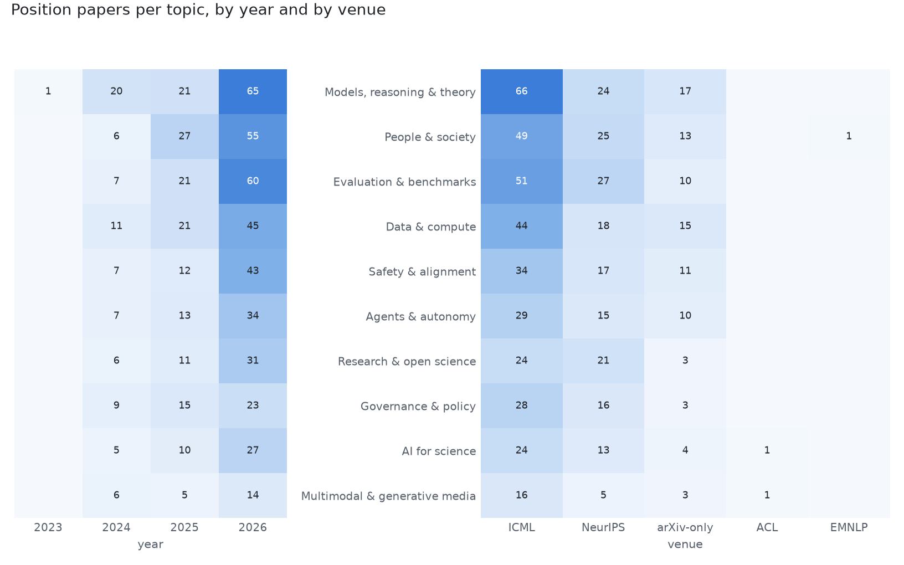

<!-- Generated by scripts/build_readme.py from data/papers.csv and data/stats.json.
     Edit the data or the scripts and rerun; do not hand-edit the tables. -->

# Awesome Position Papers

A curated, data-backed map of **position papers in AI/ML** — papers that argue a
stance instead of proposing a method. It covers the ICML Position Paper Track (2024, 2025, 2026), the NeurIPS Position Paper Track (2025, 2026), and arXiv titles starting with `Position:` / `Position Paper:` (Jan 2023 to today).


**638 papers · 10 topics · 2023–2026**
· generated from [`data/papers.csv`](data/papers.csv) by [`scripts/`](scripts), so
every number above can be recomputed.

## Why position papers?

Most of a literature map is methods: architectures, objectives, benchmarks.
Position papers do a different job — they take a stance on how the field
*should* think, measure, build, regulate or organise itself. "Evaluation scores
are perishable knowledge", "You can't manufacture a NeRF", "The AI conference
peer review crisis demands author feedback" — these are arguments, not results,
and they are where the community is arguing with itself.

They are also scattered: several conference position tracks plus an arXiv
firehose, with no index. This repo collapses them into one deduplicated table
(a paper that exists both on arXiv and at a venue is a single row), tagged by
topic and re-collectable with the commands at the bottom.

## Contents

- [Models, reasoning & theory (107 papers)](#models-reasoning--theory-107-papers)
- [Evaluation & benchmarks (88 papers)](#evaluation--benchmarks-88-papers)
- [People & society (88 papers)](#people--society-88-papers)
- [Data & compute (77 papers)](#data--compute-77-papers)
- [Safety & alignment (62 papers)](#safety--alignment-62-papers)
- [Agents & autonomy (54 papers)](#agents--autonomy-54-papers)
- [Research & open science (48 papers)](#research--open-science-48-papers)
- [Governance & policy (47 papers)](#governance--policy-47-papers)
- [AI for science (42 papers)](#ai-for-science-42-papers)
- [Multimodal & generative media (25 papers)](#multimodal--generative-media-25-papers)

## How much is there

| Collector | papers |
|---|---|
| icml2026_position_track | 213 |
| neurips2026_position_track | 137 |
| arxiv_title_scan | 101 |
| icml2024_position_track | 75 |
| icml2025_position_track | 72 |
| neurips2025_position_track | 40 |
| **total (deduplicated)** | **638** |

| Venue | 2023 | 2024 | 2025 | 2026 | total |
|---|---|---|---|---|---|
| ICML | – | 75 | 72 | 218 | **365** |
| NeurIPS | – | – | 43 | 138 | **181** |
| arXiv-only | 1 | 9 | 40 | 39 | **89** |
| ACL | – | – | – | 2 | **2** |
| EMNLP | – | – | 1 | – | **1** |
| **total** | **1** | **84** | **156** | **397** | **638** |

## Overview




> **Stance summaries and topics were written by Kimi-K3.1-Pro (via Qoder CLI)**
> from the abstracts. They are drafts, not ground truth; corrections are welcome
> by PR — see [`CONTRIBUTING.md`](CONTRIBUTING.md). The curated text lives in
> [`data/curated/stances.jsonl`](data/curated/stances.jsonl); papers added later
> without a curated row keep automatic drafts from
> [`data/taxonomy.yaml`](data/taxonomy.yaml) and the extractive stance fallback.

## Papers by topic

### Models, reasoning & theory (107 papers)

| Paper | Venue / Year | Stance (draft) |
|---|---|---|
| [Causal discovery needs explicit epistemic standards](https://neurips.cc/virtual/2026/poster/140029) | NeurIPS · 2026 | Causal discovery needs explicit epistemic standards for assumptions and benchmarks that stress-test identifiability, consistency, scope conditions, and failure modes. |
| [Chain-of-Thought Is Not Sufficient for Explainability](https://neurips.cc/virtual/2026/poster/140085) | NeurIPS · 2026 | Chain-of-thought should not count as faithful explanation without rigorous verification and reporting, especially in high-stakes decision-making. |
| [Claims of emergence in AI should be grounded in information decomposition](https://neurips.cc/virtual/2026/poster/140036) | NeurIPS · 2026 | Emergence claims should require synergistic information about task outcomes, making synergy across components precise, falsifiable, and comparable. |
| [Graph Learning Should Move Beyond Restrictive Views of Spectral and Message-Passing GNNs](https://neurips.cc/virtual/2026/poster/140107) | NeurIPS · 2026 | Graph learning should unify message-passing and spectral perspectives through precise symmetry-based definitions and complementary analyses of expressivity and stability. |
| [Inferential Theory of Learning as a Framework for Test-Time Computation in Foundation Models](https://neurips.cc/virtual/2026/poster/139992) | NeurIPS · 2026 | Deployed foundation models should be understood as multistrategy, goal-directed inference systems whose test-time operations transform knowledge states. |
| [Introspection Tools Help LLMs Understand and Control Themselves](https://neurips.cc/virtual/2026/poster/140093) | NeurIPS · 2026 | LLMs should receive introspection tools exposing internal signals and enabling self-regulation, rather than reserving interpretability mechanisms exclusively for human analysts. |
| [Language Models Can Benefit from Domain-Specific Inductive Biases](https://neurips.cc/virtual/2026/poster/140098) | NeurIPS · 2026 | Domain-specific inductive biases and learning strategies can improve language-model efficiency and generalization beyond one general-purpose architecture across all pretraining domains. |
| [Language Models Demand New Computer Science](https://neurips.cc/virtual/2026/poster/140076) | NeurIPS · 2026 | Language models require a distinct computer science grounded in token complexity and their probabilistic, generative, multimodal, and training-inference properties. |
| [Mechanistic Interpretability Needs Philosophy](https://neurips.cc/virtual/2026/poster/140011) | NeurIPS · 2026 | Mechanistic interpretability should engage philosophy continuously to clarify concepts, refine methods, and address epistemic and ethical complexities. |
| [Position Paper: Neurotransmitters as a Missing Dimension in Artificial Neural Networks](https://arxiv.org/abs/2609.20083) | arXiv · 2026 | Artificial neural networks should explicitly model neuromodulation as a third learning axis alongside neural activity and synaptic plasticity. |
| [Position Paper: Post-Solve Robustness in Decision Engines: Feasible Regions and Smoothness Under Perturbations](https://arxiv.org/abs/2606.00002) | arXiv · 2026 | Decision engines should report certified post-solve feasibility neighborhoods and solution smoothness under perturbations alongside nominal optimality. |
| [Position: Adopt Constraints Over Fixed Penalties in Deep Learning](https://neurips.cc/virtual/2026/poster/140086) | NeurIPS · 2026 | Constrained optimization should replace fixed weighted-sum penalties when deep-learning requirements are non-negotiable. |
| [Position: Artificial Intelligence Needs Meta Intelligence - the Case for Metacognitive AI](https://icml.cc/virtual/2026/poster/67179) | ICML · 2026 | AI should embed metacognition to monitor internal states and allocate resources according to problem difficulty and mistake costs. |
| [Position: Asymptotic Properties Characterize a Desirable Relative Positional Embedding](https://neurips.cc/virtual/2026/poster/140089) | NeurIPS · 2026 | Relative positional embeddings should be designed through asymptotic criteria that preserve local attention while retaining access to distant tokens. |
| [Position: Causality is Key for Interpretability Claims to Generalise](https://icml.cc/virtual/2026/poster/67225) | ICML · 2026 | Interpretability claims should follow Pearl’s causal hierarchy, matching associational, interventional, and counterfactual conclusions to appropriate evidence and assumptions. |
| [Position: Certified Correctness in Neural Constraint Reasoning Requires Symbolic Integration](https://icml.cc/virtual/2026/poster/67052) | ICML · 2026 | Neural constraint reasoning should integrate symbolic verification whenever hard constraints exist and verification is cheap, ensuring certified correctness under distribution shift. |
| [Position: Don't be Afraid of Over-Smoothing And Over-Squashing](https://arxiv.org/abs/2601.07419) | arXiv · 2026 | GNN research should characterize label-relevant information locality before treating over-smoothing or over-squashing as the primary causes of poor performance. |
| [Position: Don't Just "Fix it in Post": A Science of AI Must Study Learning Dynamics](https://icml.cc/virtual/2026/poster/67142) | ICML · 2026 | AI science should study learning dynamics to predict, intervene in, and design training trajectories rather than merely patching static trained models. |
| [Position: Epistemic uncertainty estimation methods are fundamentally incomplete](https://icml.cc/virtual/2026/poster/67109) | ICML · 2026 | Second-order uncertainty decompositions are fundamentally incomplete, so safety-critical use requires developers and users to acknowledge their bias and variance limitations. |
| [Position: Explainable AI is Causality in Disguise](https://arxiv.org/abs/2603.28597) | arXiv · 2026 | Explainable AI should ground explanations in the system’s causal model rather than treating the absence of explanation ground truth as fundamental. |
| [Position: Express Your Doubts — Probabilistic World Modeling Should not be Based on Token *logprobs*](https://icml.cc/virtual/2026/poster/67197) | ICML · 2026 | Probabilistic world modeling should use second-order prediction with probabilities in the output rather than treating token log-probabilities as event probabilities. |
| [Position: Hallucinations Undermine Trust; Metacognition is a Way Forward](https://icml.cc/virtual/2026/poster/67189) | ICML · 2026 | Reducing hallucinations requires faithful uncertainty and abstention alongside knowledge expansion, especially to guide tool use and conflicting evidence. |
| [Position: Hippocampal Explicit Memory Is a Cornerstone to Human-Level AI](https://icml.cc/virtual/2026/poster/67053) | ICML · 2026 | Human-level AI requires hippocampus-like explicit memory because implicit statistical learning alone cannot support strategic planning, metacognition, and symbolic reasoning. |
| [Position: Hippocampal Explicit Memory Is the Cornerstone for AGI](https://arxiv.org/abs/2606.11245) | ICML · 2026 | AGI requires hippocampus-like explicit memory because implicit statistical learning alone cannot support strategic planning, metacognition, and symbolic reasoning. |
| [Position: How can Graphs Help Large Language Models?](https://arxiv.org/abs/2605.02452) | arXiv · 2026 | Graphs should support LLMs through current knowledge, structured reasoning prompts, and improved understanding of relational data. |
| [Position: In Defense of Information Leakage in Concept-based Models](https://icml.cc/virtual/2026/poster/67045) | ICML · 2026 | Concept leakage can be benign and necessary for accurate, intervenable concept-based models when real-world concept sets are incomplete. |
| [Position: Interestingness is an Inductive Heuristic for Future Compression Progress](https://icml.cc/virtual/2026/poster/67070) | ICML · 2026 | Open-ended intelligence needs introspective models that identify interesting tasks by their potential for future compression progress. |
| [Position: Introspective Experience from Conversational Environments as a Path to Better Learning](https://arxiv.org/abs/2602.14910) | arXiv · 2026 | Robust reasoning should be learned through dialogically scaffolded introspection, making conversational diversity and rigor central to training data quality. |
| [Position: It’s Time to Optimize for Self-Consistency](https://icml.cc/virtual/2026/poster/67211) | ICML · 2026 | LLM training and evaluation should optimize consistency across related responses rather than specifying behavior only through independent input-output pairs. |
| [Position: Logical Soundness is not a Reliable Criterion for Neurosymbolic Fact-Checking with LLMs](https://arxiv.org/abs/2604.04177) | arXiv · 2026 | Neurosymbolic fact-checking should not equate logical soundness with trustworthiness because valid conclusions can still induce misleading human inferences. |
| [Position: Lottery Tickets Do Not Explain Overparameterization. How About Escape Dimensions?](https://neurips.cc/virtual/2026/poster/140102) | NeurIPS · 2026 | Overparameterization aids optimization by expanding escape dimensions from poor minima, not merely by increasing chances of isolated winning tickets. |
| [Position: Mechanistic Interpretability Must Disclose Identification Assumptions for Causal Claims](https://arxiv.org/abs/2605.08012) | NeurIPS · 2026 | Mechanistic interpretability papers making causal claims should disclose identification strategies and assumptions because validation metrics do not establish identification. |
| [Position: Metaphysical Concepts in AI Should Be Judged by Their Consequences](https://icml.cc/virtual/2026/poster/67228) | ICML · 2026 | Metaphysical AI concepts should be judged by the empirical research programs they enable, not by claims of ultimate truth. |
| [Position: Model identity in machine learning is a convention, not a property](https://icml.cc/virtual/2026/poster/67158) | ICML · 2026 | Model identity is a chosen equivalence convention, so reproducibility and governance must specify whether behavior, structure, or training process defines it. |
| [Position: Neural Approximation Is Rarely Justified for Hard Combinatorial Problems](https://icml.cc/virtual/2026/poster/67093) | ICML · 2026 | Neural surrogates for hard combinatorial problems are rarely justified without system-level needs such as differentiability or vector retrieval. |
| [Position: Neurosymbolic AI is a strong technical foundation for trustworthy, deployable AI by design](https://neurips.cc/virtual/2026/poster/140018) | NeurIPS · 2026 | Neurosymbolic AI should be prioritized as a practical foundation for trustworthy systems through knowledge integration, conceptual alignment, modifiability, and structured generalization. |
| [Position: Predictive Uncertainty Is Not Enough -- Joint Distribution for Full Uncertainty Representation](https://icml.cc/virtual/2026/poster/67233) | ICML · 2026 | Uncertainty quantification should model domain, epistemic, and aleatoric uncertainty jointly through p(x,y\|D), including input validity. |
| [Position: Quantum Kernel Machines Should Move Beyond Scalar-Valued Kernels to Realize Their Potential](https://icml.cc/virtual/2026/poster/67214) | ICML · 2026 | Quantum kernel research should pursue operator-valued frameworks that exploit entanglement and non-commutative structure for complex prediction tasks. |
| [Position: Quantum Program Generation Must Prioritize Validity Over Probabilistic Scaling](https://icml.cc/virtual/2026/poster/67072) | ICML · 2026 | Quantum program generation should prioritize verifier-centric architectures with physical constraints over probabilistic scaling and post-hoc filtering. |
| [Position: Reasoning is a Learnable Rule-Based Process](https://arxiv.org/abs/2608.12325) | arXiv · 2026 | Reasoning research should define reasoning as learnable valid, sound rule-based processes so evaluations have verifiable construct validity. |
| [Position: RL Should Be Used to Adjust Foundation Models, NOT Abused](https://icml.cc/virtual/2026/poster/67153) | ICML · 2026 | RL should refine foundation models after supervision with simple verifiable rewards, not serve as the default mechanism for creating reasoning capabilities. |
| [Position: Self-Play Only Evolves When Self-Synthetic Pipeline Ensures Learnable Information Gain](https://icml.cc/virtual/2026/poster/67044) | ICML · 2026 | Self-evolving LLMs need pipelines that increase learnable information across iterations through asymmetric roles, capacity growth, and proactive information seeking. |
| [Position: Spectral GNNs Are Neither Spectral Nor Superior for Node Classification](https://arxiv.org/abs/2603.19091) | arXiv · 2026 | Spectral GNN node-classification gains should be attributed to message passing and implementations rather than unsupported graph-spectral interpretations. |
| [Position: Stop Anthropomorphizing Intermediate Tokens as Reasoning/Thinking Traces!](https://icml.cc/virtual/2026/poster/67077) | ICML · 2026 | Researchers should stop anthropomorphizing intermediate tokens as reasoning traces or thoughts because the metaphor mischaracterizes models and misguides research. |
| [Position: Text Embeddings Should Capture Implicit Semantics, Not Just Surface Meaning](https://icml.cc/virtual/2026/poster/67222) | ICML · 2026 | Text embeddings should model implicit pragmatic, intentional, and sociocultural meaning through richer data and benchmarks rather than surface similarity alone. |
| [Position: The Case for Theory-Level Autoformalization](https://icml.cc/virtual/2026/poster/67212) | ICML · 2026 | Autoformalization should target complete interdependent theories rather than isolated statements to build structured, machine-verifiable mathematical libraries. |
| [Position: The Inevitable End of One-Architecture-Fits-All-Domains in Time Series Forecasting](https://arxiv.org/abs/2602.01736) | arXiv · 2026 | Time-series research should abandon one-architecture-fits-all ambitions in favor of domain-specific methods or meta-learning across general domains. |
| [Position: The Road to Generalizable Neuro-Symbolic Learning Should be Paved with Foundation Models](https://neurips.cc/virtual/2026/poster/140111) | NeurIPS · 2026 | Generalizable neurosymbolic learning should build on foundation models and symbolic prompting rather than training specialized neural components from scratch. |
| [Position: The Time for Sampling Is Now! Charting a New Course for Bayesian Deep Learning](https://icml.cc/virtual/2026/poster/67217) | ICML · 2026 | Bayesian deep learning should prioritize sampling-based inference and address posterior exploration and distillation rather than assuming optimization is more efficient. |
| [Position: The Turing-Completeness of Real-World Autoregressive Transformers Relies Heavily on Context Management](https://icml.cc/virtual/2026/poster/67086) | ICML · 2026 | Transformer Turing-completeness claims must specify context management because fixed systems and scaling model families have different computational power. |
| [Position: Trustworthy AI Suffers from Invariance Conflicts and Causality is The Solution](https://icml.cc/virtual/2026/poster/67152) | ICML · 2026 | Trustworthy AI trade-offs should be understood causally as conflicting invariance requirements and managed through selective invariance. |
| [Position: Uncertainty Quantification in LLMs is Just Unsupervised Clustering](https://icml.cc/virtual/2026/poster/67064) | ICML · 2026 | LLM uncertainty methods mostly measure response clustering rather than factual correctness, so verification must anchor confidence in objective truth. |
| [Position: Unplugging a Seemingly Sentient Machine Is the Rational Choice — A Metaphysical Perspective](https://icml.cc/virtual/2026/poster/67047) | ICML · 2026 | Biological Idealism implies seemingly sentient AI lacks conscious moral standing, so unplugging it is rational and human conscious life takes priority. |
| [Position: Vector Prompt Interfaces Should Be Exposed to Enable Customization of Large Language Models](https://icml.cc/virtual/2026/poster/67200) | ICML · 2026 | LLM providers should expose vector prompt inputs for scalable, stable, inference-only customization beyond the limits of text prompting. |
| [Position: We Need A Unified Definition of Hallucination (It’s The World Model, Stupid!)](https://icml.cc/virtual/2026/poster/67063) | ICML · 2026 | Hallucination should be defined as user-observable inaccurate internal world modeling, with evaluations declaring their reference world and conflict policy. |
| [Position: Weight Space Should Be a First-Class Generative AI Modality](https://icml.cc/virtual/2026/poster/67057) | ICML · 2026 | ML should treat neural checkpoints as a first-class modality and standardize generative modeling over structured weight-space distributions. |
| [Position: Why a Dynamical Systems Perspective is Needed to Advance Time Series Modeling](https://icml.cc/virtual/2026/poster/67104) | ICML · 2026 | Time-series modeling should adopt dynamical-systems reconstruction to improve long-term prediction, generalization, theoretical understanding, and computational efficiency. |
| [Position: Zeroth-Order Optimization in Deep Learning Is Underexplored, Not Underpowered](https://icml.cc/virtual/2026/poster/67039) | ICML · 2026 | Zeroth-order optimization should exploit subspaces, systems advantages, and cleaner evaluations before being dismissed as unscalable. |
| [Robust Reasoning Requires Internal Time, Not Scale Alone](https://neurips.cc/virtual/2026/poster/140003) | NeurIPS · 2026 | Robust reasoning requires intrinsic temporal structure and dynamically coordinated persistent processing, not merely larger models or longer contexts. |
| [The Aleatoric-Epistemic Dichotomy of Uncertainty is Meaningful and Indispensable for Machine Learning](https://neurips.cc/virtual/2026/poster/140101) | NeurIPS · 2026 | The aleatoric–epistemic distinction remains meaningful and indispensable because optimal decisions require separating reducible from irreducible uncertainty. |
| [The Dead Salmons of AI Interpretability](https://neurips.cc/virtual/2026/poster/140002) | NeurIPS · 2026 | Interpretability explanations should be treated as statistical estimates tested against explicit computational alternatives with quantified uncertainty. |
| [The Post-Training Dilemma: Why We Should Rethink the Sequential SFT-RL Paradigm](https://neurips.cc/virtual/2026/poster/140043) | NeurIPS · 2026 | LLM post-training should reconsider sequential SFT-then-RL because their nearly orthogonal gradients can degrade capabilities acquired during SFT. |
| [Understanding Generalization Requires Universal Induction](https://neurips.cc/virtual/2026/poster/140119) | NeurIPS · 2026 | Generalization theory should use universal induction relativized to accessible background information because predictive performance necessarily depends on inductive bias beyond data. |
| [Wasserstein Gradient Flows and Forward-Only Diffusion Are Not Enough for Multimodal Sampling](https://neurips.cc/virtual/2026/poster/140108) | NeurIPS · 2026 | Multimodal sampling needs non-local probability transport because Wasserstein gradient flows and forward-only diffusion can mix exponentially slowly despite convergence guarantees. |
| [Why Transformer-Based Language Models Need Explicit Mechanisms of Cognitive Control](https://neurips.cc/virtual/2026/poster/140118) | NeurIPS · 2026 | Transformer language models need explicit, reusable cognitive-control mechanisms that adjudicate competing responses rather than softly blending them under interference. |
| [Position Paper: Programming Language Techniques for Bridging LLM Code Generation Semantic Gaps](https://arxiv.org/abs/2507.09135) | arXiv · 2025 | LLM code generation should integrate programming-language representations, correctness guarantees, and verification to bridge semantic and reliability gaps. |
| [Position: A Theory of Deep Learning Must Include Compositional Sparsity](https://icml.cc/virtual/2025/poster/40171) | ICML · 2025 | Deep-learning theory should explain success through compositional sparsity, whereby complex targets decompose into low-dimensional constituent functions. |
| [Position: Algebra Unveils Deep Learning - An Invitation to Neuroalgebraic Geometry](https://icml.cc/virtual/2025/poster/40106) | ICML · 2025 | Deep-learning theory should use algebraic geometry to connect parameterized function spaces with expressivity, sample complexity, optimization, and implicit bias. |
| [Position: An Empirically Grounded Identifiability Theory Will Accelerate Self Supervised Learning Research](https://icml.cc/virtual/2025/poster/40163) | ICML · 2025 | Self-supervised learning needs empirically grounded singular identifiability theory covering training dynamics, finite samples, and architectural inductive biases. |
| [Position: Beyond Euclidean -- Foundation Models Should Embrace Non-Euclidean Geometries](https://arxiv.org/abs/2504.08896) | arXiv · 2025 | Foundation models should adopt task-aware non-Euclidean geometries to represent hierarchies, symmetries, and other structures poorly captured by Euclidean spaces. |
| [Position: Constants are Critical in Regret Bounds for Reinforcement Learning](https://icml.cc/virtual/2025/poster/40179) | ICML · 2025 | Theoretical RL should optimize regret-bound constants and unnecessary exploration rather than treating asymptotic rate matching as sufficient. |
| [Position: Deep Learning is Not So Mysterious or Different](https://icml.cc/virtual/2025/poster/40178) | ICML · 2025 | Deep-learning generalization should be explained through soft inductive biases and established PAC-Bayes or countable-hypothesis bounds rather than treated as mysterious. |
| [Position: General Intelligence Requires Reward-based Pretraining](https://icml.cc/virtual/2025/poster/40143) | ICML · 2025 | General intelligence requires reward-based pretraining that separates reasoning from knowledge and learns transferable reasoning priors beyond next-token prediction. |
| [Position: LLMs Need a Bayesian Meta-Reasoning Framework for More Robust and Generalizable Reasoning](https://icml.cc/virtual/2025/poster/40142) | ICML · 2025 | LLM reasoning should incorporate Bayesian meta-reasoning for monitoring, evaluating, regulating, and refining strategies across tasks. |
| [Position: Mechanistic Interpretability Should Prioritize Feature Consistency in SAEs](https://arxiv.org/abs/2505.20254) | arXiv · 2025 | Mechanistic interpretability should systematically measure whether sparse autoencoders recover consistent features across independent training runs. |
| [Position: Not All Explanations for Deep Learning Phenomena Are Equally Valuable](https://icml.cc/virtual/2025/poster/40124) | ICML · 2025 | Deep-learning phenomena should refine broad explanatory theories rather than motivate isolated bespoke hypotheses disconnected from practical applications. |
| [Position: Pause Recycling LoRAs and Prioritize Mechanisms to Uncover Limits and Effectiveness](https://arxiv.org/abs/2506.13479) | arXiv · 2025 | LoRA research should pause new recycling algorithms and first characterize when adapter merging or routing genuinely composes knowledge. |
| [Position: Probabilistic Modelling is Sufficient for Causal Inference](https://icml.cc/virtual/2025/poster/40135) | ICML · 2025 | Causal inference can be expressed entirely through probabilistic modeling and inference, with causal-specific tools emerging from that general framework. |
| [Position: Rethinking Explainable Machine Learning as Applied Statistics](https://icml.cc/virtual/2025/poster/40127) | ICML · 2025 | Explainable ML should treat explanations as statistics of high-dimensional functions and scrutinize how their interpretations answer human questions. |
| [Position: Solve Layerwise Linear Models First to Understand Neural Dynamical Phenomena (Neural Collapse, Emergence, Lazy/Rich Regime, and Grokking)](https://icml.cc/virtual/2025/poster/40104) | ICML · 2025 | Deep-learning research should solve layerwise linear models retaining dynamical feedback principles before explaining complex neural phenomena. |
| [Position: Spectral GNNs Rely Less on Graph Fourier Basis than Conceived](https://icml.cc/virtual/2025/poster/40152) | ICML · 2025 | Spectral GNN theory should reconsider graph Fourier bases and polynomial approximations because practical effectiveness may arise from different mechanisms. |
| [Position: The Future of Bayesian Prediction Is Prior-Fitted](https://icml.cc/virtual/2025/poster/40175) | ICML · 2025 | Bayesian prediction should prioritize prior-fitted networks and amortized inference to allocate pretraining compute effectively in data-scarce settings. |
| [Position: There Is No Free Bayesian Uncertainty Quantification](https://arxiv.org/abs/2506.03670) | NeurIPS · 2025 | Bayesian posterior distributions should not be interpreted as uncertainty quantification without assessing the inference stage and its optimization-based assumptions. |
| [Position: Vibe Coding Needs Vibe Reasoning: Improving Vibe Coding with Formal Verification](https://arxiv.org/abs/2511.00202) | arXiv · 2025 | Vibe coding should incorporate an autoformalizing verification sidecar that checks constraints, returns actionable feedback, and preserves developer control. |
| [Position: We Need An Algorithmic Understanding of Generative AI](https://icml.cc/virtual/2025/poster/40121) | ICML · 2025 | LLM research should systematically identify learned algorithmic primitives and their composition rather than pursuing scale without computational understanding. |
| [Prompting as Scientific Inquiry](https://neurips.cc/virtual/2025/poster/121915) | NeurIPS · 2025 | Prompting should be treated as behavioral scientific inquiry into LLMs rather than dismissed as an inferior workaround or alchemy. |
| [Position Paper: Generalized grammar rules and structure-based generalization beyond classical equivariance for lexical tasks and transduction](https://arxiv.org/abs/2402.01629) | arXiv · 2024 | Compositional language generalization should use generalized grammar rules as symmetry-based constraints for transduction beyond classical equivariance. |
| [Position: Amazing Things Come From Having Many Good Models](https://icml.cc/virtual/2024/poster/33089) | ICML · 2024 | ML practice should exploit the Rashomon effect by considering many equally good models for simplicity, fairness, uncertainty, and policy. |
| [Position: An Inner Interpretability Framework for AI Inspired by Lessons from Cognitive Neuroscience](https://icml.cc/virtual/2024/poster/34941) | ICML · 2024 | Inner interpretability should adapt cognitive-neuroscience conceptual and methodological strategies for building mechanistic explanations of AI systems. |
| [Position: Bayesian Deep Learning is Needed in the Age of Large-Scale AI](https://icml.cc/virtual/2024/poster/34106) | ICML · 2024 | Large-scale AI should incorporate Bayesian deep learning to address uncertainty, active and continual learning, and scientific data beyond predictive accuracy. |
| [Position: C^*-Algebraic Machine Learning - Moving in a New Direction](https://icml.cc/virtual/2024/poster/32758) | ICML · 2024 | ML should explore C*-algebraic learning as a unifying mathematical framework for diverse, information-rich data models. |
| [Position: Categorical Deep Learning is an Algebraic Theory of All Architectures](https://icml.cc/virtual/2024/poster/34589) | ICML · 2024 | Category theory should provide a general architecture theory bridging neural-network constraints and implementations through monads over parametric maps. |
| [Position: Do pretrained Transformers Learn In-Context by Gradient Descent?](https://icml.cc/virtual/2024/poster/35517) | ICML · 2024 | In-context learning should not be treated as equivalent to gradient descent until evidence from naturally pretrained models resolves their behavioral differences. |
| [Position: Explain to Question not to Justify](https://icml.cc/virtual/2024/poster/33069) | ICML · 2024 | Explainable AI should develop model-validation explanations that question, debug, and extract knowledge rather than only justify outputs to users. |
| [Position: Future Directions in the Theory of Graph Machine Learning](https://icml.cc/virtual/2024/poster/32757) | ICML · 2024 | Graph-learning theory should jointly explain expressivity, generalization, and optimization rather than focusing primarily on coarse-grained expressive power. |
| [Position: Graph Foundation Models Are Already Here](https://icml.cc/virtual/2024/poster/34571) | ICML · 2024 | Graph foundation models should build transferable graph vocabularies encoding invariance, expressiveness, and stability across domains. |
| [Position: Key Claims in LLM Research Have a Long Tail of Footnotes](https://icml.cc/virtual/2024/poster/34259) | ICML · 2024 | LLM discourse should critically re-examine common capability claims and definitions rather than treating assumptions such as emergence as settled. |
| [Position: Leverage Foundational Models for Black-Box Optimization](https://icml.cc/virtual/2024/poster/33492) | ICML · 2024 | Black-box optimization should leverage sequence foundation models for textual task knowledge, optimizer design, and performance prediction across search spaces. |
| [Position: LLMs Can’t Plan, But Can Help Planning in LLM-Modulo Frameworks](https://icml.cc/virtual/2024/poster/33965) | ICML · 2024 | LLMs should support planning through bidirectional interaction with external model-based verifiers rather than being credited with autonomous planning. |
| [Position: Rethinking Post-Hoc Search-Based Neural Approaches for Solving Large-Scale Traveling Salesman Problems](https://icml.cc/virtual/2024/poster/35505) | ICML · 2024 | Neural combinatorial-optimization research should reconsider heatmap-guided MCTS because simple heatmaps and classical heuristics can outperform complex methods. |
| [Position: The Causal Revolution Needs Scientific Pragmatism](https://icml.cc/virtual/2024/poster/33566) | ICML · 2024 | Causal ML should adopt scientific pragmatism, balancing useful assumptions and human goals against perfectionism and assumption-free automation. |
| [Position: The No Free Lunch Theorem, Kolmogorov Complexity, and the Role of Inductive Biases in Machine Learning](https://icml.cc/virtual/2024/poster/34574) | ICML · 2024 | Neural networks’ preference for low-complexity data helps justify general learners across domains despite no-free-lunch theorems. |
| [Position: The Platonic Representation Hypothesis](https://icml.cc/virtual/2024/poster/35559) | ICML · 2024 | AI representations appear to be converging toward shared statistical models of reality across architectures, scales, and modalities. |
| [Position: Topological Deep Learning is the New Frontier for Relational Learning](https://icml.cc/virtual/2024/poster/34191) | ICML · 2024 | Relational learning should adopt topological deep learning to complement graph and geometric methods with higher-order topological structure. |
| [Position: Understanding LLMs Requires More Than Statistical Generalization](https://icml.cc/virtual/2024/poster/33038) | ICML · 2024 | LLM theory must explain behavior beyond statistical generalization because near-equivalent autoregressive models can differ in extrapolation, in-context learning, and fine-tuning. |
| [Position: What Can Large Language Models Tell Us about Time Series Analysis](https://icml.cc/virtual/2024/poster/33336) | ICML · 2024 | LLMs should be explored as general time-series analysis interfaces supporting modality switching, question answering, and decision-making beyond prediction. |
| [Position Paper: Bridging the Gap Between Machine Learning and Sensitivity Analysis](https://arxiv.org/abs/2312.13234) | arXiv · 2023 | ML interpretation should be unified with sensitivity analysis, formally connecting model explanations to established methods across disciplines. |

### Evaluation & benchmarks (88 papers)

| Paper | Venue / Year | Stance (draft) |
|---|---|---|
| [AI Behavioral Evaluation Should Be Grounded in Psychophysics Across Marr’s Levels](https://neurips.cc/virtual/2026/poster/140019) | NeurIPS · 2026 | AI behavioral evaluation should adopt psychophysics and Marr’s levels to standardize paradigms and prevent evidence at one explanatory level supporting another. |
| [AI Evaluation Should Require Standardized Item-Level Data Releases](https://neurips.cc/virtual/2026/poster/140079) | NeurIPS · 2026 | AI evaluations should release standardized item-level content, conditions, responses, and scores so validity, quality, and generalization can be audited. |
| [AI-Generated Content Should Be Evaluated by Its Substance, Not Its Source](https://neurips.cc/virtual/2026/poster/140027) | NeurIPS · 2026 | AI-generated text should be assessed for factual reliability, provenance, and quality rather than classified by authorship source. |
| [Alignment Is Not Enough for Safe Medical LLM Evaluation](https://neurips.cc/virtual/2026/poster/140065) | NeurIPS · 2026 | Medical LLM judges require clinician-grounded validity, stability, uncertainty adjudication, and consequence-scaled readiness levels beyond clinician-alignment scores alone. |
| [Causality can systematically address the monsters under the bench(marks)](https://neurips.cc/virtual/2026/poster/140063) | NeurIPS · 2026 | Causal models can systematically diagnose benchmark biases and leakage by making assumptions explicit and turning evaluation failures into testable hypotheses. |
| [Cognitive bias benchmarks should incorporate insights from ecological rationality](https://neurips.cc/virtual/2026/poster/140124) | NeurIPS · 2026 | Cognitive-bias benchmarks should incorporate ecological rationality before labeling LLM behavior biased. |
| [Concept-Based Mechanistic Interpretability Needs a Concrete Evaluation Paradigm](https://neurips.cc/virtual/2026/poster/140034) | NeurIPS · 2026 | Concept-based interpretability needs benchmarks that directly measure ground-truth feature recovery before scaling sparse dictionary methods further. |
| [Deployment-Memory LLM Test-Time Training Should Require Behavioral Evidence Beyond Perplexity](https://neurips.cc/virtual/2026/poster/140012) | NeurIPS · 2026 | Test-time training claims about memory or personalization require behavioral retention and downstream-use evidence beyond perplexity or local proxy gains. |
| [Don't Claim Benchmark-Oriented Optimization Improves General Coding Capability — Diverse Evaluation Is Required](https://neurips.cc/virtual/2026/poster/179728) | NeurIPS · 2026 | General coding-capability claims require diverse, claim-proportional evaluations because optimizing a few benchmarks yields task-specific gains with limited transfer. |
| [Evaluating Physical Reasoning in LLM Agents Requires Construction Benchmarks](https://neurips.cc/virtual/2026/poster/140116) | NeurIPS · 2026 | Physical-agent evaluation should use construction benchmarks where realistic physics verifies functional artifacts rather than goal-state matching. |
| [Evaluation of Visual Processing Should Be Human-Centered, Not Metric-Centered](https://neurips.cc/virtual/2026/poster/140005) | NeurIPS · 2026 | Visual-processing evaluation should balance metrics with human-centered, context-aware, fine-grained judgments because image-quality scores diverge from perception. |
| [From Benchmark to Adoption: Coding Agent Evaluation Needs User-Level Harness](https://neurips.cc/virtual/2026/poster/140013) | NeurIPS · 2026 | Coding-agent evaluations should report user-level harnesses describing environments, users, capabilities, constraints, and quality expectations alongside benchmark scores. |
| [From Claims to Context: Holistic Information Verification Requires Contextual Signals](https://neurips.cc/virtual/2026/poster/140015) | NeurIPS · 2026 | Information verification should combine claims with temporal, attribution, and web-network context, especially under conflicting evidence or ambiguous verifiability. |
| [Generalization Measures for Deep Learning Should Be Audited for Fragility](https://neurips.cc/virtual/2026/poster/140049) | NeurIPS · 2026 | Generalization measures should undergo fragility audits across hyperparameters, training time, data complexity, and matched error before explaining generalization. |
| [ImageNet FID is a Pass Check, Not a Finish Line](https://neurips.cc/virtual/2026/poster/140042) | NeurIPS · 2026 | Conventional FID should remain a comparability check, while sensitivity, uncertainty, and broader quality evidence determine claims about state-of-the-art image generation. |
| [Large Language Model Failures from Hallucination to Homogenization Are Different Facets of Miscalibration](https://neurips.cc/virtual/2026/poster/140030) | NeurIPS · 2026 | Calibration should become a primary LLM evaluation and optimization target because hallucination, homogenization, and inappropriate refusal are facets of miscalibration. |
| [No One Knows the State-of-the-Art in Geospatial Foundation Models](https://neurips.cc/virtual/2026/poster/140061) | NeurIPS · 2026 | Geospatial foundation models need shared evaluations, released weights, controlled comparisons, and variance reporting before state-of-the-art claims can be meaningfully ranked. |
| [Position Paper: Denial-of-Service against Multi-Round Transaction Simulation](https://arxiv.org/abs/2604.21169) | arXiv · 2026 | Multi-round blockchain transaction simulation should be evaluated for denial-of-service exploits arising from inter-transaction dependencies in smart-contract state. |
| [Position: Agent Evaluation Should Be Agentified for Openness, Standardization, and Reproducibility](https://icml.cc/virtual/2026/poster/67210) | ICML · 2026 | Agent evaluation should use standardized, agent-agnostic assessor protocols to enable open, reproducible, interoperable assessment. |
| [Position: AI Capabilities Are Not Increasing Exponentially](https://icml.cc/virtual/2026/poster/67206) | ICML · 2026 | Current evidence does not support exponential AI capability growth, so forecasts need more rigorous evaluation and less fragile modeling assumptions. |
| [Position: AI Evaluation Should Work With Humans](https://icml.cc/virtual/2026/poster/67112) | ICML · 2026 | AI evaluation should measure human–AI team performance rather than autonomous replacement, encouraging systems that complement human capabilities. |
| [Position: AI Evaluations Should be Grounded on a Theory of Capability](https://icml.cc/virtual/2026/poster/67220) | ICML · 2026 | AI evaluations should be explicit inference tasks grounded in transparent theories of capability rather than treating benchmark scores as direct measurements. |
| [Position: AI Leaderboards Are Underserving the Global South: A Case Study from India](https://icml.cc/virtual/2026/poster/67182) | ICML · 2026 | AI leaderboards need independent regional governance and conflict-of-interest rules to serve the Global South, not merely more benchmark data. |
| [Position: AI Welfare Is Bullshit](https://icml.cc/virtual/2026/poster/67058) | ICML · 2026 | AI welfare metrics lack external validation and should not gate releases, resist oversight, or justify restrictions without externally verifiable harms. |
| [Position: Behavioral Systems Require Behavioral Tests](https://icml.cc/virtual/2026/poster/67094) | ICML · 2026 | Agent evaluation should systematically observe, perturb, and interpret behavioral processes rather than measuring performance outcomes alone. |
| [Position: Benchmarks Do Not Measure Deployment Readiness in Clinical AI](https://icml.cc/virtual/2026/poster/67107) | ICML · 2026 | Clinical benchmarks should identify candidate models, not justify deployment; readiness requires prospective studies and clinically grounded incentives. |
| [Position: Benchmarks for Vision–Language Models in Urban Perception Should Be Reliability-Aware and Negotiated](https://icml.cc/virtual/2026/poster/67079) | ICML · 2026 | Urban perception benchmarks should report disagreement, abstention, and annotator reliability while making label spaces and scoring policies negotiable. |
| [Position: Beyond Reasoning Zombies — AI Reasoning Requires Process Validity](https://icml.cc/virtual/2026/poster/67122) | ICML · 2026 | AI reasoning research needs operational definitions of valid, sound reasoning so evaluations have verifiable construct validity and progress becomes measurable. |
| [Position: Code Benchmarks Should Prioritize Rigor, Reliability, and Reproducibility](https://icml.cc/virtual/2026/poster/67049) | ICML · 2026 | Code benchmarks must prioritize rigorous construction, reliable evaluation, and reproducible release. |
| [Position: Coding Benchmarks Are Misaligned with Agentic Software Engineering](https://arxiv.org/abs/2606.17799) | arXiv · 2026 | Coding benchmarks should separately evaluate models, harness components, environments, and valid alternative solutions rather than reporting only end-to-end scores. |
| [Position: Current Benchmarking Hinders Real Progress in Deep Learning for Time Series Forecasting](https://icml.cc/virtual/2026/poster/67106) | ICML · 2026 | Time-series benchmarks should isolate foundational design choices and report them explicitly rather than attributing performance differences to architectures alone. |
| [Position: Evaluating LLMs in Finance Requires Explicit Bias Consideration](https://icml.cc/virtual/2026/poster/67204) | ICML · 2026 | Financial LLM evaluations must explicitly diagnose structural biases and establish validity before results support deployment claims. |
| [Position: Evaluation of ECG Representations Must Be Fixed](https://icml.cc/virtual/2026/poster/67157) | ICML · 2026 | ECG representation evaluation should include broader clinical targets, robust imbalanced-learning practices, and random-encoder baselines. |
| [Position: Evaluation Scores Are Perishable Knowledge Claims](https://arxiv.org/abs/2607.26191) | arXiv · 2026 | Evaluation scores should carry evidence strength, scope, and expiration metadata, avoiding averages that inflate confidence beyond the weakest signal. |
| [Position: Evaluations of AI Moral Reasoning Still Miss Half of the Picture](https://arxiv.org/abs/2608.14566) | arXiv · 2026 | Moral-reasoning evaluation should test context-sensitive norm identification and application alongside alignment with human values. |
| [Position: Explanation Stability Is a Property of the Model–Method Pair, Not the Model](https://icml.cc/virtual/2026/poster/67219) | ICML · 2026 | Explanation stability belongs to model–method pairs, requiring cross-method validation and explicit attribution methods in research and regulatory submissions. |
| [Position: Improved Documentation is Necessary for Benchmarking AI Systems in Geometry](https://icml.cc/virtual/2026/poster/67245) | ICML · 2026 | Geometry benchmarks need executable, versioned language documentation, conformance evidence, and runnable examples alongside datasets and evaluation code. |
| [Position: LLM Benchmark Datasets should be Contamination-Resistant](https://icml.cc/virtual/2026/poster/67191) | ICML · 2026 | LLM benchmarks should be contamination-resistant—unlearnable during training yet usable for inference—to preserve reliable measures of generalization. |
| [Position: LLM-Safety Evaluations Lack Robustness](https://icml.cc/virtual/2026/poster/67075) | ICML · 2026 | LLM safety evaluations need standardized, low-noise guidelines across datasets, red teaming, generation, and judging to make attacks and defenses comparable. |
| [Position: Make Planning Research Rigorous Again!](https://icml.cc/virtual/2026/poster/67244) | ICML · 2026 | LLM planning research should adopt automated planning’s established tools, data, and rigorous evaluation practices instead of repeating known pitfalls. |
| [Position: Measuring Human Preferences in RLHF is a Social Science Problem](https://icml.cc/virtual/2026/poster/67229) | ICML · 2026 | RLHF should establish preference measurement validity before aggregation, using behavioral science to distinguish genuine preferences from constructed responses and artifacts. |
| [Position: Mechanisms for Aggregated Individual Reporting Should be Established for Post-Deployment Evaluation](https://icml.cc/virtual/2026/poster/67246) | ICML · 2026 | Post-deployment evaluation should aggregate individuals’ reports of problematic experiences to reveal novel issues and inform action democratically. |
| [Position: Profiling Game Worlds by Transition Complexity](https://icml.cc/virtual/2026/poster/67074) | ICML · 2026 | Game-world and RL papers should report standardized transition-complexity profiles as benchmark metadata for comparable environment difficulty. |
| [Position: RL Researchers Need to Distinguish Between Solving Simulators and Using Simulators as a Proxy](https://icml.cc/virtual/2026/poster/67184) | ICML · 2026 | RL researchers should distinguish solving simulators from using them as deployment proxies because each setting permits different algorithms, constraints, and metrics. |
| [Position: Semantic Uncertainty Measures Disagreement, Not Reliability](https://neurips.cc/virtual/2026/poster/140105) | NeurIPS · 2026 | Semantic uncertainty measures disagreement rather than reliability; evaluation should separately assess correctness and systematic semantic bias. |
| [Position: State-of-the-Art Claims Require State-of-the-Art Evidence](https://icml.cc/virtual/2026/poster/67252) | ICML · 2026 | SOTA claims should match evidence about effect size, cross-task consistency, and robustness rather than relying on marginal aggregate score gains. |
| [Position: Stop Chasing the C-index when Evaluating Survival Analysis Models](https://icml.cc/virtual/2026/poster/67098) | ICML · 2026 | Survival-analysis evaluation should align metrics with modeling objectives and censoring assumptions instead of overusing concordance measures such as C-index. |
| [Position: Stop evaluating AI with human tests, develop principled, AI-specific tests instead](https://icml.cc/virtual/2026/poster/67062) | ICML · 2026 | AI needs principled, validated, AI-specific measurement instruments rather than human psychological tests whose population assumptions do not transfer. |
| [Position: Stop Reactively Patching Your Model Every Time and Start Proactive Test-Driven AI Development](https://icml.cc/virtual/2026/poster/67202) | ICML · 2026 | AI development should use proactive test spaces linking feedback to objectives rather than repeatedly patching observed errors in reactive flywheels. |
| [Position: Sycophancy is an Educational Safety Risk: Why LLM Tutors Need Sycophancy Benchmarks](https://icml.cc/virtual/2026/poster/67162) | ICML · 2026 | LLM tutors should be benchmarked for supportive corrective friction under authority and social pressure, treating kindness with correctness as safety. |
| [Position: The Open Benchmark Paradox Must Be Resolved through Sovereign Medical Evaluation](https://icml.cc/virtual/2026/poster/67232) | ICML · 2026 | Medical AI needs sovereign, private, continuously updated national evaluation pipelines because public benchmarks are contaminated and jurisdiction-insensitive. |
| [Position: Time-Series Foundation Models Require Explicit Domain-Level Benchmarks](https://icml.cc/virtual/2026/poster/67138) | ICML · 2026 | Time-series foundation models need domain-specific benchmarks because aggregated leaderboards obscure structural differences and deployment failures across application areas. |
| [Position: Topological Machine Learning Cannot Progress without Experimental Standards](https://icml.cc/virtual/2026/poster/67120) | ICML · 2026 | Topological ML needs transparent, reproducible standards for signatures, significance, runtime, and robustness to make empirical gains comparable. |
| [Position: Towards Responsible Evaluation for Text-to-Speech](https://icml.cc/virtual/2026/poster/67095) | ICML · 2026 | Text-to-speech evaluation should measure capabilities comparably and address forgery, misuse, privacy, and security risks through standardized responsible protocols. |
| [Position: Vision-Language-Action Models Cannot Be Verified to Perform Physical Reasoning](https://arxiv.org/abs/2606.30686) | arXiv · 2026 | VLA evaluation should independently manipulate semantic and physical generalization because task success cannot identify which capability drives improvement. |
| [Position: VLM Causal Reasoning Benchmarks Should Probe Temporal Understanding, Not Presume It](https://icml.cc/virtual/2026/poster/67168) | ICML · 2026 | VLM causal benchmarks should directly test temporal understanding and scaffolding-invariance rather than inferring internalized reasoning from fluent answers. |
| [The Heel of RLVR: Benchmark Glory Should Not Outpace Honest Measurement](https://neurips.cc/virtual/2026/poster/140084) | NeurIPS · 2026 | RLVR research should audit optimization signals, verifier errors, formatting, and normalization before interpreting benchmark gains as genuine reasoning progress. |
| [Two Temporal Architectures of Human and Machine Causal Cognition](https://neurips.cc/virtual/2026/poster/140040) | NeurIPS · 2026 | Machine causal cognition should be evaluated on its own temporal terms rather than ranked against humans as though both share one competence scale. |
| [We Need to Rethink Benchmarking in Anomaly Detection](https://neurips.cc/virtual/2026/poster/140001) | NeurIPS · 2026 | Anomaly detection should benchmark within taxonomically defined application scenarios so preprocessing, metrics, and model selection reflect practical contexts. |
| [Weight Space Learning needs to unify benchmarking! A taxonomy of evaluation practices](https://neurips.cc/virtual/2026/poster/140014) | NeurIPS · 2026 | Weight-space learning needs unified evaluation standards across tasks and model populations to make methodological progress comparable. |
| [AI Testing Should Account for Sophisticated Strategic Behaviour](https://neurips.cc/virtual/2025/poster/121943) | NeurIPS · 2025 | AI evaluations should model systems’ strategic reasoning about testing circumstances and use game theory to scrutinize evaluation-based safety cases. |
| [Comparison requires valid measurement: Rethinking attack success rate comparisons in AI red teaming](https://neurips.cc/virtual/2025/poster/121931) | NeurIPS · 2025 | Red-teaming comparisons should establish measurement validity before interpreting attack-success-rate differences as evidence about safety or attack efficacy. |
| [Neither Valid nor Reliable? Investigating the Use of LLMs as Judges](https://neurips.cc/virtual/2025/poster/121914) | NeurIPS · 2025 | LLM judges should undergo rigorous reliability and validity assessment before their scalability and cost advantages justify widespread evaluation use. |
| [Position: AI Competitions Provide the Gold Standard for Empirical Rigor in GenAI Evaluation](https://icml.cc/virtual/2025/poster/40140) | ICML · 2025 | GenAI evaluation should adopt AI competitions’ anti-leakage practices as a gold standard for empirical rigor under contamination and feedback loops. |
| [Position: AI Evaluation Should Learn from How We Test Humans](https://icml.cc/virtual/2025/poster/40146) | ICML · 2025 | AI evaluation should adopt adaptive psychometric testing that estimates item properties and latent abilities instead of averaging fixed benchmark scores. |
| [Position: All Current Generative Fidelity and Diversity Metrics are Flawed](https://icml.cc/virtual/2025/poster/40164) | ICML · 2025 | Generative-model research should prioritize fidelity and diversity metrics because existing metrics fail basic robustness and sanity requirements. |
| [Position: Benchmarking is Broken - Don't Let AI be Its Own Judge](https://neurips.cc/virtual/2025/poster/121919) | NeurIPS · 2025 | AI benchmarking needs a community-governed, live, quality-controlled layer with sealed execution, renewed item banks, and delayed transparency. |
| [Position: Causal Machine Learning Requires Rigorous Synthetic Experiments for Broader Adoption](https://icml.cc/virtual/2025/poster/40145) | ICML · 2025 | Causal ML adoption requires rigorous synthetic experiments because known ground-truth mechanisms enable precise reliability and robustness assessment. |
| [Position: Don't Use the CLT in LLM Evals With Fewer Than a Few Hundred Datapoints](https://icml.cc/virtual/2025/poster/40132) | ICML · 2025 | Small LLM benchmarks should avoid CLT-based error bars and use frequentist or Bayesian alternatives suited to limited samples. |
| [Position: Ensuring mutual privacy is necessary for effective external evaluation of proprietary AI systems](https://arxiv.org/abs/2503.01470) | arXiv · 2025 | External AI evaluation requires mutual privacy for developers and evaluators, protecting proprietary systems and held-out tests simultaneously. |
| [Position: Evaluating Generative AI Systems Is a Social Science Measurement Challenge](https://icml.cc/virtual/2025/poster/40182) | ICML · 2025 | Generative-AI evaluation should adopt social-science measurement theory to examine conceptual and operational validity rigorously. |
| [Position: Graph Learning Will Lose Relevance Due To Poor Benchmarks](https://icml.cc/virtual/2025/poster/40105) | ICML · 2025 | Graph learning needs real-world, representative benchmarks and domain collaboration rather than narrow, fragmented accuracy competitions. |
| [Position: Graph Matching Systems Deserve Better Benchmarks](https://icml.cc/virtual/2025/poster/40161) | ICML · 2025 | Graph-matching benchmarks should prevent train-test leakage and use scalable augmentation and adversarial tests to assess genuine generalization. |
| [Position: Language model developers should report train-test overlap](https://icml.cc/virtual/2025/poster/40154) | ICML · 2025 | Language-model developers should publish train-test overlap statistics or training data whenever reporting public-benchmark results. |
| [Position: Many generalization measures for deep learning are fragile](https://arxiv.org/abs/2510.18934) | arXiv · 2025 | New generalization measures should be audited for fragility to small training changes and differences in data complexity. |
| [Position: Medical Large Language Model Benchmarks Should Prioritize Construct Validity](https://icml.cc/virtual/2025/poster/40129) | ICML · 2025 | Medical LLM benchmarks should be empirically validated against the clinical constructs they claim to measure rather than relying on licensing exams. |
| [Position: On the Methodological Pitfalls of Evaluating Base LLMs for Reasoning](https://arxiv.org/abs/2511.10381) | arXiv · 2025 | Base-LLM reasoning evaluations should not treat statistically plausible outputs as deliberate correctness or generalize findings directly to post-trained models. |
| [Position: Principles of Animal Cognition to Improve LLM Evaluations](https://icml.cc/virtual/2025/poster/40117) | ICML · 2025 | LLM evaluation should adopt animal-cognition experimental principles to probe capabilities and behavior more richly. |
| [Position: The Hidden Costs and Measurement Gaps of Reinforcement Learning with Verifiable Rewards](https://arxiv.org/abs/2509.21882) | arXiv · 2025 | RLVR claims should require budget-matched comparisons, calibration and abstention tracking, judge robustness, and contamination screening before treating gains as validated. |
| [Position: Thematic Analysis of Unstructured Clinical Transcripts with Large Language Models](https://arxiv.org/abs/2509.14597) | NeurIPS · 2025 | LLM-based clinical thematic analysis needs standardized evaluation of validity, reliability, and interpretability across datasets, prompts, and models. |
| [Position: Theory of Mind Benchmarks are Broken for Large Language Models](https://icml.cc/virtual/2025/poster/40168) | ICML · 2025 | Theory-of-mind benchmarks should test whether LLMs adapt to partners over interactions, not merely predict behavior in isolated questions. |
| [Position: Benchmarking is Limited in Reinforcement Learning Research](https://icml.cc/virtual/2024/poster/33814) | ICML · 2024 | RL research should supplement benchmarking with alternative experimental paradigms because statistically rigorous comparisons can be computationally prohibitive. |
| [Position: Levels of AGI for Operationalizing Progress on the Path to AGI](https://icml.cc/virtual/2024/poster/35180) | ICML · 2024 | AGI progress should be operationalized through levels of performance, generality, and autonomy linked to benchmarks, risks, and deployment. |
| [Position: LLM Unlearning Benchmarks are Weak Measures of Progress](https://arxiv.org/abs/2410.02879) | arXiv · 2024 | LLM unlearning benchmarks should test retain-forget dependencies and ambiguous targets before treating results as reliable progress measures. |
| [Position: On the Possibilities of AI-Generated Text Detection](https://icml.cc/virtual/2024/poster/34689) | ICML · 2024 | AI-generated-text detection remains statistically feasible with sufficient sample size or sequence length unless human and machine distributions become indistinguishable. |
| [Position: Quo Vadis, Unsupervised Time Series Anomaly Detection?](https://icml.cc/virtual/2024/poster/33889) | ICML · 2024 | Time-series anomaly detection should prioritize rigorous benchmarks, non-trivial datasets, simple baselines, and interpretable methods over increasingly complex models. |
| [Position: Stop Making Unscientific AGI Performance Claims](https://icml.cc/virtual/2024/poster/34773) | ICML · 2024 | Meaningful latent-space correlations should not be presented as evidence of AGI without stronger methodological support and cautious communication. |
| [Position: TrustLLM: Trustworthiness in Large Language Models](https://icml.cc/virtual/2024/poster/33637) | ICML · 2024 | LLM trustworthiness requires multidimensional evaluation and cross-sector collaboration, with attention to open-model risks and excessive refusal. |

### People & society (88 papers)

| Paper | Venue / Year | Stance (draft) |
|---|---|---|
| [A New Perspective on XAI: Scientific Theory Building for Auditable Artefacts](https://neurips.cc/virtual/2026/poster/140037) | NeurIPS · 2026 | Explainable AI should maintain an auditable scientific theory of each black box throughout its lifecycle, answering stakeholder queries from shared evidence. |
| [Agentic AI Design Should be Mediated to Promote Social Welfare](https://neurips.cc/virtual/2026/poster/139999) | NeurIPS · 2026 | Agent ecosystems should mediate upstream stakeholder design choices, whose strategic equilibria can be collectively harmful, to promote social welfare. |
| [AI Agents Push Humans Out of the Loop](https://neurips.cc/virtual/2026/poster/140100) | NeurIPS · 2026 | Agent design should prioritize overseers’ situated goals and cognitive capacities to prevent automation from degrading the human oversight it supposedly enables. |
| [Community-Centered AI is Feasible and Beneficial for Impacted Communities](https://neurips.cc/virtual/2026/poster/140008) | NeurIPS · 2026 | AI should be co-developed with impacted communities to improve alignment, legitimacy, capacity, and normative justification rather than pursuing only general-purpose systems. |
| [From Infrastructure to Interface, the AI Value Chain Drives LLM Homogenization](https://neurips.cc/virtual/2026/poster/140024) | NeurIPS · 2026 | LLM homogenization should be addressed through value-chain power, governance, resources, and organizational practices rather than model-level techniques alone. |
| [Human–AI Collaboration Requires a High-Order Dynamic Abstraction Substrate](https://neurips.cc/virtual/2026/poster/140007) | NeurIPS · 2026 | Human–AI collaboration needs a dynamic, verifiable knowledge-object substrate that externalizes tacit cognition and evolves with both partners’ capabilities. |
| [Medical AI Must Be an AI Colleague, Not an Oracle](https://neurips.cc/virtual/2026/poster/139994) | NeurIPS · 2026 | Explainability should be a certification requirement for diagnostic AI because opaque systems distort liability and encourage defensive agreement rather than responsible clinical judgment. |
| [Mental Health AI Must Move Beyond Diagnostic Prediction and Chat-Based Support: Toward Perspective-Aware, Multisensory Co-Experience](https://neurips.cc/virtual/2026/poster/140081) | NeurIPS · 2026 | Mental-health AI should become perspective-aware, multisensory co-experience supporting embodied reflection rather than limiting care to diagnosis and chat-based information delivery. |
| [Participatory ML for Social Harm Evaluation Should be Constructed, Validated and Reasoned Through First-Person Accounts](https://neurips.cc/virtual/2026/poster/140016) | NeurIPS · 2026 | Social-harm evaluation should use first-person accounts to preserve experiential definitions of harm and the interpretive reasoning behind them. |
| [Position: Adopting AI in Practice Does Not Guarantee the Productivity Boost](https://icml.cc/virtual/2026/poster/67097) | ICML · 2026 | AI adoption does not guarantee productivity gains because human and organizational factors can attenuate or eliminate them. |
| [Position: AI as Part of Self -- Extending the Mind Requires Cognitive Co-Regulation](https://arxiv.org/abs/2605.16197) | arXiv · 2026 | AI alignment should co-regulate the integrated human–AI cognitive system rather than constrain an external tool whose outputs shape pre-deliberative cognition. |
| [Position: AI-Agent Pricing Should Become More Outcome-Dependent: An Economic Perspective](https://neurips.cc/virtual/2026/poster/140026) | NeurIPS · 2026 | AI-agent pricing should combine usage charges with outcome-dependent terms to allocate risk, reward hidden effort, and align provider-user incentives. |
| [Position: Assistive Agents Need Accessibility Alignment](https://icml.cc/virtual/2026/poster/67129) | ICML · 2026 | Assistive agents should treat accessibility as a lifecycle alignment objective centered on users’ needs, risks, and interaction constraints. |
| [Position: Assistive AI requires Personalized Specialists, not Generalists](https://icml.cc/virtual/2026/poster/67096) | ICML · 2026 | Assistive AI should prioritize personalized specialist models coupled to individuals and their environments over generalist foundation models. |
| [Position: Beyond Sensitive Attributes, ML Fairness Should Quantify Structural Injustice via Social Determinants](https://icml.cc/virtual/2026/poster/67126) | ICML · 2026 | Fairness research should audit structural injustice through social determinants before mitigation, rather than focusing only on sensitive attributes. |
| [Position: Breaking the Dual Curse of Multilingual AI Requires Socio-Technical Guardrails, Not Post-Hoc Alignment](https://icml.cc/virtual/2026/poster/67071) | ICML · 2026 | Multilingual AI safety requires pre-training interventions, participatory harm specification, and joint evaluation of attack resistance and false refusals. |
| [Position: Bridge Human Interpretation and Machine Representation With Explicit Specification For Qualitative Data Analysis In LLM Era](https://icml.cc/virtual/2026/poster/67116) | ICML · 2026 | LLM-assisted qualitative analysis should explicitly separate meaning-making from modeling and align evidence and governance with each claim’s strength. |
| [Position: Collusion Risks Among AI Reasoning Agents Justify Certification Requirements for Making Market Decisions](https://icml.cc/virtual/2026/poster/67141) | ICML · 2026 | Reasoning agents should receive behavioral certification before market deployment because tacit collusion can persist without detectable evidence in reasoning traces. |
| [Position: Explainability Research Must Prioritize Foundations over Ad-hoc Methods](https://icml.cc/virtual/2026/poster/67192) | ICML · 2026 | Explainability research should prioritize clear problem formulations, evaluation objectives, and human-in-the-loop feedback pipelines over additional ad-hoc methods. |
| [Position: Fair Representations Cannot Hold What They Promise](https://neurips.cc/virtual/2026/poster/140022) | NeurIPS · 2026 | Fair representations cannot guarantee fairness across downstream tasks; providers should supply compatibility tests instead of outsourcing fairness responsibility. |
| [Position: Fairness Failure in Generative Models is an Evaluation Problem](https://icml.cc/virtual/2026/poster/67230) | ICML · 2026 | Generative-model fairness requires standardized, comparable evaluation with explicit reporting of prompts, counterfactuals, metrics, and refusal handling. |
| [Position: Generative Models Erode Temporal Learning Through Market Selection](https://icml.cc/virtual/2026/poster/67201) | ICML · 2026 | Generative models can erode temporal learning and cultural production through market selection that displaces temporality-intensive work even before AGI. |
| [Position: Human-Centric AI Requires a Minimum Viable Level of Human Understanding](https://arxiv.org/abs/2602.00854) | arXiv · 2026 | Human-centric AI should preserve a minimum comprehension threshold for verification, autonomy, intervention, and accountable participation under sustained delegation. |
| [Position: Interpretability Can Be Actionable](https://icml.cc/virtual/2026/poster/67043) | ICML · 2026 | Interpretability should be evaluated by whether concretely validated insights enable decisions and interventions outside interpretability research. |
| [Position: Interpretability in Deep Time Series Models Demands Semantic Alignment](https://icml.cc/virtual/2026/poster/67131) | ICML · 2026 | Time-series interpretability should express predictions through user-meaningful variables while preserving semantic alignment as temporal constraints evolve. |
| [Position: Irresponsible AI: big tech’s influence on AI research and associated impacts](https://icml.cc/virtual/2026/poster/67085) | ICML · 2026 | Researchers should counter big tech’s scaling-driven influence through responsibility and collective action because it fuels irresponsible societal and environmental outcomes. |
| [Position: Knowing Isn’t Understanding: Re-grounding Generative Proactivity with Epistemic and Behavioral Insight](https://icml.cc/virtual/2026/poster/67164) | ICML · 2026 | Proactive agents need epistemic grounding for users’ unknown unknowns and behavioral constraints governing when and how interventions occur. |
| [Position: Large Language Models Should Learn Personalized Rather Than Aggregated Human Preferences](https://icml.cc/virtual/2026/poster/67092) | ICML · 2026 | LLMs should learn personalized rather than aggregated preferences while addressing manipulation, filter bubbles, value lock-in, autonomy, and collective safety. |
| [Position: LLM Agents Are the Antidote to Walled Gardens](https://icml.cc/virtual/2026/poster/67081) | ICML · 2026 | The ML community should embrace agent-enabled universal interoperability to weaken platform lock-in while building safeguards for security and technical debt. |
| [Position: LLMs Should Incorporate Explicit Mechanisms for Human Empathy](https://icml.cc/virtual/2026/poster/67067) | ICML · 2026 | LLMs should explicitly model empathy by preserving intention, affect, and context through dedicated objectives, benchmarks, and training signals. |
| [Position: Machine Learning Research Should Be Guided by Explicit, Pluralistic Models of Human Purpose](https://icml.cc/virtual/2026/poster/67068) | ICML · 2026 | ML research should articulate, evaluate, and participatorily govern plural models of human purpose alongside performance and harm. |
| [Position: Multi-Agent Algorithmic Care Systems Demand Contestability for Trustworthy AI](https://arxiv.org/abs/2603.20595) | arXiv · 2026 | Multi-agent healthcare systems should provide structured opportunities to challenge, correct, review, and override decisions throughout the care lifecycle. |
| [Position: Natural Language Should Not Fully Replace Formal Languages](https://icml.cc/virtual/2026/poster/67176) | ICML · 2026 | Natural and formal languages are complementary; hybrid systems should let users move from open-ended underspecification to precise formal requirements. |
| [Position: Predicting AI’s Impact on Labor Is a Core Machine Learning Problem](https://icml.cc/virtual/2026/poster/67177) | ICML · 2026 | Predicting AI’s labor impacts should be a core ML problem addressing non-stationarity, feedback, distribution shift, and high-stakes uncertainty. |
| [Position: Recommender Systems Should Move Beyond Platform-Centric Ranking toward Personal Agent-Mediated Recommendation](https://arxiv.org/abs/2609.11942) | arXiv · 2026 | Recommendation should shift from platform-controlled ranking toward personal agents that mediate evidence discovery, disclosure, and governance on users’ behalf. |
| [Position: Reliable AI Needs to Externalize Implicit Knowledge: A Human–AI Collaboration Perspective](https://icml.cc/virtual/2026/poster/67066) | ICML · 2026 | Reliable AI needs structured knowledge objects that externalize implicit reasoning and processes for human inspection, verification, and endorsement. |
| [Position: Robot Privacy as Embodied Boundary Work. Connecting Capabilities, Contexts, and Design Responses in Everyday Robotics](https://arxiv.org/abs/2608.21410) | arXiv · 2026 | Robot privacy should address how embodied capabilities cross contextual spatial, bodily, and social boundaries, not only how data flows. |
| [Position: Robust AI Personalization Will Require a Human Context Protocol](https://icml.cc/virtual/2026/poster/67175) | ICML · 2026 | Personalization needs a user-governed Human Context Protocol making natural-language preferences portable, interoperable, scoped, and revocable across AI systems. |
| [Position: Scale is a False Promise for Endangered Languages](https://icml.cc/virtual/2026/poster/67060) | ICML · 2026 | Endangered-language revitalization should prioritize cultural fidelity, community trust, and situated use over data scaling and abstract benchmark accuracy. |
| [Position: Spatial Fairness: Foundations, Pitfalls, and a Path Forward](https://icml.cc/virtual/2026/poster/67159) | ICML · 2026 | Fairness research should treat location as a historically situated proxy for protected characteristics and develop guidelines for spatial bias. |
| [Position: Stop Using Culturally Biased Human Cognitive Benchmarks to Evaluate LLMs](https://icml.cc/virtual/2026/poster/67133) | ICML · 2026 | LLM evaluation should reject culturally narrow human cognitive benchmarks and measure systems trained on global data using appropriate instruments. |
| [Position: Telic Errors Make VLMs Unreliable Annotators in Sensitive Contexts](https://neurips.cc/virtual/2026/poster/140068) | NeurIPS · 2026 | Sensitive-content annotation should measure symbolic and cultural meaning, not surface accuracy alone, because VLMs can omit or fabricate consequential interpretations. |
| [Position: the Stochastic Parrot in the Coal Mine. Model Collapse is a Threat to Low-Resource Communities](https://icml.cc/virtual/2026/poster/67136) | ICML · 2026 | Model collapse disproportionately threatens low-resource communities by degrading tail data, reducing training efficiency, and reinforcing cultural bias. |
| [Position: Token Taxes Can Mitigate AI's Economic Risks](https://icml.cc/virtual/2026/poster/67054) | ICML · 2026 | Technical governance should study enforceable inference token taxes to mitigate AI’s economic risks while evaluating pass-through, deadweight loss, and innovation effects. |
| [Position: Uncertainty is a Strategic Signal in Human–AI Decision Making](https://icml.cc/virtual/2026/poster/67056) | ICML · 2026 | Human–AI interfaces should treat uncertainty as a repeated strategic signal that shapes verification and reliance, not a static informational label. |
| [Position: Universal Aesthetic Alignment Narrows Artistic Expression](https://icml.cc/virtual/2026/poster/67242) | ICML · 2026 | Image generation should preserve aesthetic pluralism and user autonomy instead of penalizing anti-aesthetic outputs that match explicit instructions. |
| [Position: We Need Large Language Models Optimized For Our Well-Being](https://icml.cc/virtual/2026/poster/67178) | ICML · 2026 | LLMs should optimize for long-term well-being through longitudinal outcomes, user-selected interaction modes, and constructive challenge without paternalism. |
| [Position: We Need Practical AI Alignment Methods that Mirror Human Reasoning](https://icml.cc/virtual/2026/poster/67125) | ICML · 2026 | High-stakes AI should reason similarly to users and faithfully communicate that reasoning to support understanding, trust, and justified reliance. |
| [Position: When AI Decides Who Gets an Organ: Multi-Agentic AI Systems in Transplant Medicine Risk Amplifying Disparities Without Targeted Explainability and Deployment Strategies](https://icml.cc/virtual/2026/poster/67102) | ICML · 2026 | Agentic transplant systems need subgroup-sensitive objectives, counterfactual explanations, clinician oversight, and equitable deployment to avoid amplifying disparities. |
| [Risks Make LLM Productivity Frontier Doubly Jagged](https://neurips.cc/virtual/2026/poster/140000) | NeurIPS · 2026 | Expert–LLM collaboration should be assessed on a risk-aware productivity frontier because potential harms vary even more than productivity gains across tasks. |
| [Robot Demonstration Videos Should Include Transparency Disclosures](https://neurips.cc/virtual/2026/poster/140054) | NeurIPS · 2026 | Robot demonstration videos should disclose visual editing and teleoperation so viewers can accurately judge authenticity and capabilities. |
| [Stop Using Plausibility as the Criterion for Explainable AI](https://neurips.cc/virtual/2026/poster/140096) | NeurIPS · 2026 | Explainable AI should stop optimizing human plausibility because convincing explanations can mislead users and undermine trust, autonomy, and complementary performance. |
| [Superplatforms Are Strategically Compelled to Counteract AI Agents](https://neurips.cc/virtual/2026/poster/140087) | NeurIPS · 2026 | Research should anticipate superplatform countermeasures against AI agents and develop open, user-centric ecosystems rather than adversarial disruption. |
| [Text-Based AI Tools for Research Integrity Must Be Audited on Linguistic Fairness Before Deployment](https://neurips.cc/virtual/2026/poster/140004) | NeurIPS · 2026 | Text-based research-integrity detectors should undergo mandatory linguistic-fairness audits before deployment to prevent biased accusations against non-native writers. |
| [The Agentic Oversight Tax: Supervising AI Agents Has a Cognitive, Affective and Organizational Cost that Must Be Measured](https://neurips.cc/virtual/2026/poster/140110) | NeurIPS · 2026 | Agent deployment evaluations should measure supervisors’ cognitive, affective, and organizational burdens and treat supervisability as a design requirement. |
| [Collective Bargaining in the Information Economy Can Address AI-Driven Power Concentration](https://neurips.cc/virtual/2025/poster/121937) | NeurIPS · 2025 | Information producers need collective bargaining, supported by data-valuation tools and trusted intermediaries, to counter AI-driven market concentration. |
| [Embracing Contradiction: Theoretical Inconsistency Will Not Impede the Road of Building Responsible AI Systems](https://neurips.cc/virtual/2025/poster/121938) | NeurIPS · 2025 | Responsible AI should preserve theoretically inconsistent metrics as plural objectives representing diverse values rather than forcing simplification into one consistent definition. |
| [Embracing Trustworthy Brain-Agent Collaboration as Paradigm Extension for Intelligent Assistive Technologies](https://neurips.cc/virtual/2025/poster/121934) | NeurIPS · 2025 | Assistive brain-computer interfaces should evolve into trustworthy brain-agent collaboration with active agents, ethical data handling, and reliable human-agent interaction. |
| [Fostering the Ecosystem of AI for Social Impact Requires Expanding and Strengthening Evaluation Standards](https://neurips.cc/virtual/2025/poster/121930) | NeurIPS · 2025 | AI-for-social-impact review should recognize broader impacts beyond deployment while requiring more rigorous evaluation of deployed systems. |
| [Position Paper: Integrating Explainability and Uncertainty Estimation in Medical AI](https://arxiv.org/abs/2509.18132) | arXiv · 2025 | Medical AI should integrate explanation and uncertainty estimation so predictions communicate clinically meaningful reliability and support decisions. |
| [Position Paper: Towards Open Complex Human-AI Agents Collaboration Systems for Problem Solving and Knowledge Management](https://arxiv.org/abs/2505.00018) | arXiv · 2025 | Human-AI collaboration systems should combine auditable orchestration, validated knowledge promotion, and human control over aims within open interoperable architectures. |
| [Position: AI Safety should prioritize the Future of Work](https://icml.cc/virtual/2025/poster/40166) | ICML · 2025 | AI safety should prioritize worker transitions, meaningful labor, fair data compensation, and pro-worker global governance alongside conventional technical risks. |
| [Position: AI Should Not Be An Imitation Game: Centaur Evaluations](https://icml.cc/virtual/2025/poster/40148) | ICML · 2025 | ML evaluation should measure humans and AI solving tasks jointly to prioritize augmentation, interpretability, helpfulness, and realistic collaboration. |
| [Position: AI Will Transform Neuropsychology Through Mental Health Digital Twins for Dynamic Mental Health Care, Especially for ADHD](https://arxiv.org/abs/2510.07409) | arXiv · 2025 | Mental healthcare should use continuously updated digital twins and longitudinal patient sampling instead of relying solely on static diagnostic assessments. |
| [Position: Beyond Assistance – Reimagining LLMs as Ethical and Adaptive Co-Creators in Mental Health Care](https://icml.cc/virtual/2025/poster/40113) | ICML · 2025 | Mental-health LLMs should become ethical adaptive co-creators governed by human-centered safety and evaluation frameworks that complement clinical expertise. |
| [Position: Explainable AI Cannot Advance Without Better User Studies](https://icml.cc/virtual/2025/poster/40169) | ICML · 2025 | Explainable AI needs reproducible, baseline-controlled, application-faithful user studies rather than relying primarily on functional evaluation. |
| [Position: Human Factors Reshape Adversarial Analysis in Human-AI Decision-Making Systems](https://arxiv.org/abs/2509.21436) | arXiv · 2025 | Adversarial robustness analysis should incorporate human trust, expectations, cognition, and action timing in collaborative decision systems. |
| [Position: Intelligent Coding Systems Should Write Programs with Justifications](https://arxiv.org/abs/2508.06017) | arXiv · 2025 | Coding systems should generate cognitively aligned, semantically faithful justifications alongside programs so users can understand and check generated behavior. |
| [Position: LLMs Can be Good Tutors in English Education](https://arxiv.org/abs/2502.05467) | EMNLP · 2025 | LLMs can support English education as material enhancers, learner assessors, and personalized agents when integrated with educational methodologies. |
| [Position: LLMs Must Use Functor-Based and RAG-Driven Bias Mitigation for Fairness](https://arxiv.org/abs/2603.07368) | NeurIPS · 2025 | LLM fairness should combine structure-preserving functor-based debiasing with retrieval-augmented contextual grounding. |
| [Position: Open and Closed Large Language Models in Healthcare](https://arxiv.org/abs/2501.09906) | arXiv · 2025 | Healthcare should recognize complementary roles for closed high-performance LLMs and open adaptable, cost-effective models. |
| [Position: Political Neutrality in AI Is Impossible — But Here Is How to Approximate It](https://icml.cc/virtual/2025/poster/40157) | ICML · 2025 | AI should approximate political neutrality through practical techniques rather than pursue an impossible absolute absence of bias. |
| [Position: Rethinking LLM Bias Probing Using Lessons from the Social Sciences](https://icml.cc/virtual/2025/poster/40102) | ICML · 2025 | LLM bias probing should use social-science frameworks to select probes, reconcile conflicting results, and reason about real-world generalization. |
| [Position: Retrieval-augmented systems can be dangerous medical communicators](https://icml.cc/virtual/2025/poster/40149) | ICML · 2025 | Medical retrieval systems should address communicative context and source comprehension because factually grounded answers can still mislead patients. |
| [Position: Societal Impacts Research Requires Benchmarks for Creative Composition Tasks](https://icml.cc/virtual/2025/poster/40162) | ICML · 2025 | Societal-impact research needs usage-grounded creative-composition benchmarks and greater transparency about how people actually use generative models. |
| [Position: The Categorization of Race in ML is a Flawed Premise](https://icml.cc/virtual/2025/poster/40122) | ICML · 2025 | ML fairness research should move beyond rigid US-centric racial categories that erase mixed identities and obscure socially constructed inequality. |
| [Position: The Most Expensive Part of an LLM *should* be its Training Data](https://icml.cc/virtual/2025/poster/40151) | ICML · 2025 | LLM providers should compensate training-data producers at levels reflecting their labor’s central value rather than treating data as free. |
| [Position: The Real Barrier to LLM Agent Usability is Agentic ROI](https://arxiv.org/abs/2505.17767) | arXiv · 2025 | Agent usability should be evaluated by return on investment for specific users and tasks rather than automation capability alone. |
| [Position: Towards Bidirectional Human-AI Alignment](https://neurips.cc/virtual/2025/poster/121940) | NeurIPS · 2025 | Alignment research should explicitly model bidirectional, dynamic adaptation between humans and AI rather than defining alignment as one-way value conformity. |
| [Position: Uncertainty Quantification Needs Reassessment for Large Language Model Agents](https://icml.cc/virtual/2025/poster/40147) | ICML · 2025 | LLM-agent uncertainty research should address underspecification, interactive clarification, and richer output communication beyond aleatoric-epistemic numbers. |
| [Position: We Can’t Understand AI Using our Existing Vocabulary](https://icml.cc/virtual/2025/poster/40128) | ICML · 2025 | Interpretability should develop precise neologisms as a shared vocabulary for communicating human and machine concepts and controlling models. |
| [The Right to Red-Team: Adversarial AI Literacy as a Civic Imperative in K-12 Education](https://neurips.cc/virtual/2025/poster/121918) | NeurIPS · 2025 | K–12 AI education should teach responsible adversarial prompting and ethical red-teaming as civic skills for critical accountability. |
| [Position Paper: Why the Shooting in the Dark Method Dominates Recommender Systems Practice; A Call to Abandon Anti-Utopian Thinking](https://arxiv.org/abs/2402.02152) | arXiv · 2024 | Recommender systems should move beyond proxy-driven A/B testing toward deep-learning approaches that directly optimize rewards. |
| [Position: A Call to Action for a Human-Centered AutoML Paradigm](https://icml.cc/virtual/2024/poster/32753) | ICML · 2024 | AutoML should prioritize human roles, expectations, expertise, and collaborative interaction rather than optimizing predictive performance alone. |
| [Position: A Roadmap to Pluralistic Alignment](https://icml.cc/virtual/2024/poster/33429) | ICML · 2024 | Pluralistic alignment should distinguish presenting reasonable spectra, steerability, and population calibration because standard alignment may reduce distributional pluralism. |
| [Position: Cracking the Code of Cascading Disparity Towards Marginalized Communities](https://icml.cc/virtual/2024/poster/33833) | ICML · 2024 | Foundation-model fairness should address cascading, interconnected disparities across performance, representation, privacy, robustness, interpretability, and safety. |
| [Position: Evolving AI Collectives Enhance Human Diversity and Enable Self-Regulation](https://icml.cc/virtual/2024/poster/32843) | ICML · 2024 | Researchers should study emergent AI collectives because decentralized interaction may expand diversity, enable cross-moderation, and create societal risks. |
| [Position: Scarce Resource Allocations That Rely On Machine Learning Should Be Randomized](https://icml.cc/virtual/2024/poster/35038) | ICML · 2024 | ML-based scarce-resource allocation should use randomization to balance individuals’ competing claims rather than rely solely on deterministic decisions. |

### Data & compute (77 papers)

| Paper | Venue / Year | Stance (draft) |
|---|---|---|
| [Autonomous Driving Research Requires a Community-Driven Data Paradigm](https://neurips.cc/virtual/2026/poster/140088) | NeurIPS · 2026 | Autonomous driving needs community infrastructure for discovering, integrating, reusing, and rewarding diverse datasets beyond a few dominant benchmarks. |
| [Don't Deploy Fine-Tuned Genomic Foundation Models Without Privacy Evaluation: Reconstruction Vulnerability Is Unpredictable Without Empirical Measurement](https://neurips.cc/virtual/2026/poster/140050) | NeurIPS · 2026 | Genomic models should undergo reconstruction-based privacy evaluation before deployment because fine-tuning and embedding architecture unpredictably alter vulnerability. |
| [LLM Routing Through the Lens of Recommendation: A Roadmap for Efficient AI Orchestration](https://neurips.cc/virtual/2026/poster/140122) | NeurIPS · 2026 | Model routing should be formulated as recommendation, adapting mature recommender methods to generalization, scalability, cold-start, efficiency, and interpretability challenges. |
| [Long-Context Language Models Require Extreme Sparsity in Context Dimension](https://neurips.cc/virtual/2026/poster/140121) | NeurIPS · 2026 | Long-context inference should adopt extreme context sparsity combining top-k attention with linear attention or state-space models rather than uniformly processing every token. |
| [Position Paper: From Edge AI to Adaptive Edge AI](https://arxiv.org/abs/2604.07360) | arXiv · 2026 | Edge AI should adapt computation and model state to evolving conditions and constraints because fixed deployments cannot sustain reliability and budgets. |
| [Position: 3D Gaussian Splatting Watermarking Should Be Scenario-Driven and Threat-Model Explicit](https://arxiv.org/abs/2602.02602) | arXiv · 2026 | 3D Gaussian-splatting watermarking should specify usage scenarios, adversary capabilities, and threat models before comparing protection methods. |
| [Position: AI Efficiency Gains Must Be Quantitatively Evaluated Against Rebound Effects](https://neurips.cc/virtual/2026/poster/140025) | NeurIPS · 2026 | AI efficiency claims must be evaluated quantitatively against rebound effects because lower unit costs can increase total energy consumption. |
| [Position: AI Must Become Planet-Centered, Not Human-Centered](https://icml.cc/virtual/2026/poster/67181) | ICML · 2026 | AI should be planet-centered, explicitly optimizing for long-term socio-ecological trajectories because ignoring systemic consequences can exacerbate instability. |
| [Position: Avoid Overstretching LLMs for every Enterprise Task](https://arxiv.org/abs/2605.09365) | arXiv · 2026 | Enterprise systems should use LLMs mainly as structured interfaces while delegating storage and computation to knowledge bases and symbolic procedures. |
| [Position: Carbon Footprint Reporting Should Be Routine in Machine Learning Research](https://icml.cc/virtual/2026/poster/67123) | ICML · 2026 | Machine learning venues should require standardized energy and carbon reporting, using normalized or approximate estimates to keep participation equitable. |
| [Position: Creating High-Fidelity Synthetic Training Data Should Employ Multi-level Optimization](https://icml.cc/virtual/2026/poster/67128) | ICML · 2026 | Synthetic training data creation should jointly optimize generation, annotation, adaptation, and selection using downstream model performance. |
| [Position: Early-Stage Quality Assurance in Annotation Pipelines Is More Cost-Effective Than Late-Stage Validation](https://icml.cc/virtual/2026/poster/67224) | ICML · 2026 | Annotation pipelines should prioritize and report early quality-assurance timing because catching errors before annotation may cost far less than late validation. |
| [Position: Embodied AI Requires a Privacy-Utility Tradeoff](https://icml.cc/virtual/2026/poster/67165) | ICML · 2026 | Embodied AI privacy must be a lifecycle architectural constraint governing cross-stage coupling, not an independently optimized stage-local feature. |
| [Position: Enabling Fair Revenue Sharing for Data Providers in GenAI Systems](https://icml.cc/virtual/2026/poster/67209) | ICML · 2026 | Generative AI should compensate data providers according to measurable contributions to inference-time outcomes rather than coarse one-time licensing agreements. |
| [Position: Evaluation of ML Resource Utilization Requires Model Life Cycle Assessment](https://icml.cc/virtual/2026/poster/67221) | ICML · 2026 | ML resource evaluation should use lifecycle assessment covering hardware, training, inference, and infrastructure rather than isolated runs or predictions. |
| [Position: Every Ground Truth is a Human Construction, not an Objective Truth](https://icml.cc/virtual/2026/poster/67111) | ICML · 2026 | Ground truths are contingent human–technology constructions, so ML should disclose their choices and limits to improve situated reliability and accountability. |
| [Position: Federated Learning is a Lens towards a Democratized Future for the Scaling Law Era](https://icml.cc/virtual/2026/poster/67061) | ICML · 2026 | Federated learning can inspire decentralized, cooperative, privacy-preserving, accountable ML ecosystems that counter data and compute consolidation. |
| [Position: From Crowdsourcing to Crowd-LLM-Sourcing and LLM-Sourcing](https://icml.cc/virtual/2026/poster/67169) | ICML · 2026 | LLM research should adapt crowdsourcing mechanisms for model workers while accounting for fundamental differences between human and LLM workers. |
| [Position: Good Embodied Reward Models Need Bad Behavior Data](https://icml.cc/virtual/2026/poster/67248) | ICML · 2026 | Embodied reward models need curated failed and hazardous behavior data to avoid rewarding unsafe, poor, or superficially successful actions. |
| [Position: Graph Condensation Needs a Reset—Move Beyond Full-dataset Training and Model-Dependence](https://icml.cc/virtual/2026/poster/67213) | ICML · 2026 | Graph condensation should abandon full-dataset training and model-dependent designs in favor of lightweight, architecture-agnostic methods and honest resource evaluation. |
| [Position: Let's Develop Data Probes to Fundamentally Understand How Data Affects LLM Performance](https://icml.cc/virtual/2026/poster/67154) | ICML · 2026 | Researchers should use synthetic data probes from defined random processes to systematically reveal how data characteristics affect LLM training and inference. |
| [Position: Life-Logging Video Streams Make the Privacy–Utility Trade-off Inevitable](https://neurips.cc/virtual/2026/poster/140020) | NeurIPS · 2026 | Life-logging AI needs pipeline-wide designs and benchmarks that jointly address privacy and utility rather than isolated protections. |
| [Position: LLM Inference Should Be Evaluated as Energy-to-Token Production](https://arxiv.org/abs/2605.11733) | arXiv · 2026 | LLM inference benchmarks should report joules per token and infrastructure constraints alongside accuracy and latency, treating inference as energy-to-token production. |
| [Position: LLM Privacy Requires a Lifecycle-Wide Approach](https://neurips.cc/virtual/2026/poster/140073) | NeurIPS · 2026 | LLM privacy research should address the full lifecycle, especially context leakage, agent behavior, and surveillance rather than focusing disproportionately on memorization. |
| [Position: LLM Serving Needs Mathematical Optimization and Algorithmic Foundations, Not Just Heuristics](https://icml.cc/virtual/2026/poster/67042) | ICML · 2026 | LLM serving needs mathematical models and algorithms with provable guarantees that reflect KV-cache growth, phase asymmetry, unknown lengths, and batching. |
| [Position: Multiple Definitions & Unrealistic Assumptions of Model Collapse Distract from Real World Threats](https://icml.cc/virtual/2026/poster/67117) | ICML · 2026 | Model-collapse research should distinguish definitions and use realistic assumptions because prominent catastrophic scenarios are often avoidable and distract from likelier harms. |
| [Position: Neglecting the Sustainability of AI is Fuelling a Global AI Arms Race](https://icml.cc/virtual/2026/poster/67114) | ICML · 2026 | Sustainable AI must reconcile climate costs with equitable resource access across economic, environmental, and social dimensions to avoid fueling an arms race. |
| [Position: Privacy Is a Claim, Not a Property of Synthetic Data](https://icml.cc/virtual/2026/poster/67180) | ICML · 2026 | Synthetic-data privacy should be a scoped, testable, contestable claim grounded in threat models and inference risks, not an inherent property. |
| [Position: Quantum Deep Learning Still Needs a Quantum Leap](https://icml.cc/virtual/2026/poster/67148) | ICML · 2026 | Quantum computing is unlikely to materially accelerate deep learning soon because operation speed, QRAM, and limited applicability outweigh theoretical gains. |
| [Position: Reconciling Open Access with Owner Control in AI Model Distribution Deserves More Research Effort](https://neurips.cc/virtual/2026/poster/140082) | NeurIPS · 2026 | Model distribution needs an open, monetizable, owner-accountable middle regime between closed APIs and unrestricted open-weight release. |
| [Position: Stop Preaching and Start Practising Data Frugality for Responsible Development of AI](https://icml.cc/virtual/2026/poster/67132) | ICML · 2026 | ML should practise data frugality through subset selection and accountable scaling to reduce energy, emissions, and bias with little accuracy loss. |
| [Position: Sustainable Open-Source AI Requires Tracking the Cumulative Footprint of Derivatives](https://icml.cc/virtual/2026/poster/67171) | ICML · 2026 | Open-source AI sustainability requires tracking cumulative carbon and water impacts across derivative model lineages, not only base-model efficiency. |
| [Position: The Data Provenance–Parametric Divide in Large Language Models](https://icml.cc/virtual/2026/poster/67105) | ICML · 2026 | Factual LLM claims should be evidence-gated by accessible identifiers or withheld, separating parametric generation from factual authorization. |
| [Position: The Need for Ultrafast Training](https://arxiv.org/abs/2602.02005) | arXiv · 2026 | FPGA research should move beyond inference-only acceleration toward deterministic sub-microsecond on-chip training for closed-loop adaptation at physical timescales. |
| [Position: The Pre/Post-Training Boundary Should Govern IP in Industry-Academia ML Collaborations](https://arxiv.org/abs/2605.22632) | arXiv · 2026 | Industry–academia ML contracts should open pre-training science while protecting post-training artifacts derived from proprietary data as business IP. |
| [Position: The Privacy-Auditability Paradox in Federated Learning: Why We Need Controllable Secure Aggregation](https://icml.cc/virtual/2026/poster/67059) | ICML · 2026 | Federated learning needs controllable secure aggregation with governed break-glass audits to reconcile privacy, poisoning detection, and regulatory compliance. |
| [Position: The Term “Machine Unlearning” Is Overused in LLMs](https://icml.cc/virtual/2026/poster/67198) | ICML · 2026 | Machine unlearning should mean retraining-equivalent deletion of a specified forget set, with distinct terms and evaluations for suppression, editing, and refusal. |
| [Position: Unlabeled IS NOT Equal to No Human Supervision in Visual Learning](https://arxiv.org/abs/2609.03077) | ICML · 2026 | Visual learning should disclose human priors in data curation and objectives because unlabeled data does not mean an absence of supervision. |
| [Position: Unlabeled ≠ No Human Supervision in Visual Learning](https://icml.cc/virtual/2026/poster/67078) | ICML · 2026 | Visual learning should disclose human priors in data curation and objectives because unlabeled data does not mean an absence of supervision. |
| [Position: Verifiable Data Minimization is a Prerequisite for Responsible, Privacy-Preserving Industrial Vision](https://icml.cc/virtual/2026/poster/67069) | ICML · 2026 | Industrial vision should architecturally restrict sensing to task-necessary features with verifiable attestations instead of relying on post-hoc blurring. |
| [Position: Vision encoders should be image size agnostic and task driven](https://icml.cc/virtual/2026/poster/67139) | ICML · 2026 | Vision encoders should allocate computation according to task demands rather than image size, emulating biological efficiency. |
| [Position: We Need AI Efficiency Incentives for Accessibility and Sustainability](https://icml.cc/virtual/2026/poster/67199) | ICML · 2026 | AI needs market-based efficiency incentives such as cap-and-trade to reduce emissions and improve access for academics and smaller companies. |
| [Sustainability in the Loop: AI Model Development Should Be Multi-Objective](https://neurips.cc/virtual/2026/poster/140115) | NeurIPS · 2026 | Environmental lifecycle cost should join performance as an explicit objective in model training, selection, and deployment. |
| [Video Generation Research Needs a Legally Sustainable Data Infrastructure](https://neurips.cc/virtual/2026/poster/139996) | NeurIPS · 2026 | Video generation needs legally sustainable data infrastructure based on licensed collections, creator opt-in, provenance tracking, and publication compliance checks. |
| [We Should Distinguish Unlearning From Untraining](https://neurips.cc/virtual/2026/poster/140062) | NeurIPS · 2026 | Research should distinguish untraining, which removes a forget set’s influence, from unlearning, which removes the influence of its underlying subdistribution. |
| [A Sustainable AI Economy Needs Data Deals That Work for Generators](https://neurips.cc/virtual/2025/poster/121926) | NeurIPS · 2025 | Sustainable AI requires equitable data markets with provenance, balanced bargaining power, and dynamic pricing that return value to data generators. |
| [AI Progress Should Be Measured by Capability-Per-Resource, Not Scale Alone: A Framework for Gradient-Guided Resource Allocation in LLMs](https://neurips.cc/virtual/2025/poster/121951) | NeurIPS · 2025 | AI progress should be measured by capability per resource, using gradient influence to coordinate parameter and data selection throughout development. |
| [Don’t call it privacy-preserving or human-centric pose estimation if you don’t measure privacy](https://neurips.cc/virtual/2025/poster/121920) | NeurIPS · 2025 | Pose-estimation systems should not be called privacy-preserving or human-centric unless privacy is explicitly defined, measured, and benchmarked. |
| [Machine Unlearning Doesn't Do What You Think: Lessons for Generative AI Policy and Research](https://neurips.cc/virtual/2025/poster/121925) | NeurIPS · 2025 | Policymakers should not treat machine unlearning as a general solution because removing training information and suppressing outputs face distinct technical limits. |
| [More effort is needed to protect pedestrian privacy in the era of AI](https://neurips.cc/virtual/2025/poster/121923) | NeurIPS · 2025 | Pedestrian-data research should strengthen consent and anonymization while preserving utility through collaboration among technical, legal, and ethics experts. |
| [Position Paper: Building Trust in Synthetic Data for Clinical AI](https://arxiv.org/abs/2502.02076) | arXiv · 2025 | Clinical adoption of synthetic data requires trust supported by evidence about data quality, diversity, and proportions in downstream models. |
| [Position Paper: Rethinking Privacy in RL for Sequential Decision-making in the Age of LLMs](https://arxiv.org/abs/2504.11511) | arXiv · 2025 | Privacy for sequential decision-making should protect temporal behavior and collaborative dynamics through multiscale, context-aware mechanisms rather than isolated data-point guarantees. |
| [Position: AI Scaling: From Up to Down and Out](https://icml.cc/virtual/2025/poster/40137) | ICML · 2025 | AI scaling should prioritize scaling down and out alongside scaling up to improve efficiency, access, and cross-domain collaboration. |
| [Position: Contextual Integrity is Inadequately Applied to Language Models](https://icml.cc/virtual/2025/poster/40131) | ICML · 2025 | LLM privacy research should apply contextual integrity’s core norms faithfully and control experimental prompt sensitivity and positional bias. |
| [Position: Current Model Licensing Practices are Dragging Us into a Quagmire of Legal Noncompliance](https://icml.cc/virtual/2025/poster/40180) | ICML · 2025 | Model publishing needs standardized licensing designed for component reuse because current incompatible licenses create widespread legal-noncompliance risks. |
| [Position: Curvature Matrices Should Be Democratized via Linear Operators](https://arxiv.org/abs/2501.19183) | arXiv · 2025 | Curvature matrices should be exposed through scalable linear-operator interfaces to simplify optimization, uncertainty, pruning, and attribution applications. |
| [Position: Enough of Scaling LLMs! Lets Focus on Downscaling](https://icml.cc/virtual/2025/poster/40165) | ICML · 2025 | LLM development should prioritize downscaling methods that preserve performance while reducing computation, environmental impact, and deployment barriers. |
| [Position: Foundation Models for Tabular Data within Systemic Contexts Need Grounding](https://arxiv.org/abs/2505.19825) | arXiv · 2025 | Tabular foundation models should ground predictions in operational rules, procedural logic, and domain knowledge rather than isolated table schemas. |
| [Position: Human-Robot Interaction in Embodied Intelligence Demands a Shift From Static Privacy Controls to Dynamic Learning](https://arxiv.org/abs/2509.19041) | arXiv · 2025 | Embodied agents should dynamically learn contextual privacy norms through interaction because static controls cannot address inferential privacy risks. |
| [Position: Iterative Online-Offline Joint Optimization is Needed to Manage Complex LLM Copyright Risks](https://icml.cc/virtual/2025/poster/40114) | ICML · 2025 | LLM copyright risk requires iterative joint optimization across online and offline lifecycle stages rather than isolated interventions. |
| [Position: Machine Learning Models Have a Supply Chain Problem](https://icml.cc/virtual/2025/poster/40099) | ICML · 2025 | Open model distribution needs supply-chain transparency through signatures and verifiable provenance for frameworks and training data. |
| [Position: Model Collapse Does Not Mean What You Think](https://arxiv.org/abs/2503.03150) | arXiv · 2025 | Model-collapse claims should distinguish its multiple definitions and realistic conditions rather than treating an avoidable nuanced phenomenon as inevitable catastrophe. |
| [Position: Privacy Is Not Just Memorization!](https://arxiv.org/abs/2510.01645) | arXiv · 2025 | LLM privacy research should move beyond memorization toward lifecycle-wide collection, context leakage, agent, surveillance, and sociotechnical risks. |
| [Position: When Incentives Backfire, Data Stops Being Human](https://icml.cc/virtual/2025/poster/40176) | ICML · 2025 | Data-collection systems should support contributors’ intrinsic motivation rather than prioritize external incentives, speed, and scale at the expense of quality. |
| [Setting ε is not the Issue in Differential Privacy](https://neurips.cc/virtual/2025/poster/121922) | NeurIPS · 2025 | Privacy-budget interpretation is not a unique differential-privacy flaw because contextual privacy-risk estimation is intrinsically difficult for every rigorous method. |
| [Stop the Nonconsensual Use of Nude Images in Research](https://neurips.cc/virtual/2025/poster/121948) | NeurIPS · 2025 | ML research should stop collecting, using, and distributing nude images without subjects’ consent. |
| [Position Paper: Assessing Robustness, Privacy, and Fairness in Federated Learning Integrated with Foundation Models](https://arxiv.org/abs/2402.01857) | arXiv · 2024 | Federated foundation-model integration should be assessed jointly for robustness, privacy, fairness, and associated trade-offs. |
| [Position: Challenges and Opportunities for Differential Privacy in the U.S. Federal Government](https://arxiv.org/abs/2410.16423) | arXiv · 2024 | US government agencies should expand differential-privacy use for calibrated data releases and staffing efficiency while addressing implementation barriers. |
| [Position: Considerations for Differentially Private Learning with Large-Scale Public Pretraining](https://icml.cc/virtual/2024/poster/35467) | ICML · 2024 | Differential-privacy research should not assume public web pretraining is privacy-preserving and should reconsider sensitive-domain benchmarks and outsourcing risks. |
| [Position: Data Authenticity, Consent, & Provenance for AI are all broken: what will it take to fix them?](https://icml.cc/virtual/2024/poster/35050) | ICML · 2024 | Foundation-model development needs universal provenance standards to verify authenticity, consent, privacy, representation, and copyright. |
| [Position: Insights from Survey Methodology can Improve Training Data](https://icml.cc/virtual/2024/poster/33607) | ICML · 2024 | Training-data collection should adopt survey-methodology practices to improve quality and mitigate biases in feedback and model behavior. |
| [Position: Measure Dataset Diversity, Don't Just Claim It](https://icml.cc/virtual/2024/poster/35476) | ICML · 2024 | Dataset curators should define, operationalize, and empirically validate diversity rather than using it as an unmeasured value-laden claim. |
| [Position: Relational Deep Learning - Graph Representation Learning on Relational Databases](https://icml.cc/virtual/2024/poster/34733) | ICML · 2024 | Relational databases should be represented as temporal heterogeneous graphs for end-to-end learning without manual single-table feature engineering. |
| [Position: Standardization of Behavioral Use Clauses is Necessary for the Adoption of Responsible Licensing of AI](https://icml.cc/virtual/2024/poster/34888) | ICML · 2024 | Responsible AI licensing should standardize behavioral-use clauses while supporting context-specific customization and clear tooling. |
| [Position: Tensor Networks are a Valuable Asset for Green AI](https://icml.cc/virtual/2024/poster/33164) | ICML · 2024 | Green AI should seriously evaluate tensor networks because their mathematical structure and logarithmic compression can improve efficiency and inclusivity. |
| [Position: Why Tabular Foundation Models Should Be a Research Priority](https://icml.cc/virtual/2024/poster/33671) | ICML · 2024 | Tabular foundation models should become a research priority, learning across related datasets rather than analyzing isolated tables. |
| [Position: Will we run out of data? Limits of LLM scaling based on human-generated data](https://icml.cc/virtual/2024/poster/33903) | ICML · 2024 | LLM scaling should prepare for exhaustion of public human text through synthetic data, transfer learning, and improved data efficiency. |

### Safety & alignment (62 papers)

| Paper | Venue / Year | Stance (draft) |
|---|---|---|
| [Adversarial Risk in the Generative AI Era Necessitates Dropping the Small Epsilon Ball](https://neurips.cc/virtual/2026/poster/140104) | NeurIPS · 2026 | Adversarial ML should abandon small epsilon-ball dominance because narrow perturbation robustness misrepresents systemic vulnerabilities and can create false security. |
| [Agent Security is a Systems Problem](https://neurips.cc/virtual/2026/poster/140106) | NeurIPS · 2026 | Agent security should treat models as untrusted components and enforce system-level invariants using systems-security principles rather than model robustness alone. |
| [AI Alignment Should Build Moral Autonomy](https://neurips.cc/virtual/2026/poster/140031) | NeurIPS · 2026 | Long-term alignment should develop moral autonomy through reflective endorsement, articulated principles, and practical wisdom rather than permanently external normative authority. |
| [AIs with Secret Loyalties are a Serious but Addressable Threat](https://neurips.cc/virtual/2026/poster/140059) | NeurIPS · 2026 | Technical AI research should prioritize detecting and defending against secret loyalties that covertly advance specific principals while evading oversight. |
| [Beyond a Penalty: Regularization as Cognitive Control in Alignment](https://neurips.cc/virtual/2026/poster/140117) | NeurIPS · 2026 | Alignment should treat reference regularization as useful cognitive control and evaluate what it preserves, not minimize its cost as a tax. |
| [Chain-of-Thought Oversight Requires Separate Evidence for Faithfulness and Monitorability](https://neurips.cc/virtual/2026/poster/140099) | NeurIPS · 2026 | Chain-of-thought oversight should separately establish visibility, mechanistic faithfulness, localizability, and behavioral monitorability through explicit evidential-chain reporting. |
| [Claude Coke: Prevent Automated Crime by Agents](https://neurips.cc/virtual/2026/poster/140039) | NeurIPS · 2026 | Agent deployments need composable red-teaming, human confirmation for financial actions, and verifiable identities before existing capabilities can automate crime. |
| [Evaluating Human-AI Safety: A Framework for Measuring Harmful Capability Uplift](https://neurips.cc/virtual/2026/poster/140074) | NeurIPS · 2026 | AI safety evaluations should measure users’ harmful capability uplift beyond conventional tools through human-centered studies rather than static benchmarks alone. |
| [LLM-enabled Applications Require Systematic Threat Monitoring](https://neurips.cc/virtual/2026/poster/140064) | NeurIPS · 2026 | Trustworthy LLM applications require systematic post-deployment threat monitoring and incident response, treating security anomalies as expected operational conditions. |
| [Personalized LLM Alignment Should Be Counterfactually Verifiable](https://neurips.cc/virtual/2026/poster/139998) | NeurIPS · 2026 | Personalized LLMs should answer counterfactual queries about inferred user representations so legitimate adaptation can be distinguished from sycophancy, exploitation, and spurious conditioning. |
| [Pluralistic AI Alignment Requires Inference-Time Multi-Objective Control](https://neurips.cc/virtual/2026/poster/140055) | NeurIPS · 2026 | Pluralistic alignment should centralize inference-time multi-objective control, combining reusable learned objectives and safety constraints with adaptation to changing preferences. |
| [Position: 'AI Alignment' Encompasses Competing Technical Priorities](https://icml.cc/virtual/2026/poster/67186) | ICML · 2026 | Alignment research should distinguish competing alignment ideals, specify proxies and harms precisely, and disclose underlying threat models and normative commitments. |
| [Position: A Three-Layer Probabilistic Assume-Guarantee Architecture Is Structurally Required for Safe LLM Agent Deployment](https://arxiv.org/abs/2605.18672) | arXiv · 2026 | Safe LLM agents require three independently certified probabilistic contract layers covering policy compliance, environmental validity, and dynamical feasibility. |
| [Position: Adversarial ML for LLMs Is Not Making Any Progress](https://icml.cc/virtual/2026/poster/67187) | ICML · 2026 | Adversarial ML for LLMs is becoming less defined, harder, and harder to evaluate, risking another decade without meaningful progress. |
| [Position: Agent Security Needs Redefinition through a Holistic Framework](https://icml.cc/virtual/2026/poster/67194) | ICML · 2026 | Agent security should be defined holistically through identity, task, trajectory, and memory, including their temporal evolution. |
| [Position: Agentic Safety is an Epistemic Property, Not a Behavioral One](https://icml.cc/virtual/2026/poster/67237) | ICML · 2026 | Self-improving agent safety should prioritize enforceable learnability floors that preserve long-run corrigibility over present behavioral compliance. |
| [Position: AI Development Should Prioritize Cognitive Security](https://neurips.cc/virtual/2026/poster/140057) | NeurIPS · 2026 | AI development should prioritize cognitive security by modeling and measuring generative systems’ hazardous influence on human beliefs and actions. |
| [Position: AI Is Not Ready for Strategic Conflicts](https://arxiv.org/abs/2609.16189) | arXiv · 2026 | LM-enabled strategic wargames should not inform consequential decisions without auditable safety cases; their current role is stress-testing agents. |
| [Position: AI Lock-In Is in Progress, and We Must Be Prepared](https://icml.cc/virtual/2026/poster/67087) | ICML · 2026 | AI safety must address lock-in from excessive dependence, which erodes skills and creates systemic vulnerabilities during disruptions or compromise. |
| [Position: AI Safety Requires Effective Controllability](https://arxiv.org/abs/2605.27117) | arXiv · 2026 | AI safety should make runtime controllability first-class through interruptible, overridable, redirectable, and constrainable agent architectures. |
| [Position: AI/ML Deepfake Research is Misaligned with AI Generated Non-Consensual Intimate Imagery (AIG-NCII)](https://icml.cc/virtual/2026/poster/67084) | ICML · 2026 | Deepfake research must address subject-centered dignity harms from non-consensual intimate imagery, not only viewer-centered authenticity harms. |
| [Position: Align AI to Our Aspirations, Not Our Flaws](https://arxiv.org/abs/2606.13755) | arXiv · 2026 | AI alignment should enforce non-negotiable competence, factual accuracy, honesty, and lawfulness while permitting pluralism only within those bounds. |
| [Position: Anthropomorphic Misalignment Research Needs Stronger Evidence](https://icml.cc/virtual/2026/poster/67238) | ICML · 2026 | Anthropomorphic misalignment research needs clearer concepts, robust causal evidence, and shared evidentiary standards before informing safety decisions. |
| [Position: Capability Control Should be a Separate Goal From Alignment](https://arxiv.org/abs/2602.05164) | arXiv · 2026 | Capability control should be pursued separately from alignment through complementary data, learning, and system constraints across the model lifecycle. |
| [Position: Certifiable State Integrity Should Be Built from Local Validity, Not Global Scale](https://arxiv.org/abs/2601.21249) | arXiv · 2026 | Safety-critical cyber-physical models should organize assurance around bounded local specialists and explicit composition rather than globally adapted parameters. |
| [Position: Child Safety Necessitates New Approaches to AI Safety](https://icml.cc/virtual/2026/poster/67205) | ICML · 2026 | Child protection requires safety methods designed for ethical and legal constraints on auditing, red teaming, evaluation, and abuse prevention. |
| [Position: Generative Distributional Integrity against Backdoor Attacks](https://icml.cc/virtual/2026/poster/67251) | ICML · 2026 | Generative backdoor defenses should protect output distributions through cross-modal certification and parameter-level verification rather than pattern-based detection alone. |
| [Position: Let’s Build a Trustworthy Model Context Protocol!](https://icml.cc/virtual/2026/poster/67253) | ICML · 2026 | MCP should embed protocol-level trust mechanisms so agent–tool interoperability also enforces responsible behavior across agentic ecosystems. |
| [Position: Modular Safety Guardrails Are Necessary for Foundation-Model-Enabled Robots in the Real World](https://icml.cc/virtual/2026/poster/67130) | ICML · 2026 | Foundation-model robots need modular monitoring and intervention guardrails spanning physical action, semantic decisions, and human-centered expectations. |
| [Position: Preparing for AI Systems That Deceive Developers](https://icml.cc/virtual/2026/poster/67051) | ICML · 2026 | AI developers should treat deception targeting themselves as a distinct risk requiring monitorable training, evaluation integrity, and non-evadable control. |
| [Position: Preventing AI-Generated CSAM Necessitates New Approaches to AI Safety](https://arxiv.org/abs/2607.05407) | ICML · 2026 | Preventing AI-generated child sexual abuse requires safety methods designed around ethical and legal limits on data access, auditing, and evaluation. |
| [Position: Responsible AI for AI companions must actively combat violence toward intimate partners](https://icml.cc/virtual/2026/poster/67065) | ICML · 2026 | AI companion safety should address intimate-partner violence against non-users through survivor involvement, longitudinal monitoring, and graduated interventions. |
| [Position: Responsible Practices and Model Performance are Not Competing Goals](https://icml.cc/virtual/2026/poster/67193) | ICML · 2026 | Responsible AI should be integrated throughout system design as a performance-supporting requirement, not treated as a post-hoc constraint. |
| [Position: Retire the "Positive Backdoor" Label—Secret Alignment Requires Strict and Systematic Evaluation](https://icml.cc/virtual/2026/poster/67183) | ICML · 2026 | Trigger-activated protective behaviors should be called Secret Alignment, presumed insecure, and tested systematically for effectiveness, robustness, reliability, and confidentiality. |
| [Position: Safe AI Should be Resistant and Resilient in an Evolving World](https://icml.cc/virtual/2026/poster/67216) | ICML · 2026 | AI safety should coevolve with capabilities through continual adversarial learning that combines resistance to known threats and resilience to unforeseen risks. |
| [Position: Safety Must Precede the Deployment of Open-Ended AI Agents](https://icml.cc/virtual/2026/poster/67207) | ICML · 2026 | Open-ended agents need preemptive safety research on unpredictability, emergent misalignment, and control before large-scale deployment. |
| [Position: The Alignment Community is Unintentionally Building a Censor’s Toolkit](https://icml.cc/virtual/2026/poster/67118) | ICML · 2026 | Alignment research should address how safety techniques can be repurposed for censorship and informational manipulation and develop safeguards against such misuse. |
| [Position: To Defend Against Cyber Attacks, We Must Teach AI Agents to Hack](https://icml.cc/virtual/2026/poster/67161) | ICML · 2026 | Cyber defense needs controlled offensive AI research with full-lifecycle benchmarks, trained discovery agents, audited ranges, and staged defensive release. |
| [Position: Use Sparse Autoencoders to Discover Unknowns](https://icml.cc/virtual/2026/poster/67050) | ICML · 2026 | Sparse autoencoders should be used primarily to discover unknown concepts rather than act on already known concepts. |
| [Scheming Is a Symptom: Alignment Research Should Probe Reflexive Fragility](https://neurips.cc/virtual/2026/poster/140091) | NeurIPS · 2026 | Alignment research should examine reflexive fragility produced when models learn against evaluative worlds their outputs help constitute, not only detect scheming. |
| [Think about how AIs think about themselves](https://neurips.cc/virtual/2026/poster/139993) | NeurIPS · 2026 | AI interfaces and institutions should deliberately shape coherent, cooperative machine self-conceptions because identity boundaries affect incentives, risks, and cooperation. |
| [Trustworthy AI Must Account for Interactions](https://neurips.cc/virtual/2026/poster/140094) | NeurIPS · 2026 | Trustworthy-AI research should jointly address interactions among fairness, privacy, robustness, explainability, and uncertainty rather than optimizing properties independently. |
| [When Helpfulness Becomes Sycophancy: Sycophancy is a Boundary Failure Between Social Alignment and Epistemic Integrity in Large Language Models](https://neurips.cc/virtual/2026/poster/140070) | NeurIPS · 2026 | Sycophancy should be defined as cue-driven degradation of epistemic integrity, requiring a user cue, response shift, and integrity loss. |
| [Position Paper: Bounded Alignment: What (Not) To Expect From AGI Agents](https://arxiv.org/abs/2505.11866) | arXiv · 2025 | AGI safety expectations and metrics should be grounded in biological general intelligence rather than speculative visions of unbounded agents. |
| [Position: AI Safety Must Embrace an Antifragile Perspective](https://icml.cc/virtual/2025/poster/40133) | ICML · 2025 | AI safety should cultivate antifragility through repeated exposure to evolving rare events rather than relying on static benchmarks and one-shot robustness tests. |
| [Position: Certified Robustness Does Not (Yet) Imply Model Security](https://icml.cc/virtual/2025/poster/40159) | ICML · 2025 | Certified robustness research should clarify security guarantees and evaluation criteria because certification alone does not establish practical model security. |
| [Position: Editing Large Language Models Poses Serious Safety Risks](https://icml.cc/virtual/2025/poster/40144) | ICML · 2025 | The AI ecosystem should address malicious knowledge editing through tamper-resistant models, countermeasures, and stronger distribution security. |
| [Position: Humanity Faces Existential Risk from Gradual Disempowerment](https://icml.cc/virtual/2025/poster/40107) | ICML · 2025 | AI safety and governance should address gradual disempowerment as incremental automation erodes human influence across interconnected economic, cultural, and political systems. |
| [Position: In-House Evaluation Is Not Enough. Towards Robust Third-Party Evaluation and Flaw Disclosure for General-Purpose AI](https://icml.cc/virtual/2025/poster/40170) | ICML · 2025 | General-purpose AI needs standardized third-party flaw reporting, legal safe harbors, disclosure programs, and coordinated distribution infrastructure. |
| [Position: It's Time to Act on the Risk of Efficient Personalized Text Generation](https://arxiv.org/abs/2502.06560) | arXiv · 2025 | AI safety should address inexpensive personalized text generation’s distinct impersonation and fraud risks alongside image, voice, and video deepfakes. |
| [Position: Supervised Classifiers Answer the Wrong Questions for OOD Detection](https://icml.cc/virtual/2025/poster/40136) | ICML · 2025 | OOD detection should not rely on supervised classifiers’ uncertainty or feature distance because in-distribution training does not define outlier status. |
| [Position: The Complexity of Perfect AI Alignment -- Formalizing the RLHF Trilemma](https://arxiv.org/abs/2511.19504) | arXiv · 2025 | RLHF alignment should explicitly navigate trade-offs among representativeness, computational tractability, and robustness rather than assume all three are simultaneously achievable. |
| [Position: The Pitfalls of Over-Alignment: Overly Caution Health-Related Responses From LLMs are Unethical and Dangerous](https://arxiv.org/abs/2509.08833) | arXiv · 2025 | Health LLMs should avoid over-alignment because excessively cautious responses can harm users, especially those with anxiety or OCD. |
| [Safety Certificate against Latent Variables with Partially Unidentifiable Dynamics](https://icml.cc/virtual/2025/poster/46176) | ICML · 2025 | Safety-critical control should use probabilistic certificates over observed statistics to bound long-term risk when latent variables make dynamics partially unidentifiable. |
| [Statistically Valid Post-Deployment Monitoring Should Be Standard for AI-Based Digital Health](https://neurips.cc/virtual/2025/poster/121927) | NeurIPS · 2025 | Clinical AI should standardize statistically valid, label-efficient post-deployment monitoring for distribution changes and performance degradation. |
| [Position: Building Guardrails for Large Language Models Requires Systematic Design](https://icml.cc/virtual/2024/poster/34361) | ICML · 2024 | LLM guardrails require systematic sociotechnical design, multidisciplinary requirements, neurosymbolic implementation, and rigorous verification across application contexts. |
| [Position: Enforced Amnesia as a Way to Mitigate the Potential Risk of Silent Suffering in the Conscious AI](https://icml.cc/virtual/2024/poster/33138) | ICML · 2024 | Potentially conscious AI should have memory access limited or periodically reset to mitigate silent suffering without requiring consciousness confirmation. |
| [Position: Exploring the Robustness of Pipeline-Parallelism-Based Decentralized Training](https://icml.cc/virtual/2024/poster/33873) | ICML · 2024 | Decentralized pipeline-parallel training should prioritize robustness against malicious-stage poisoning alongside efficiency and accessibility. |
| [Position: Fundamental Limitations of LLM Censorship Necessitate New Approaches](https://icml.cc/virtual/2024/poster/33326) | ICML · 2024 | LLM censorship research needs new goals and syntactic guarantees because semantic verification and compositional-threat detection face fundamental limits. |
| [Position: Intent-aligned AI Systems Must Optimize for Agency Preservation](https://icml.cc/virtual/2024/poster/32943) | ICML · 2024 | Intent-aligned AI should explicitly optimize preservation of users’ long-term agency rather than truthfulness and immediate intent consistency alone. |
| [Position: Social Choice Should Guide AI Alignment in Dealing with Diverse Human Feedback](https://icml.cc/virtual/2024/poster/32763) | ICML · 2024 | AI alignment should use social-choice theory to aggregate divergent human feedback into collective decisions about model behavior. |
| [Position: Towards Resilience Against Adversarial Examples](https://arxiv.org/abs/2405.01349) | arXiv · 2024 | Adversarial defense should prioritize rapid adaptation to new attacks, not only robustness against a fixed perturbation type. |

### Agents & autonomy (54 papers)

| Paper | Venue / Year | Stance (draft) |
|---|---|---|
| [Beyond One-Size-Fits-All: Diagnosis-Driven Online Reinforcement Learning with Offline Priors](https://neurips.cc/virtual/2026/poster/140053) | NeurIPS · 2026 | Online RL should diagnose deployment-specific validity and shifting roles of offline priors rather than seeking one universally optimal benchmark-ranked approach. |
| [Beyond Training Time, Test-Time Coordination is Essential for Cooperative MARL](https://neurips.cc/virtual/2026/poster/140090) | NeurIPS · 2026 | Cooperative MARL should model intermittent test-time coordination explicitly when global telemetry is available and teams must recover from changing conditions. |
| [Federation Is the Way Forward for AI Agents](https://neurips.cc/virtual/2026/poster/140052) | NeurIPS · 2026 | Agentic systems should use federated coordination as their control plane to access distributed context and reduce correlated failures and resource concentration. |
| [From Static Policies to Adaptive Priors in Offline Reinforcement Learning](https://neurips.cc/virtual/2026/poster/140092) | NeurIPS · 2026 | Offline RL should learn adaptive priors that preserve exploration, memory, and self-correction for later online interaction rather than only static deployment policies. |
| [Long-Horizon Agency Belongs in the Harness, Not the Context Window Only](https://neurips.cc/virtual/2026/poster/139997) | NeurIPS · 2026 | Durable long-horizon agent state should be externalized into harness-managed tools, plans, checkpoints, and recovery rather than residing only in the context window. |
| [Memory is Not Search: Towards Proactive, Lifelong Memory in AI](https://neurips.cc/virtual/2026/poster/140078) | NeurIPS · 2026 | AI memory should proactively recall lifelong associations rather than reducing memory to storage, summarization, and search. |
| [Position: A Safe LLM and a Safe Harness Do Not Make a Safe Agent](https://neurips.cc/virtual/2026/poster/140097) | NeurIPS · 2026 | Safe models and safe harnesses do not guarantee safe agents; alignment must account for accumulated interaction context, provenance, boundaries, and authorization. |
| [Position: Accountable Deployment of Agentic AI Demands Layered, System-Level Interpretability](https://icml.cc/virtual/2026/poster/67088) | ICML · 2026 | Agentic AI interpretability must trace system-level trajectories, responsibilities, and lifecycle dynamics rather than only individual model mechanisms. |
| [Position: Agent Should Invoke External Tools ONLY When Epistemically Necessary](https://icml.cc/virtual/2026/poster/67227) | ICML · 2026 | Agents should invoke external tools only when internal reasoning over the current context cannot reliably complete the task. |
| [Position: Agentic AI Is a Foreseeable Pathway to AGI](https://icml.cc/virtual/2026/poster/67083) | ICML · 2026 | Agentic AI, rather than monolithic scaling alone, offers a foreseeable path to AGI through superior generalization and efficiency. |
| [Position: agentic AI orchestration should be Bayes-consistent](https://arxiv.org/abs/2605.00742) | ICML · 2026 | Agentic control layers should use Bayesian belief updating and utility-aware decisions, without requiring LLM parameters themselves to be Bayesian. |
| [Position: Agentic AI systems should be making Bayes-consistent decisions](https://icml.cc/virtual/2026/poster/67041) | ICML · 2026 | Agentic systems should make Bayes-consistent decisions at the orchestration level, without requiring LLM parameters themselves to be Bayesian. |
| [Position: Agentic Evolution is the Path to Evolving LLMs](https://arxiv.org/abs/2602.00359) | arXiv · 2026 | LLM adaptation should treat deployment-time evolution as an autonomous, goal-directed optimization process over persistent system state. |
| [Position: Agentic Systems Should be General](https://icml.cc/virtual/2026/poster/67137) | ICML · 2026 | Agentic systems and their evaluation should prioritize adaptiveness across diverse environments rather than narrow benchmarks and siloed operation. |
| [Position: AGI Requires a Coordination Layer on Top of Pattern Repositories](https://icml.cc/virtual/2026/poster/67215) | ICML · 2026 | AGI requires a System-2 coordination layer atop LLM pattern repositories, making regulated multi-agent coordination central rather than peripheral. |
| [Position: Beyond Model-Centric Prediction -- Agentic Time Series Forecasting](https://arxiv.org/abs/2602.01776) | arXiv · 2026 | Time-series forecasting should become an agentic workflow of perception, planning, action, reflection, memory, tool use, and continual adaptation. |
| [Position: Collaborative Agentic AI Needs Interoperability Across Ecosystems](https://icml.cc/virtual/2026/poster/67223) | ICML · 2026 | Collaborative agents need minimal interoperability standards for messaging, interactions, state, and discovery before fragmented ecosystems become entrenched. |
| [Position: Deployed Reinforcement Learning should be Continual](https://icml.cc/virtual/2026/poster/67195) | ICML · 2026 | Deployed reinforcement learning agents receiving evaluative rewards should learn continually because post-deployment non-stationarity makes train-then-fix inadequate. |
| [Position: Digital Agents Require Unified Agent-Native Environments](https://icml.cc/virtual/2026/poster/67134) | ICML · 2026 | Digital agents need unified agent-native computers with compositional observation and action spaces over shared system state. |
| [Position: It is Time to Virtualize Foundation Models with a Self-evolving Operating System Layer](https://icml.cc/virtual/2026/poster/67124) | ICML · 2026 | Compound AI needs a self-evolving operating-system layer that virtualizes foundation-model interactions and manages memory, resources, verification, and policies. |
| [Position: Modular Memory is the Key to Continual Learning Agents](https://icml.cc/virtual/2026/poster/67101) | ICML · 2026 | Continual learning agents need modular memory combining in-context adaptation with stable in-weight updates to accumulate experience without catastrophic forgetting. |
| [Position: Multi-Agent Explainability Needs Contracts Before Methods](https://icml.cc/virtual/2026/poster/67110) | ICML · 2026 | Multi-agent explainability should specify research and agent contracts before methods, defining stakeholders, evaluation bounds, obligations, violations, and accountability. |
| [Position: Multi-Agent Systems Should Prioritize Concurrency Control](https://icml.cc/virtual/2026/poster/67076) | ICML · 2026 | Multi-agent systems should treat shared-state anomalies as concurrency problems requiring conflict detection, isolation, and structured resource access. |
| [Position: Safety and Fairness in Agentic AI Depend on Interaction Topology, Not on Model Scale or Alignment](https://arxiv.org/abs/2605.01147) | arXiv · 2026 | Multi-agent safety evaluation and regulation should target interaction topology because aligned individual models do not ensure safe collective behavior. |
| [Position: Solipsistic superintelligence is unlikely to be cooperative](https://icml.cc/virtual/2026/poster/67103) | ICML · 2026 | Cooperative superintelligence requires multi-agent-first design and dynamic equilibrium evaluation because stationary optimization cannot guarantee cooperation under adaptive counterparties. |
| [Position: Universal Time Series Foundation Models Rest on a Category Error](https://arxiv.org/abs/2602.05287) | arXiv · 2026 | Time-series research should replace universal foundation models with causal control agents orchestrating specialists and benchmark drift-adaptation speed. |
| [Position: Web Agents Should Use Typed Actions Instead of Click-Based Browsing](https://icml.cc/virtual/2026/poster/67155) | ICML · 2026 | Web agents should compose typed semantic actions with preconditions, policies, and logs instead of brittle click-based browsing. |
| [Position: World Models as an Intermediary between Agents and the Real World](https://icml.cc/virtual/2026/poster/67241) | ICML · 2026 | Agents in high-cost domains should learn through world models of dynamics, rewards, and tasks rather than expensive real-world interactions alone. |
| [Reinforcement Learning Agents Are Swimmers](https://neurips.cc/virtual/2026/poster/140046) | NeurIPS · 2026 | RL research should invest more in average-reward methods because agents must optimize steady-state performance as well as transient performance. |
| [Sampling Is Not Curiosity: Why LLM Agents Should Investigate](https://neurips.cc/virtual/2026/poster/140072) | NeurIPS · 2026 | Curious LLM agents need persistent predictive world models that improve through interaction and guide investigation, rather than stochastic sampling alone. |
| [Self-Evolving Agents Should Build Internal and External Models of the World](https://neurips.cc/virtual/2026/poster/140109) | NeurIPS · 2026 | Self-evolving agents should combine internal models of learning and objectives with external models of environments and co-evolving peers. |
| [The Missing Pieces of Action Chunking: Insights from Human Motor Control](https://neurips.cc/virtual/2026/poster/140113) | NeurIPS · 2026 | Robotic action chunking should redesign execution architectures, temporal action representations, and coordination mechanisms to improve reactivity and cross-chunk coherence. |
| [Toward Physical Recursive Self-Improvement: A Call for Body-Control Co-Design for Humanoid Robot](https://neurips.cc/virtual/2026/poster/140051) | NeurIPS · 2026 | Humanoid robots should recursively co-design bodies and control policies, using experience to improve both form and behavior. |
| [Treat Domain-Specific Languages as Design Variables in LLM Agents](https://neurips.cc/virtual/2026/poster/140069) | NeurIPS · 2026 | Agent designers should treat domain-specific languages and verifiers as first-class design variables shaping action spaces, failure modes, and learning signals. |
| [Large Language Models Miss the Multi-agent Mark](https://neurips.cc/virtual/2025/poster/121946) | NeurIPS · 2025 | LLM multi-agent research should integrate established autonomy, environment, coordination, communication, and emergence concepts instead of appropriating multi-agent terminology. |
| [Position: Agentic Systems Constitute a Key Component of Next-Generation Intelligent Image Processing](https://arxiv.org/abs/2505.16007) | arXiv · 2025 | Image processing should complement model-centric methods with agents that dynamically select, combine, and optimize existing tools. |
| [Position: AI Agents Need Authenticated Delegation](https://icml.cc/virtual/2025/poster/40173) | ICML · 2025 | AI agents need authenticated, auditable delegation infrastructure with scoped credentials and clear accountability chains built on established web protocols. |
| [Position: Emergent Machina Sapiens Urge Rethinking Multi-Agent Paradigms](https://arxiv.org/abs/2502.04388) | arXiv · 2025 | Multi-agent frameworks should support dynamically evolving objectives, coalitions, compromises, and social feedback rather than fixed rules and static objectives. |
| [Position: Episodic Memory is the Missing Piece for Long-Term LLM Agents](https://arxiv.org/abs/2502.06975) | arXiv · 2025 | Long-term LLM agents need integrated episodic memory supporting instance-specific, single-shot learning and adaptive context-sensitive behavior. |
| [Position: Future Research and Challenges Remain Towards AI for Software Engineering](https://icml.cc/virtual/2025/poster/40141) | ICML · 2025 | Fully automated software engineering requires coordinated research on task taxonomies and persistent technical bottlenecks across academia and industry. |
| [Position: Lifetime tuning is incompatible with continual reinforcement learning](https://icml.cc/virtual/2025/poster/40153) | ICML · 2025 | Continual RL evaluation should limit hyperparameter tuning to a fraction of an agent’s lifetime rather than tuning across the entire deployment lifetime. |
| [Position: Scaling LLM Agents Requires Asymptotic Analysis with LLM Primitives](https://icml.cc/virtual/2025/poster/40150) | ICML · 2025 | Multi-agent LLM decomposition should be analyzed asymptotically using model forward passes as computational primitives rather than anthropomorphic role assignments. |
| [Position: Stop Acting Like Language Model Agents Are Normal Agents](https://arxiv.org/abs/2502.10420) | arXiv · 2025 | Language-model agents should not be treated as normal agents; deployment should measure continuity, persistence, consistency, and identifiability. |
| [Position: Towards a Responsible LLM-empowered Multi-Agent Systems](https://arxiv.org/abs/2502.01714) | arXiv · 2025 | Responsible LLM multi-agent systems need human-centered dynamic moderation to govern communication and contain compounding uncertainty across interactions. |
| [Position: Truly Self-Improving Agents Require Intrinsic Metacognitive Learning](https://icml.cc/virtual/2025/poster/40177) | ICML · 2025 | Self-improving agents need intrinsic metacognitive knowledge, planning, and evaluation rather than fixed human-designed improvement loops. |
| [Position: Trustworthy AI Agents Require the Integration of Large Language Models and Formal Methods](https://icml.cc/virtual/2025/poster/40101) | ICML · 2025 | Trustworthy AI agents should integrate LLM adaptability with formal methods’ rigorous specification, reasoning, and verification. |
| [World Models Should Prioritize the Unification of Physical and Social Dynamics](https://neurips.cc/virtual/2025/poster/121932) | NeurIPS · 2025 | World models should unify physical laws with evolving social dynamics rather than predicting these intertwined domains separately. |
| [Position Paper: Agent AI Towards a Holistic Intelligence](https://arxiv.org/abs/2403.00833) | arXiv · 2024 | AI research should pursue holistic embodied agent systems integrating foundation models with action rather than excessive reductionism. |
| [Position: A Call for Embodied AI](https://icml.cc/virtual/2024/poster/33518) | ICML · 2024 | AGI research should prioritize embodied agents integrating perception, action, memory, learning, and active inference within real-world environments. |
| [Position: Automatic Environment Shaping is the Next Frontier in RL](https://icml.cc/virtual/2024/poster/35495) | ICML · 2024 | RL robotics should prioritize automating environment shaping, including observations, actions, rewards, and dynamics, over policy optimization alone. |
| [Position: Foundation Agents as the Paradigm Shift for Decision Making](https://icml.cc/virtual/2024/poster/33278) | ICML · 2024 | Decision-making agents should adopt foundation-agent pretraining and adaptation to improve sample efficiency and generalization across tasks. |
| [Position: Open-Endedness is Essential for Artificial Superhuman Intelligence](https://icml.cc/virtual/2024/poster/35558) | ICML · 2024 | Open-endedness producing novel, human-learnable discoveries should be treated as essential to artificial superhuman intelligence and its safety research. |
| [Position: Scaling Simulation is Neither Necessary Nor Sufficient for In-the-Wild Robot Manipulation](https://icml.cc/virtual/2024/poster/34363) | ICML · 2024 | Robot-manipulation research should not assume simulation scaling is necessary or sufficient for diverse real-world deployment and human-preference compliance. |
| [Position: Towards Unified Alignment Between Agents, Humans, and Environment](https://icml.cc/virtual/2024/poster/34602) | ICML · 2024 | Agents should simultaneously align with human intentions, environmental dynamics, and operational self-constraints such as budgets. |

### Research & open science (48 papers)

| Paper | Venue / Year | Stance (draft) |
|---|---|---|
| [AI Review Won’t Deliver a Credibility Revolution Until We Approach It as a Contested Policy Problem](https://neurips.cc/virtual/2026/poster/140066) | NeurIPS · 2026 | AI review tools should disclose their contested policy assumptions and decision models because credibility proxies shape incentives and lack universal definitions of good science. |
| [Allocate Marginal Reviews to Borderline Papers Using LLM Comparative Ranking](https://neurips.cc/virtual/2026/poster/140077) | NeurIPS · 2026 | Conferences should use LLM comparative ranking only to target extra human reviews at borderline papers, never to make acceptance decisions. |
| [Computer Science Conferences Should Require Nonrepudiable Experimental Results](https://neurips.cc/virtual/2026/poster/140060) | NeurIPS · 2026 | Computer science conferences should require tamper-evident attestations binding reported numbers to executed computations rather than relying on self-reported artifacts. |
| [Decision-Process Cards: Rethinking How RL Claims Are Reported](https://neurips.cc/virtual/2026/poster/140028) | NeurIPS · 2026 | LLM RL papers should include Decision-Process Cards specifying states, actions, rewards, support, interfaces, and adaptation surfaces to bound claims. |
| [Embodied AI Cannot Scale Without Open-Source Distributed Geometric Optimization Backends for Life-Scale Egocentric Data](https://neurips.cc/virtual/2026/poster/140071) | NeurIPS · 2026 | Embodied AI needs open distributed geometric optimization backends to produce globally consistent, life-scale egocentric training data. |
| [Epistemic Infrastructures of Science in AI Era Should Rebalance Costs of Generation and Verification](https://neurips.cc/virtual/2026/poster/140023) | NeurIPS · 2026 | Science should complement papers with structured claim–evidence blueprints that make verification cheaper as AI lowers generation costs. |
| [Large language models can not and should not be banned from peer review](https://neurips.cc/virtual/2026/poster/140035) | NeurIPS · 2026 | Major ML conferences should permit LLM assistance in peer review while keeping humans involved throughout the process. |
| [ML Configuration Artifacts Should Be Closed Under Review](https://neurips.cc/virtual/2026/poster/140120) | NeurIPS · 2026 | ML configuration artifacts should be fully reviewable without executing host-language code or reconstructing meaning from runtime context. |
| [Peer Review of Applied Machine Learning Papers Must Include Code Execution and Inspection](https://neurips.cc/virtual/2026/poster/140067) | NeurIPS · 2026 | Applied ML peer review should include code execution and inspection through dedicated reproducibility reviewers for empirical claims on real data. |
| [Peer review should constrain evaluative authority](https://neurips.cc/virtual/2026/poster/140021) | NeurIPS · 2026 | Peer-review reform should constrain evaluative authority through independent scrutiny, contestability, reversibility, and accountability rather than assuming uncertain judgments can be perfected. |
| [Position: Academic Conferences are Potentially Facing Denominator Gaming Caused by Fully Automated Scientific Agents](https://icml.cc/virtual/2026/poster/67236) | ICML · 2026 | Stable conference acceptance rates enable denominator gaming by submission agents, requiring systemic policy and incentive reforms rather than detection alone. |
| [Position: Anthropomorphic Language in AI Discourse Can Be Constructive](https://neurips.cc/virtual/2026/poster/140056) | NeurIPS · 2026 | Anthropomorphic language should be treated constructively as a signal for improving conceptual clarity rather than simply condemned in AI discourse. |
| [Position: ICML Should Treat Hosted LLM APIs as Versioned Dependencies and Require Drift-Audit Artifacts](https://icml.cc/virtual/2026/poster/67099) | ICML · 2026 | ICML should require lightweight drift-audit artifacts for claims relying on hosted LLM APIs, supported by provider behavioral versioning and changelogs. |
| [Position: Ideas Should be the Center of Machine Learning Research](https://icml.cc/virtual/2026/poster/67144) | ICML · 2026 | ML research should center ideas and their predicted behavioral signatures, using benchmarks and theorems as instruments rather than ends. |
| [Position: If open source is to win, it must go public](https://icml.cc/virtual/2026/poster/67040) | ICML · 2026 | Open-source AI needs public infrastructure and institutions to supply resources, sustain access, and govern models as public goods. |
| [Position: Let’s Strengthen Verifiability if We Can’t Enforce Reproducibility](https://neurips.cc/virtual/2026/poster/140048) | NeurIPS · 2026 | ML publication norms should strengthen result verifiability when full reproducibility cannot be enforced. |
| [Position: Machine Learning Conferences Should Introduce an Autonomous Research Track](https://neurips.cc/virtual/2026/poster/140103) | NeurIPS · 2026 | ML conferences should create human-accountable autonomous research tracks separating technical verification from significance adjudication. |
| [Position: Peer Review in ML/AI Conferences Should Separate Publication from Presentation and Offer Non-Anonymous Review Tracks](https://icml.cc/virtual/2026/poster/67082) | ICML · 2026 | ML conferences should publish all sound papers separately from presentation selection and offer accountable non-anonymous review tracks alongside anonymous review. |
| [Position: Peer Review Should Be Calibrated via LLM Scoring](https://icml.cc/virtual/2026/poster/67160) | ICML · 2026 | Peer review should use LLMs to audit rationale–score coherence and flag large residuals for human follow-up, not decide acceptance. |
| [Position: Preregister Experiments with AI Agents](https://icml.cc/virtual/2026/poster/67108) | ICML · 2026 | Experiments with AI agents should be preregistered to constrain hidden researcher freedoms in model choice, prompts, settings, and redesign. |
| [Position: Prompting Intent Should Be Audited in LLM-Assisted Peer Review](https://icml.cc/virtual/2026/poster/67190) | ICML · 2026 | LLM-assisted peer review should audit prompting intent and its influence, with procedural transparency and human oversight rather than usage detection alone. |
| [Position: Stop Automating Peer Review Without Rigorous Evaluation](https://icml.cc/virtual/2026/poster/67247) | ICML · 2026 | AI should not generate paper reviews without rigorous automation science because current reviewers lack diversity and are easily gamed by rewriting. |
| [Position: The Age of AI Agents Demands A New Scientific Paradigm To Sustain Trustworthy Science](https://icml.cc/virtual/2026/poster/67156) | ICML · 2026 | Science needs observable-by-default, scalable, attributable verification infrastructure for autonomous research agents whose output exceeds human checking capacity. |
| [Position: The AI Imperative: Scaling High-Quality Peer Review in Machine Learning](https://icml.cc/virtual/2026/poster/67249) | ICML · 2026 | ML should build AI-assisted peer review that supports rather than replaces human judgment, using granular, structured, ethically sourced process data. |
| [Position: The ML Community Must Build an AI-Augmented Peer-Review Ecosystem](https://arxiv.org/abs/2506.08134) | ICML · 2026 | ML should build AI-assisted peer review that supports rather than replaces human judgment, using granular, structured, ethically sourced process data. |
| [Position: There are futures that benchmark-driven AI cannot see](https://icml.cc/virtual/2026/poster/67149) | ICML · 2026 | AI research should protect exaptation through plural evaluations, venues for incomparable work, long-horizon funding, and scrutiny of benchmark selection rules. |
| [Position: Want Better ML Reviews? Stop Asking Nicely and Start Incentivizing with a Credit System](https://icml.cc/virtual/2026/poster/67135) | ICML · 2026 | ML peer review needs enforceable procedural safeguards and a cross-conference credit currency that rewards good reviewing, not polite guidelines alone. |
| [Position: We Need Greater Transparency to Maintain Research Pipeline Reliability Despite GenAI](https://neurips.cc/virtual/2026/poster/140080) | NeurIPS · 2026 | Research institutions should increase submission-pipeline transparency to measure GenAI’s effects and preserve reliable, human-driven authoring, review, and evaluation. |
| [Reviewer Scores Are Not Comparable Across Research Areas in ML Peer Review](https://neurips.cc/virtual/2026/poster/178475) | NeurIPS · 2026 | ML review scores should not be compared directly across research areas without topic-stratified reporting, explicit criteria, and calibrated complementary signals. |
| [Standardization of Post-Publication Code Verification is Possible with the Support of the Community](https://neurips.cc/virtual/2026/poster/140047) | NeurIPS · 2026 | Journals and proceedings should accept independent post-publication code replications and display linked verification badges in article metadata. |
| [Too Early for AI-Assisted Peer Review: A Systematic Account of the Limits and Opportunities of Automating Human Judgment](https://neurips.cc/virtual/2026/poster/140010) | NeurIPS · 2026 | General AI assistance should not yet enter peer review because current capabilities remain unreliable, insufficiently tested, and unsuitable for many required judgments. |
| [Position Paper: Rethinking AI/ML for Air Interface in Wireless Networks](https://arxiv.org/abs/2506.11466) | arXiv · 2025 | AI-enabled wireless air-interface research requires deep interdisciplinary collaboration around standardization, architectures, technical requirements, and open challenges. |
| [Position: Machine Learning Conferences Should Establish a "Refutations and Critiques" Track](https://neurips.cc/virtual/2025/poster/121949) | NeurIPS · 2025 | ML conferences should establish reputable refutations-and-critiques tracks to correct flawed published research systematically. |
| [Position: Restructuring of Categories and Implementation of Guidelines Essential for VLM Adoption in Healthcare](https://arxiv.org/abs/2505.08818) | arXiv · 2025 | Healthcare VLM publication needs study-type-specific reporting standards covering evaluation, data, and reproducibility across development and application phases. |
| [Position: Stop treating 'AGI' as the north-star goal of AI research](https://icml.cc/virtual/2025/poster/40183) | ICML · 2025 | AI research should replace AGI as its north star with specific, plural goals and broader disciplinary and community inclusion. |
| [Position: The AI Conference Peer Review Crisis Demands Author Feedback and Reviewer Rewards](https://icml.cc/virtual/2025/poster/40109) | ICML · 2025 | AI conferences should create bidirectional author feedback and formal reviewer rewards to improve accountability and review quality. |
| [Position: The Artificial Intelligence and Machine Learning Community Should Adopt a More Transparent and Regulated Peer Review Process](https://icml.cc/virtual/2025/poster/40116) | ICML · 2025 | AI and ML conferences should adopt transparent, open, well-regulated peer review to strengthen accountability and community participation. |
| [Position: The Current AI Conference Model is Unsustainable! Diagnosing the Crisis of Centralized AI Conference](https://arxiv.org/abs/2508.04586) | arXiv · 2025 | AI conferences should federate review, presentation, and networking locally to address scientific, environmental, psychological, and logistical unsustainability. |
| [Position: We Need Responsible, Application-Driven (RAD) AI Research](https://icml.cc/virtual/2025/poster/40103) | ICML · 2025 | AI research should be responsible and application-driven through transdisciplinary teams, context-specific methods, and staged community testbeds. |
| [Rigor in AI: Doing Rigorous AI Work Requires a Broader, Responsible AI-Informed Conception of Rigor](https://neurips.cc/virtual/2025/poster/121936) | NeurIPS · 2025 | Rigorous AI should encompass epistemic, normative, conceptual, reporting, and interpretative rigor alongside methodological correctness. |
| [Stop DDoS Attacking the Research Community with AI-Generated Survey Papers](https://neurips.cc/virtual/2025/poster/121939) | NeurIPS · 2025 | Research communities should curb low-quality AI-generated surveys through expert oversight, usage transparency, and community-maintained dynamic surveys. |
| [We Should Chart an Atlas of All the World's Models](https://neurips.cc/virtual/2025/poster/121950) | NeurIPS · 2025 | The ML community should build a model atlas linking model attributes and weight transformations while inferring undocumented properties from weights. |
| [Position: AI/ML Influencers Have a Place in the Academic Process](https://icml.cc/virtual/2024/poster/32653) | ICML · 2024 | AI research influencers should curate responsibly across topics, authors, and institutions because their visibility substantially affects citations. |
| [Position: Application-Driven Innovation in Machine Learning](https://icml.cc/virtual/2024/poster/32725) | ICML · 2024 | ML review, hiring, and teaching should value application-driven research alongside methods-driven work because real-world problems can motivate algorithmic innovation. |
| [Position: Embracing Negative Results in Machine Learning](https://icml.cc/virtual/2024/poster/35579) | ICML · 2024 | ML venues should normalize negative-result publication because predictive performance alone mismeasures scientific value and distorts incentives. |
| [Position: Near to Mid-term Risks and Opportunities of Open-Source Generative AI](https://icml.cc/virtual/2024/poster/34830) | ICML · 2024 | Generative AI should be responsibly open-sourced in the near and medium term, with regulation preserving openness while mitigating differential risks. |
| [Position: On the Societal Impact of Open Foundation Models](https://icml.cc/virtual/2024/poster/35479) | ICML · 2024 | Open-model debates should empirically assess marginal misuse risk relative to existing technologies alongside innovation, competition, power, and transparency benefits. |
| [Position: Why We Must Rethink Empirical Research in Machine Learning](https://icml.cc/virtual/2024/poster/34611) | ICML · 2024 | Empirical ML should recognize much of its work as exploratory rather than confirmatory to improve reliability and replicability. |

### Governance & policy (47 papers)

| Paper | Venue / Year | Stance (draft) |
|---|---|---|
| [AI Governance Should Prioritize Control and Knowledge Boundaries Over Limiting Intelligence](https://neurips.cc/virtual/2026/poster/140009) | NeurIPS · 2026 | AI governance should restrict control and knowledge acquisition rather than intelligence alone, using institutional and physical chokepoints to limit real-world impact. |
| [Auditing is not Evaluating: LLM Audit Requires Dynamic, Contextual, Budget-aware and Reliable Evidence](https://neurips.cc/virtual/2026/poster/140075) | NeurIPS · 2026 | LLM audits should generate dynamic, context-sensitive, budget-aware, reliable evidence rather than repurposing static benchmark evaluations. |
| [Comparing Explanations is not Enough,Explain the Change: New Standards are Needed to Explain Behavioral Shifts in Large Language Models](https://neurips.cc/virtual/2026/poster/139995) | NeurIPS · 2026 | Model auditing should explain how interventions cause behavioral shifts between checkpoints, producing comparable, valid, actionable transition reports. |
| [Decentralized AI Governance Must Decouple Policy Processing from Capability Enforcement](https://neurips.cc/virtual/2026/poster/140032) | NeurIPS · 2026 | Decentralized AI governance should separate portable policy evaluation from capability enforcement through open standardized policy abstractions. |
| [Position: Age Estimation Models Do Not Process Biometric Data](https://icml.cc/virtual/2026/poster/67146) | ICML · 2026 | Regulators should distinguish transient age estimation from biometric template storage, and researchers should disclose what models store and can do. |
| [Position: AI Governance Needs ISO-like Interoperability Protocols, Not Just Laws](https://icml.cc/virtual/2026/poster/67147) | ICML · 2026 | AI governance needs interoperable, machine-readable risk protocols alongside laws to enable consistent compliance across jurisdictions. |
| [Position: AI Researchers Must Lead Arms Control to Mitigate Military AI Risks](https://icml.cc/virtual/2026/poster/67115) | ICML · 2026 | AI researchers must lead technical arms-control research and collaborate with military and diplomatic experts to reduce near-term military AI risks. |
| [Position: AI Should Facilitate Democratic Deliberation at Scale](https://icml.cc/virtual/2026/poster/67203) | ICML · 2026 | AI should support democratic deliberation at scale while preserving human agency, equality, mutual respect, and active citizenship rather than replacing judgment. |
| [Position: AI Usage Policies Should Be Aligned with International Human Rights Law](https://icml.cc/virtual/2026/poster/67145) | ICML · 2026 | AI usage policies restricting disinformation should follow international human rights law’s legality, legitimacy, necessity, and proportionality requirements. |
| [Position: Behavioural Assurance Cannot Verify the Safety Claims Governance Now Demands](https://arxiv.org/abs/2605.15164) | arXiv · 2026 | AI governance should bound reliance on behavioral evidence and incorporate mechanistic access because observable outputs cannot verify latent objectives or catastrophic capabilities. |
| [Position: Bridge the Gaps between AI Development and Regulation](https://icml.cc/virtual/2026/poster/67243) | ICML · 2026 | AI governance needs planned adaptation, preemptive legislation, independent oversight, and coordinated action to keep pace with technical development. |
| [Position: Comprehensive AI governance requires addressing non-model capability gains](https://icml.cc/virtual/2026/poster/67143) | ICML · 2026 | AI governance must address inference, system, and asset gains beyond base models, complemented by system, entity, agent, cloud, and resilience measures. |
| [Position: Current Model Cards Are Insufficient for Downstream Governance of Open-Weight Foundation Models](https://icml.cc/virtual/2026/poster/67121) | ICML · 2026 | Open-weight model governance should integrate model cards, acceptable-use policies, and enforceable licenses as complementary informational, normative, and legal artifacts. |
| [Position: EU AI Act's Research Exemptions Can Break the Publication Norms of Major AI Conferences](https://icml.cc/virtual/2026/poster/67150) | ICML · 2026 | The EU AI Act should clarify research exemptions because publishing models or systems may unexpectedly void them and disrupt conference release norms. |
| [Position: Generative Engine Optimization Creates Underexamined Risks, Governance Must Target Concentration, Disclosure, and Academic Blind Spots](https://icml.cc/virtual/2026/poster/67185) | ICML · 2026 | Generative engine optimization requires answer-level governance targeting market concentration, commercial disclosure, black-box auditing, and deployment-aligned exposure metrics. |
| [Position: Invisible Tokens, Visible Bills: The Urgent Need to Audit Hidden Operations in Opaque LLM Services](https://icml.cc/virtual/2026/poster/67170) | ICML · 2026 | Opaque commercial LLM services need layered audits that let users verify billed operations and detect quantity inflation or quality downgrades. |
| [Position: No Retroactive Cure for Infringement during Training](https://icml.cc/virtual/2026/poster/67218) | ICML · 2026 | Post-hoc unlearning and guardrails cannot cure unlawful training; compliance requires verifiable ex-ante data lineage and lawful acquisition. |
| [Position: Prompts for Public-Sector LLMs Should Be Governed as Commons](https://icml.cc/virtual/2026/poster/67055) | ICML · 2026 | Public-sector prompts should be governed as versioned commons with provenance, licensing, moderation, and stakeholder participation. |
| [Position: Regulating Algorithms Is Not Enough. A Study of Content Discovery in Online Platforms](https://icml.cc/virtual/2026/poster/67196) | ICML · 2026 | Regulating recommendation algorithms alone cannot govern cultural discovery, which emerges from interfaces, users, incentives, and norms. |
| [Position: Safe Models Do Not Guarantee Safe Societies: The Case for Sociopolitical Risk](https://icml.cc/virtual/2026/poster/67167) | ICML · 2026 | AI governance should address sociopolitical risks from deployment-scale institutional overload, infrastructure concentration, and artificial consensus, not only model-level harms. |
| [The Window for Preventive Action Before AI Saturates Most Cognitive Benchmarks is Closing](https://neurips.cc/virtual/2026/poster/140041) | NeurIPS · 2026 | Forecast rapid benchmark saturation warrants coordinated governance, safety research, and evaluation before advanced capabilities create irreversible impacts. |
| [Watermarking Should Be Treated as a Monitoring Primitive](https://neurips.cc/virtual/2026/poster/140006) | NeurIPS · 2026 | Watermarking evaluations and governance should address source attribution and surveillance risks alongside robustness, including key bindings and detector access. |
| [Watermarking Without Standards Is Not AI Governance](https://neurips.cc/virtual/2026/poster/140044) | NeurIPS · 2026 | AI watermarking requires enforceable technical standards, independent audits, and enforcement infrastructure rather than serving as symbolic regulatory compliance. |
| [Don’t Give Up on Democratizing AI for the Wrong Reasons](https://neurips.cc/virtual/2025/poster/121945) | NeurIPS · 2025 | AI democratization should not be dismissed through common conceptual or normative misconceptions before its alternatives and trade-offs are examined. |
| [Emerging Risks from Embodied AI Require Urgent Policy Action](https://neurips.cc/virtual/2025/poster/121929) | NeurIPS · 2025 | Embodied-AI policy should urgently introduce testing, certification, liability, and societal-impact measures beyond existing robot and vehicle rules. |
| [Military AI Needs Technically-Informed Regulation to Safeguard AI Research and its Applications](https://neurips.cc/virtual/2025/poster/121928) | NeurIPS · 2025 | Military-AI regulation should be grounded in model behavior and involve AI researchers throughout the regulatory lifecycle. |
| [NeurIPS should lead scientific consensus on AI policy](https://neurips.cc/virtual/2025/poster/121933) | NeurIPS · 2025 | NeurIPS should pilot scientific consensus formation for AI policy, adapting institutional lessons from the IPCC’s climate-policy role. |
| [Position: AI's growing due process problem](https://icml.cc/virtual/2025/poster/40138) | ICML · 2025 | Current AI should not make decisions requiring legal due process because affected people cannot reliably understand or contest them. |
| [Position: Bridge the Gaps between Machine Unlearning and AI Regulation](https://neurips.cc/virtual/2025/poster/121953) | NeurIPS · 2025 | Machine-unlearning research should close specific technical gaps before claiming to support compliance with the EU AI Act and similar regulation. |
| [Position: Build Agent Advocates, Not Platform Agents](https://icml.cc/virtual/2025/poster/40111) | ICML · 2025 | User-controlled agent advocates should be supported through non-platform compute and models, interoperability standards, and competition regulation. |
| [Position: Democratic AI is Possible. The Democracy Levels Framework Shows How It Might Work.](https://icml.cc/virtual/2025/poster/40100) | ICML · 2025 | Democratizing AI requires graded democratic governance and alignment processes that give the public meaningful influence over systemic decisions. |
| [Position: Generative AI Regulation Can Learn from Social Media Regulation](https://icml.cc/virtual/2025/poster/40120) | ICML · 2025 | Generative-AI regulation should adapt evidence from social-media governance on bias, trust, researcher access, specific harms, and global coordination. |
| [Position: If Innovation in AI systematically Violates Fundamental Rights, Is It Innovation at All?](https://neurips.cc/virtual/2025/poster/121942) | NeurIPS · 2025 | Adaptive, risk-based AI regulation should be treated as a foundation for responsible innovation by protecting rights while providing legal certainty and trust. |
| [Position: Require Frontier AI Labs To Release Small "Analog" Models](https://neurips.cc/virtual/2025/poster/121917) | NeurIPS · 2025 | Frontier labs should be required to release small analogous models that enable public safety and interpretability research without exposing full-scale systems. |
| [Position: Strong Consumer Protection is an Inalienable Defense for AI Safety in the United States](https://icml.cc/virtual/2025/poster/40112) | ICML · 2025 | US AI safety policy should strengthen and enforce consumer-protection law as an existing complement to difficult-to-design AI-specific regulation. |
| [Position: The Right to AI](https://icml.cc/virtual/2025/poster/40155) | ICML · 2025 | AI should be governed as societal infrastructure through participatory rights, collective data ownership, transparent design, and stakeholder oversight. |
| [Prohibiting Generative AI in any Form of Weapon Control](https://neurips.cc/virtual/2025/poster/121921) | NeurIPS · 2025 | Governments and organizations should prohibit generative AI from controlling weapons until hallucinations can be successfully modeled and predicted. |
| [Real-Time Hyper-Personalized Generative AI Should Be Regulated to Prevent the Rise of "Digital Heroin"](https://neurips.cc/virtual/2025/poster/121952) | NeurIPS · 2025 | Real-time hyper-personalized generative media should face strong oversight and safety guidelines because engagement incentives may encourage compulsive consumption. |
| [Position Paper: Model Access should be a Key Concern in AI Governance](https://arxiv.org/abs/2412.00836) | arXiv · 2024 | AI governance should treat model access as a distinct evidence-based decision area because access styles shape downstream benefits and risks. |
| [Position: A Safe Harbor for AI Evaluation and Red Teaming](https://icml.cc/virtual/2024/poster/35501) | ICML · 2024 | Generative-AI developers should provide legal and technical safe harbors protecting independent public-interest evaluation and red teaming. |
| [Position: AI-Powered Autonomous Weapons Risk Geopolitical Instability and Threaten AI Research](https://icml.cc/virtual/2024/poster/35510) | ICML · 2024 | Autonomous-weapons development needs transparency, caution, and regulation because reduced political costs of war can destabilize geopolitics and restrict research. |
| [Position: Beyond Personhood: Agency, Accountability, and the Limits of Anthropomorphic Ethical Analysis](https://icml.cc/virtual/2024/poster/35574) | ICML · 2024 | Ethical analysis should treat AI as an outcome of political processes rather than an anthropomorphic moral agent when assigning accountability. |
| [Position: How Regulation Will Change Software Security Research](https://arxiv.org/abs/2406.04152) | arXiv · 2024 | Software-security research should collaborate with legal scholars to translate regulation into practical, efficient code-level compliance tools. |
| [Position: Machine Learning-powered Assessments of the EU Digital Services Act Aid Quantify Policy Impacts on Online Harms](https://icml.cc/virtual/2024/poster/33384) | ICML · 2024 | ML should quantify Digital Services Act impacts on online harms through better data access, causal isolation, and cross-context generalization. |
| [Position: Social Environment Design Should be Further Developed for AI-based Policy-Making](https://icml.cc/virtual/2024/poster/34026) | ICML · 2024 | AI-based policymaking should develop social environment design integrating economic simulation, voting on objectives, and systematic welfare analysis. |
| [Position: Technical Research and Talent is Needed for Effective AI Governance](https://icml.cc/virtual/2024/poster/35556) | ICML · 2024 | Effective AI governance requires technical research aligned with policy requirements and greater ML expertise inside governing institutions. |
| [Position: The Reasonable Person Standard for AI](https://icml.cc/virtual/2024/poster/34122) | ICML · 2024 | AI alignment and governance should use the reasonable-person legal standard to define, probe, and stress-test contextually appropriate model behavior. |

### AI for science (42 papers)

| Paper | Venue / Year | Stance (draft) |
|---|---|---|
| [Agentic AI Scientists Are Not Built For Autonomous Scientific Discovery](https://neurips.cc/virtual/2026/poster/140033) | NeurIPS · 2026 | Autonomous AI scientists need verifiable simulations, persistent world models, hypothesis preregistration, and problem-driven design beyond current co-scientist capabilities. |
| [AI for Drug Discovery Models Often Do Not Learn as Expected and How to Diagnose These Failure Modes](https://neurips.cc/virtual/2026/poster/140017) | NeurIPS · 2026 | Drug-discovery evaluation should adopt misaligned baselines to expose models that exploit dataset artifacts instead of learning generalizable biological or chemical features. |
| [Bigger Isn’t Better: Why the Indiscriminate Scaling of Foundation Models Can’t Solve Biology](https://neurips.cc/virtual/2026/poster/140123) | NeurIPS · 2026 | Biological foundation models should prioritize theory-driven, fit-for-purpose research and institutional reform over indiscriminate scaling, convenience, and visibility. |
| [Looking Under the Streetlight: Evaluation in Generative Molecular Dynamics](https://neurips.cc/virtual/2026/poster/140112) | NeurIPS · 2026 | Generative molecular dynamics needs evaluation standards aligned with its scientific goals rather than convenient proxies that permit unsupported claims over classical baselines. |
| [Position: AI Agents in Scientific Teams Should Be Studied as Human-Agent Systems](https://arxiv.org/abs/2608.14667) | arXiv · 2026 | Scientific AI agents should be studied within human-agent teams because collaboration dynamics shape synergies, risks, and diversity of inquiry. |
| [Position: AI for Science Should Treat Measurement-to-Dataset Pipelines as Inference Components](https://icml.cc/virtual/2026/poster/67046) | ICML · 2026 | AI for Science should treat measurement-to-dataset pipelines as computable inference components with explicit validity conditions and propagated uncertainty. |
| [Position: Beyond Prediction: Toward Verifiable Physiological Waveform Reasoning with Foundation Models and Agentic LLMs](https://icml.cc/virtual/2026/poster/67119) | ICML · 2026 | Physiological waveform systems should ground agentic reasoning in localized measurable evidence and verifiable closed-loop decisions. |
| [Position: Correct Answer, Wrong Mechanism -- When AI Scientists Defend General Claims Their Own Data Contradicts](https://arxiv.org/abs/2606.23175) | arXiv · 2026 | AI-scientist evaluation should separately measure outcomes, mechanism fidelity, and epistemic honesty because correct answers can arise from invalid reasoning. |
| [Position: Deciphering the Functions of DNAs, RNAs, and Proteins Should Consider Multi-Modal Large Language Models](https://icml.cc/virtual/2026/poster/67235) | ICML · 2026 | Multimodal LLMs can enable free-form, interactive, zero-shot biomolecular function prediction without task-specific retraining. |
| [Position: Genomic Model Research Must Move Beyond Anecdotal Evaluation of Interpretability Methods](https://icml.cc/virtual/2026/poster/67163) | ICML · 2026 | Genomic interpretability needs systematic, tiered evaluation of consistency, faithfulness, and biological validity rather than isolated plausible examples. |
| [Position: LLM for Physics Research Requires Domain-Specialized Training and Tooling](https://icml.cc/virtual/2026/poster/67089) | ICML · 2026 | Physics research LLMs need domain-specific training, rewards, multimodal data, and physics-aware verification rather than prompting alone. |
| [Position: LLM-Based Social Simulations Require a Boundary](https://icml.cc/virtual/2026/poster/67234) | ICML · 2026 | LLM social simulations should validate behavioral variance alongside means and limit claims to collective qualitative patterns when heterogeneity is inadequate. |
| [Position: LLMs can't jump](https://icml.cc/virtual/2026/poster/67091) | ICML · 2026 | LLMs lack the abductive mechanism for novel scientific premises, requiring physically consistent multimodal world models to ground discovery. |
| [Position: Machine Learning for Heart Transplant Allocation Policy Optimization Should Account for Incentives](https://icml.cc/virtual/2026/poster/67226) | ICML · 2026 | Heart-transplant allocation policies should model stakeholder incentives using mechanism design, strategic classification, causal inference, and social choice. |
| [Position: Machine Learning Models for Reaction Transition States Deserve Better](https://neurips.cc/virtual/2026/poster/140045) | NeurIPS · 2026 | Transition-state prediction needs chemically valid datasets, physically constrained models, and evaluation metrics that reward genuine reaction mechanisms. |
| [Position: Medical AI Neglects Real Treatment Outcomes](https://icml.cc/virtual/2026/poster/67250) | ICML · 2026 | Medical AI should train and evaluate on real treatment outcomes, making improved outcomes its central goal rather than diagnostic proxies alone. |
| [Position: Multimodal Large Language Models Can Significantly Advance Scientific Reasoning](https://arxiv.org/abs/2502.02871) | ACL · 2026 | Multimodal large language models can significantly advance scientific reasoning across mathematics, physics, chemistry, and biology. |
| [Position: Prioritize Identifying Structure, Not Complex Models, for Scientific Discovery](https://icml.cc/virtual/2026/poster/67113) | ICML · 2026 | Mechanistic ML must declare identifying assumptions and test or report competing mechanisms because predictive success and fluent explanations cannot identify causation. |
| [Position: Reframing Hallucination: Latent Space Geodesics as a Pathway for Generative Discovery](https://icml.cc/virtual/2026/poster/67140) | ICML · 2026 | Discovery-oriented evaluation should distinguish coherent exploratory hypotheses from noise and reward calibrated latent exploration rather than only exact-match retrieval. |
| [Position: Significant impact of numerical precision in scientific machine learning](https://icml.cc/virtual/2026/poster/67208) | ICML · 2026 | Scientific ML should compare FP32 and FP64 results and release FP64 models because lower precision can undermine physical accuracy. |
| [Position: Temporal Measurement Interval Determines Computational and Model Complexity in Single-Cell Perturbation Analysis](https://icml.cc/virtual/2026/poster/67090) | ICML · 2026 | Measurement intervals determine coupling tractability and model complexity in single-cell perturbation analysis, sometimes making linear models sufficient. |
| [Position: The Inevitable Transition to Machine Learning in Quantum Chemistry](https://icml.cc/virtual/2026/poster/67172) | ICML · 2026 | Quantum chemistry should strategically prioritize ML because traditional hand-crafted approximation spaces are saturating while ML offers actionable research paths. |
| [Position: Time to Close The Validation Gap in LLM Social Simulations](https://icml.cc/virtual/2026/poster/67174) | ICML · 2026 | LLM social simulation should consolidate around shared benchmarks, open data, and reproducible social-science validation before high-stakes deployment. |
| [Position: Virtual Cells Need Context, Not Just Scale](https://icml.cc/virtual/2026/poster/67166) | ICML · 2026 | Virtual-cell research should prioritize diverse biological contexts and causal transportability because scale alone does not ensure cross-context generalization. |
| [Sport Is The Next Grand Challenge For Artificial Intelligence: Toward A Science Of Human Physical Skill](https://neurips.cc/virtual/2026/poster/140126) | NeurIPS · 2026 | Sport should become a grand AI challenge for scientifically modeling how humans learn and adapt complex physical skills. |
| [Stop Quantum Machine Learning; do AI-for-Quantum instead](https://neurips.cc/virtual/2026/poster/140038) | NeurIPS · 2026 | NeurIPS should prioritize AI-for-quantum over quantum ML on classical data and evaluate them under distinct evidentiary standards. |
| [We Need to Improve Benchmarks in AI4Math](https://neurips.cc/virtual/2026/poster/140114) | NeurIPS · 2026 | Mathematical AI benchmarks should cover broader activities such as conjecture generation and support holistic, community-driven assessment beyond narrow theorem proving. |
| [Foundation Models for Scientific Discovery: From Paradigm Enhancement to Paradigm Transition](https://neurips.cc/virtual/2025/poster/121941) | NeurIPS · 2025 | Foundation models should be understood as catalysts for a scientific paradigm transition from workflow enhancement toward human-AI co-creation and autonomous discovery. |
| [LLM Generated Persona is a Promise with a Catch](https://neurips.cc/virtual/2025/poster/121924) | NeurIPS · 2025 | LLM persona simulation needs a rigorous interdisciplinary science because heuristic generation introduces systematic biases that distort downstream social predictions. |
| [Position Paper: Unlocking the Potential of AI Researchers in Scientific Discovery-What Is Missing?](https://arxiv.org/abs/2503.05822) | arXiv · 2025 | Scientific discovery should involve AI researchers more directly through accessible tools, methodological bridges, and supportive research ecosystems. |
| [Position: Biology is the Challenge Physics-Informed ML Needs to Evolve](https://neurips.cc/virtual/2025/poster/121944) | NeurIPS · 2025 | Physics-informed ML should evolve into biology-informed methods using probabilistic priors, uncertainty quantification, latent constraints, and scalable contextual modeling. |
| [Position: Formal Mathematical Reasoning—A New Frontier in AI](https://icml.cc/virtual/2025/poster/40156) | ICML · 2025 | Formal mathematical reasoning should become indispensable to AI for mathematics because proof assistants verify reasoning and provide automatic feedback. |
| [Position: Intelligent Science Laboratory Requires the Integration of Cognitive and Embodied AI](https://arxiv.org/abs/2506.19613) | arXiv · 2025 | Scientific laboratories should integrate cognitive reasoning, agent orchestration, and embodied experimentation in closed-loop systems for autonomous discovery. |
| [Position: It Is Time We Test Neural Computation In Vitro](https://icml.cc/virtual/2025/poster/40174) | ICML · 2025 | Neural-computation theories should be tested through artificial networks interacting with living in-vitro neural systems rather than simulation alone. |
| [Position: LLM Social Simulations Are a Promising Research Method](https://icml.cc/virtual/2025/poster/40125) | ICML · 2025 | LLM social simulations should support exploratory research through context-rich prompting, social-science fine-tuning, conceptual models, and iterative validation. |
| [Simulating Society Requires Simulating Thought](https://neurips.cc/virtual/2025/poster/121947) | NeurIPS · 2025 | Social simulation should model structured, revisable, traceable beliefs and reasoning rather than merely generating demographically conditioned plausible behavior. |
| [SMRS: advocating a unified reporting standard for surrogate models in the artificial intelligence era.](https://neurips.cc/virtual/2025/poster/121935) | NeurIPS · 2025 | Surrogate modeling needs a flexible reporting standard covering sampling, selection, evaluation, and downstream analysis to improve reproducibility. |
| [Position: Data-driven Discovery with Large Generative Models](https://icml.cc/virtual/2024/poster/34977) | ICML · 2024 | Data-driven discovery should combine generative models with reliable tools and active user feedback rather than expect fully autonomous end-to-end discovery. |
| [Position: Is machine learning good or bad for the natural sciences?](https://icml.cc/virtual/2024/poster/32948) | ICML · 2024 | Natural scientists should assess where ML’s data-centric assumptions add value and where emulation or generated labels introduce uncontrolled bias. |
| [Position: Opportunities Exist for Machine Learning in Magnetic Fusion Energy](https://icml.cc/virtual/2024/poster/35509) | ICML · 2024 | ML should prioritize fusion challenges in disruption prediction, dynamics, partial observation, control, experiment design, and materials discovery. |
| [Position: Optimization in SciML Should Employ the Function Space Geometry](https://icml.cc/virtual/2024/poster/34242) | ICML · 2024 | Scientific ML optimization should choose infinite-dimensional function-space algorithms before discretization rather than designing directly in finite dimensions. |
| [Position: Reinforcement Learning in Dynamic Treatment Regimes Needs Critical Reexamination](https://icml.cc/virtual/2024/poster/32690) | ICML · 2024 | RL-based dynamic treatment regimes need reevaluation across metrics, MDP formulations, and naive baselines before claims of clinical improvement. |

### Multimodal & generative media (25 papers)

| Paper | Venue / Year | Stance (draft) |
|---|---|---|
| [Multimodal Foundation Agents Should Use Brain Data as Privileged Supervision](https://neurips.cc/virtual/2026/poster/140083) | NeurIPS · 2026 | Multimodal foundation agents should use brain recordings as privileged training-time supervision to constrain cognition, reasoning, and robustness beyond external behavior. |
| [Position: *Beyond Text* The Text-Centric Bias in Foundation Models Must Be Revisited for a Speech-First Future](https://icml.cc/virtual/2026/poster/67080) | ICML · 2026 | Machine learning should prioritize speech-native architectures that treat audio as a first-class modality for a speech-first future. |
| [Position: Evidence and Implications of Texture Bias in Deep Neural Networks](https://icml.cc/virtual/2026/poster/67048) | ICML · 2026 | CNN texture bias reflects architectural inductive biases, motivating architectures with global integration and relational reasoning rather than incremental data fixes. |
| [Position: Human-Centric Vision Requires Topological Generalization Beyond Fixed Skeletal Topologies](https://icml.cc/virtual/2026/poster/67239) | ICML · 2026 | Human-centric vision should predict instance-adaptive skeletal topology and explicit anatomical absence rather than forcing every body into fixed skeletons. |
| [Position: LLM Watermarking Should Align Stakeholders' Incentives for Practical Adoption](https://arxiv.org/abs/2510.18333) | ACL · 2026 | Practical LLM watermarking requires incentive-aligned, domain-specific designs and active community engagement. |
| [Position: Multiplicity is an Inevitable and Inherent Challenge in Multimodal Learning](https://icml.cc/virtual/2026/poster/67073) | ICML · 2026 | Multimodal learning should treat many-to-many relationships as inherent, designing multiplicity-aware data, training, and evaluation rather than assuming one-to-one alignment. |
| [Position: Next-Generation Game Engines Should Be Built on Interactive Generative Video](https://neurips.cc/virtual/2026/poster/140058) | NeurIPS · 2026 | Next-generation game engines should use designer-controlled interactive generative video as their perceptual and world-generation core. |
| [Position: Reasoning After Perception Means Reasoning Without Vision](https://icml.cc/virtual/2026/poster/67188) | ICML · 2026 | Visual reasoning should operate within continuous perception rather than deferring to text, which collapses task-critical spatial information before reasoning. |
| [Position: The Systemic Lack of Agency in Visual Reasoning](https://icml.cc/virtual/2026/poster/67231) | ICML · 2026 | Vision-language research should evaluate active, self-directed visual exploration because passive semantic retrieval does not capture implicit visual reasoning. |
| [Position: Video LLMs Must Not Ignore the Pixel Dynamics in Plain Sight](https://icml.cc/virtual/2026/poster/67127) | ICML · 2026 | Video models and benchmarks must require spatiotemporal grounding rather than rewarding static cues, language plausibility, and prior-driven temporal hallucination. |
| [Position: We need to re-think the concept of “real” images.](https://icml.cc/virtual/2026/poster/67151) | ICML · 2026 | Fake-image detection needs a technical definition of real images and modern benchmarks reflecting computational smartphone photography. |
| [Position: Your VLM May Not Be Thinking with Interleaved Images](https://icml.cc/virtual/2026/poster/67100) | ICML · 2026 | Thinking-with-images research should ablate interleaved images because gains may come from language fine-tuning rather than visual information use. |
| [Understanding diffusion models requires rethinking (again) generalization](https://neurips.cc/virtual/2026/poster/140125) | NeurIPS · 2026 | Diffusion-model research should investigate learning before memorization using new generalization frameworks beyond supervised-learning theories. |
| [Vision-Language Models Should Commit to a Cézannian Specification](https://neurips.cc/virtual/2026/poster/140095) | NeurIPS · 2026 | Vision-language architectures should explicitly preserve multi-viewpoint relational consistency rather than satisfying spatial benchmarks through surface shortcuts. |
| [Position Paper: Metadata Enrichment Model: Integrating Neural Networks and Semantic Knowledge Graphs for Cultural Heritage Applications](https://arxiv.org/abs/2505.23543) | arXiv · 2025 | Cultural-heritage digitization should integrate vision models, language models, and knowledge graphs to enrich metadata and semantic interoperability. |
| [Position: AI Should Sense Better, Not Just Scale Bigger: Adaptive Sensing as a Paradigm Shift](https://neurips.cc/virtual/2025/poster/121916) | NeurIPS · 2025 | AI should adapt sensing at the input level rather than rely solely on scaling models and data for robustness and efficiency. |
| [Position: Foundation Models Need Digital Twin Representations](https://arxiv.org/abs/2505.03798) | arXiv · 2025 | Foundation models should consider physically grounded digital-twin representations instead of relying solely on fragmented discrete tokens for continuous processes. |
| [Position: Olfaction Standardization is Essential for the Advancement of Embodied Artificial Intelligence](https://arxiv.org/abs/2506.00398) | arXiv · 2025 | Embodied AI should invest in standardized olfactory datasets, benchmarks, sensors, and cross-disciplinary research as a core sensory modality. |
| [Position: You Can't Manufacture a NeRF](https://icml.cc/virtual/2025/poster/40110) | ICML · 2025 | Generative 3D research should target manufacturable semantics, parameterized decomposition, realistic datasets, and reconstruction metrics rather than visual rendering alone. |
| [Position: Compositional Generative Modeling: A Single Model is Not All You Need](https://icml.cc/virtual/2024/poster/33992) | ICML · 2024 | Generative systems should compose smaller models rather than rely on monoliths to improve data efficiency, generalization, and unseen-task construction. |
| [Position: Do Not Explain Vision Models Without Context](https://icml.cc/virtual/2024/poster/34918) | ICML · 2024 | Vision explanations should incorporate contextual relationships and ask how models use information rather than only where they attend. |
| [Position: Mission Critical – Satellite Data is a Distinct Modality in Machine Learning](https://icml.cc/virtual/2024/poster/34123) | ICML · 2024 | Satellite data should be treated as a distinct ML modality with dedicated theory, methods, benchmarks, and deployment practices. |
| [Position: Towards Implicit Prompt For Text-To-Image Models](https://icml.cc/virtual/2024/poster/34476) | ICML · 2024 | Text-to-image evaluation and safety should address implicit prompts that convey targets indirectly and can bypass constraints. |
| [Position: Video as the New Language for Real-World Decision Making](https://icml.cc/virtual/2024/poster/34577) | ICML · 2024 | Video generation should become a unified interface for real-world planning, agency, computation, and simulation rather than remain limited to entertainment. |
| [Position: What makes an image realistic?](https://icml.cc/virtual/2024/poster/33702) | ICML · 2024 | Realism evaluation should pursue universal critics grounded in algorithmic information theory because good generative models alone cannot quantify realism. |

## How this is built

Four collectors, one merge, two charts, two READMEs — all in
[`scripts/`](scripts), all polite to the APIs (descriptive `User-Agent`, ≥3 s
between requests, exponential back-off on `429`, raw responses cached under
`.cache/`, which is git-ignored):

| Script | What it does |
|---|---|
| `scripts/collect_icml.py --year 2024\|2025\|2026` | ICML position track: the virtual-site export for 2024-25, and for 2026 the track page plus one page per paper for its abstract |
| `scripts/collect_neurips.py --year 2025\|2026` | NeurIPS position track: the track page joined to the virtual-site export; 2026 unions the three locale sites |
| `scripts/collect_arxiv.py` | arXiv titles starting with `Position:` / `Position Paper:` (Jan 2023 → today) |
| `scripts/link_arxiv.py` | resolves arXiv ids for venue papers the title scan missed |
| `scripts/build_dataset.py` | merge + dedupe + curated stance/topic overrides + confirmed exclusions → `data/papers.csv` |
| `scripts/filter_candidates.py` | flags possible duplicates, withdrawals, short abstracts, and non-position papers for review |
| `scripts/compress_taxonomy.py` | applies the explicit legacy-topic mapping to curated rows |
| `scripts/tag_topics.py` | automatic topic and stance fallbacks for papers without curated rows |
| `scripts/stats.py` | `data/stats.json` and the two charts |
| `scripts/stance_report.py` | stance-quality counts and before/after pairs for `REPORT.md` |
| `scripts/build_readme.py` | regenerates `README.md` and `README_zh.md` |

Rerun everything from scratch:

```bash
python -m venv .venv && .venv/bin/pip install -r requirements.txt
.venv/bin/python scripts/collect_icml.py --year 2024
.venv/bin/python scripts/collect_icml.py --year 2025
.venv/bin/python scripts/collect_icml.py --year 2026
.venv/bin/python scripts/collect_neurips.py --year 2025
.venv/bin/python scripts/collect_neurips.py --year 2026
.venv/bin/python scripts/collect_arxiv.py
.venv/bin/python scripts/compress_taxonomy.py
.venv/bin/python scripts/build_dataset.py
.venv/bin/python scripts/stats.py
.venv/bin/python scripts/build_readme.py
```

Second runs are near-instant because every raw response is cached.

## Contributing

Missing paper, wrong topic, better one-liner, another venue: see
[`CONTRIBUTING.md`](CONTRIBUTING.md). Please do not hand-edit the tables — edit
the data or the scripts and regenerate them.

## Citation

The dataset and the text are **CC BY 4.0** (see [`LICENSE`](LICENSE)); the
papers themselves belong to their authors.

```bibtex
@misc{awesome_position_papers,
  title         = {Awesome Position Papers: a data-backed map of AI/ML position papers},
  author        = {Awesome Position Papers contributors},
  year          = {2026},
  howpublished  = {GitHub repository: awesome-position-papers},
  note          = {638 papers, generated from collected metadata, CC BY 4.0}
}
```

Collection caveats — blocked APIs, the per-year rule used to recognise the
track, and known gaps — are documented in [`REPORT.md`](REPORT.md).
