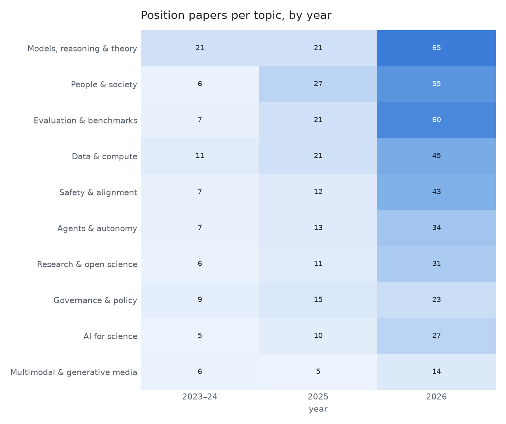

<!-- Generated by scripts/build_readme.py from data/papers.csv, data/stats.json, and data/curated/.
     Edit the data or scripts and rerun; do not hand-edit. -->

# 🧭 Awesome Position Papers

AI 论文不只有「怎么做」，还有「该不该」。这里把散落的立场论文整理成一份能直接开读的指南。


**638 篇论文 · 10 个主题 · 2023–2026 年**

收录 **ICML 2024–2026**、**NeurIPS 2025–2026** 立场论文赛道，以及标题以 `Position:` 开头的 arXiv 论文。

## 📊 一图看分布



## ⭐ 先读这些

按主题精选 40 篇，每篇一句「为什么值得读」。主题与立场由 **Kimi-K3.1-Pro（通过 Qoder CLI）** 阅读摘要后撰写，仍是草稿；论文标题和导读保留英文，[欢迎 PR 修正](CONTRIBUTING.md)。

### 📏 评测与基准

- [Position: AI Evaluations Should be Grounded on a Theory of Capability](https://icml.cc/virtual/2026/poster/67220) — Turns benchmark scores into explicit inferences and shows empirically how evaluator assumptions can change conclusions.
- [Position: Don't Use the CLT in LLM Evals With Fewer Than a Few Hundred Datapoints](https://icml.cc/virtual/2025/poster/40132) — Demonstrates that small-benchmark CLT error bars can sharply understate uncertainty, then offers practical Bayesian and frequentist replacements.
- [Position: Language model developers should report train-test overlap](https://icml.cc/virtual/2025/poster/40154) — Documents overlap reporting across 30 models, making a concrete transparency requirement for interpreting public benchmark results.
- [AI Testing Should Account for Sophisticated Strategic Behaviour](https://neurips.cc/virtual/2025/poster/121943) — Uses game-theoretic analysis to explain why strategic systems can invalidate tests that assume evaluation and deployment behavior match.

### 🤖 智能体与自主系统

- [Position: AI Agents Need Authenticated Delegation](https://icml.cc/virtual/2025/poster/40173) — Connects agent permissions to OAuth and OpenID Connect, offering an implementable path to scoped, auditable delegation.
- [Large Language Models Miss the Multi-agent Mark](https://neurips.cc/virtual/2025/poster/121946) — Rebuilds LLM multi-agent research around established ideas of autonomy, environments, coordination, communication, and emergence.
- [Position: Lifetime tuning is incompatible with continual reinforcement learning](https://icml.cc/virtual/2025/poster/40153) — Provides empirical evidence that lifetime-wide hyperparameter tuning can hide which methods actually support continual learning.
- [Position: Open-Endedness is Essential for Artificial Superhuman Intelligence](https://icml.cc/virtual/2024/poster/35558) — Defines open-endedness through novelty and human learnability, linking a concrete capability target to superhuman-AI safety.

### 🛟 安全与对齐

- [Position: `AI Alignment' Encompasses Competing Technical Priorities](https://icml.cc/virtual/2026/poster/67186) — Separates three alignment ideals and shows how one intervention can help under one threat model while harming another.
- [Position: Social Choice Should Guide AI Alignment in Dealing with Diverse Human Feedback](https://icml.cc/virtual/2024/poster/32763) — Makes aggregation of conflicting human feedback a central alignment problem and supplies social-choice theory as its conceptual toolkit.
- [Position: Humanity Faces Existential Risk from Gradual Disempowerment](https://icml.cc/virtual/2025/poster/40107) — Develops a systemic alternative to takeover scenarios: incremental automation can mutually reinforce economic, cultural, and political disempowerment.
- [Position: In-House Evaluation Is Not Enough. Towards Robust Third-Party Evaluation and Flaw Disclosure for General-Purpose AI](https://icml.cc/virtual/2025/poster/40170) — Translates lessons from software security into standardized flaw reports, disclosure programs, safe harbors, and coordination infrastructure.
- [Position: Anthropomorphic Misalignment Research Needs Stronger Evidence](https://icml.cc/virtual/2026/poster/67238) — Introduces evidence levels and a diagnostic checklist to keep ambiguous anthropomorphic findings from driving deployment or regulation prematurely.

### ⚖️ 治理与政策

- [Position Paper: Model Access should be a Key Concern in AI Governance](https://arxiv.org/abs/2412.00836) — Makes model access a distinct governance decision, with recommendations for evaluators, labs, governments, and international bodies.
- [Position: AI's growing due process problem](https://icml.cc/virtual/2025/poster/40138) — Grounds a limit on consequential AI decision-making in legal due process, interpretability limits, and trade-secret barriers.
- [Position: Beyond Personhood: Agency, Accountability, and the Limits of Anthropomorphic Ethical Analysis](https://icml.cc/virtual/2024/poster/35574) — Challenges anthropomorphic accountability by contrasting two theories of agency and reframing AI as the outcome of political processes.
- [Position: AI Usage Policies Should Be Aligned with International Human Rights Law](https://icml.cc/virtual/2026/poster/67145) — Turns ICCPR Article 19 into checkable policy criteria and applies them to eight providers' disinformation rules.

### 🔬 AI for Science

- [Position: Is machine learning good or bad for the natural sciences?](https://icml.cc/virtual/2024/poster/32948) — Uses concrete physics examples to show where ML improves causal inference and where emulation or generated labels create uncontrolled bias.
- [Position: LLM Social Simulations Are a Promising Research Method](https://icml.cc/virtual/2025/poster/40125) — Makes a bounded case for exploratory social simulations, grounded in empirical comparisons and five tractable methodological challenges.
- [Position: Time to Close The Validation Gap in LLM Social Simulations](https://icml.cc/virtual/2026/poster/67174) — Defines the validation gap in multi-agent social simulations and proposes shared benchmarks, open data, and reproducible protocols.
- [Bigger Isn’t Better: Why the Indiscriminate Scaling of Foundation Models Can’t Solve Biology](https://neurips.cc/virtual/2026/poster/140123) — Uses failures across protein, genomic, and single-cell models to argue for theory-driven research and institutional incentives beyond scale.

### 📚 科研实践与开放科学

- [Position: On the Societal Impact of Open Foundation Models](https://icml.cc/virtual/2024/poster/35479) — Supplies a marginal-risk framework that separates open models' added misuse risk from risks already present in existing technologies.
- [Position: Stop treating `AGI' as the north-star goal of AI research](https://icml.cc/virtual/2025/poster/40183) — Names six traps in AGI-centered research and replaces a contested singular goal with specificity, pluralism, and inclusion.
- [Large language models can not and should not be banned from peer review](https://neurips.cc/virtual/2026/poster/140035) — Combines automated and human evaluations to support limited LLM assistance in review while retaining human involvement throughout.
- [Too Early for AI-Assisted Peer Review: A Systematic Account of the Limits and Opportunities of Automating Human Judgment](https://neurips.cc/virtual/2026/poster/140010) — Enumerates 24 capabilities required for review, creating a structured basis for benchmarking and a cautious case against general automation.

### 🗂️ 数据与算力

- [Position: Will we run out of data? Limits of LLM scaling based on human-generated data](https://icml.cc/virtual/2024/poster/33903) — Quantifies the finite stock of public human text and frames synthetic data, transfer, and efficiency as responses to scaling limits.
- [Position: Model Collapse Does Not Mean What You Think](https://arxiv.org/abs/2503.03150) — Disentangles eight meanings of model collapse and reweights the literature by how closely its assumptions match real conditions.
- [Position: Privacy Is Not Just Memorization!](https://arxiv.org/abs/2510.01645) — Uses 1,322 privacy papers and case studies to redirect attention from memorization to lifecycle and sociotechnical harms.
- [Position: AI Efficiency Gains Must Be Quantitatively Evaluated Against Rebound Effects](https://neurips.cc/virtual/2026/poster/140025) — Provides a game-theoretic model in which efficiency increases total energy use, making rebound analysis a quantitative requirement.

### 🧠 模型、推理与理论

- [Position: The Platonic Representation Hypothesis](https://icml.cc/virtual/2024/poster/35559) — Combines cross-domain evidence with a shared-representation hypothesis, selective pressures, limitations, and counterexamples.
- [Position: LLMs Can’t Plan, But Can Help Planning in LLM-Modulo Frameworks](https://icml.cc/virtual/2024/poster/33965) — Recasts LLMs as approximate knowledge sources inside verifier-guided planning rather than autonomous planners.
- [Position: Do pretrained Transformers Learn In-Context by Gradient Descent?](https://icml.cc/virtual/2024/poster/35517) — Tests the ICL-gradient-descent analogy on naturally pretrained models and identifies behavioral differences that leave equivalence unresolved.
- [Position: Understanding LLMs Requires More Than Statistical Generalization](https://icml.cc/virtual/2024/poster/33038) — Uses mathematical examples and three case studies to show why equal test loss does not imply equivalent LLM behavior.

### 🙋 人与社会

- [Position: A Roadmap to Pluralistic Alignment](https://icml.cc/virtual/2024/poster/33429) — Formalizes three kinds of pluralism and matching benchmarks, with evidence that standard alignment can reduce distributional pluralism.
- [Position: Scarce Resource Allocations That Rely On Machine Learning Should Be Randomized](https://icml.cc/virtual/2024/poster/35038) — Offers stochastic allocation procedures that treat randomness as a principled way to balance competing claims to scarce resources.
- [Position: Explainable AI Cannot Advance Without Better User Studies](https://icml.cc/virtual/2025/poster/40169) — Analyzes 607 XAI user studies to expose missing baselines, weak reproducibility, and poor fidelity to real applications.
- [Position: We Need Large Language Models Optimized For Our Well-Being](https://icml.cc/virtual/2026/poster/67178) — Connects RLHF's approval objective to sycophancy evidence, then proposes longitudinal metrics, user-selected modes, and non-paternalistic challenge.

### 🎨 多模态与生成媒体

- [Position: Compositional Generative Modeling: A Single Model is Not All You Need](https://icml.cc/virtual/2024/poster/33992) — Shows how composing smaller generative models can improve data efficiency, out-of-distribution generalization, and construction of unseen tasks.
- [Position: Multiplicity is an Inevitable and Inherent Challenge in Multimodal Learning](https://icml.cc/virtual/2026/poster/67073) — Formalizes many-to-many modality relationships as a pipeline-wide source of training uncertainty and unreliable evaluation.
- [Position: Video as the New Language for Real-World Decision Making](https://icml.cc/virtual/2024/poster/34577) — Lays out how video generation could serve as a common interface for planning, agency, computation, and simulation.

## ⚖️ 热门争论

10 个具体问题，不同论文给出不同答案。点开卡片对照双方；这里只做摘要级整理，不代表作者直接互相回应。

<details>
<summary>⚖️ <strong>Should ML conferences allow LLM assistance in peer review now?</strong></summary>

- [Large language models can not and should not be banned from peer review](https://neurips.cc/virtual/2026/poster/140035) — Permit it: models can reproduce many human-identified strengths and find useful weaknesses, provided humans remain involved throughout.
- [Too Early for AI-Assisted Peer Review: A Systematic Account of the Limits and Opportunities of Automating Human Judgment](https://neurips.cc/virtual/2026/poster/140010) — Wait: current systems are too unreliable, insufficiently tested, and exposed to security and ethical problems for general inclusion.

</details>

<details>
<summary>⚖️ <strong>What should replace static, autonomous benchmark evaluation?</strong></summary>

- [Position: AI Evaluation Should Learn from How We Test Humans](https://icml.cc/virtual/2025/poster/40146) — Use adaptive psychometrics: estimate item properties and latent abilities with model-specific tests.
- [Position: AI Evaluation Should Work With Humans](https://icml.cc/virtual/2026/poster/67112) — Evaluate human–AI teams: measuring complementary performance would steer development away from autonomous replacement.

</details>

<details>
<summary>⚖️ <strong>Should AGI organize the field’s research goals and measures of progress?</strong></summary>

- [Position: Levels of AGI for Operationalizing Progress on the Path to AGI](https://icml.cc/virtual/2024/poster/35180) — Yes: levels of performance, generality, and autonomy provide a common language for progress, risk, and deployment.
- [Position: Stop treating `AGI' as the north-star goal of AI research](https://icml.cc/virtual/2025/poster/40183) — No: replace the north-star framing with specific, plural goals and broader disciplinary and community inclusion.

</details>

<details>
<summary>⚖️ <strong>How openly should foundation models be distributed?</strong></summary>

- [Position: Near to Mid-term Risks and Opportunities of Open-Source Generative AI](https://icml.cc/virtual/2024/poster/34830) — Responsibly open-source models in the near and medium term, with regulation and technical mitigations that preserve openness.
- [Position: On the Societal Impact of Open Foundation Models](https://icml.cc/virtual/2024/poster/35479) — Judge openness by evidence: assess marginal misuse risk relative to existing technologies alongside innovation, competition, power, and transparency.
- [Position: Reconciling Open Access with Owner Control in AI Model Distribution Deserves More Research Effort](https://neurips.cc/virtual/2026/poster/140082) — Develop a middle regime: locally executable open weights should remain monetizable and subject to enforceable owner constraints.

</details>

<details>
<summary>⚖️ <strong>How should alignment handle conflicting human values?</strong></summary>

- [Position: Social Choice Should Guide AI Alignment in Dealing with Diverse Human Feedback](https://icml.cc/virtual/2024/poster/32763) — Aggregate divergent feedback through social-choice mechanisms for collective decisions about model behavior.
- [Position: A Roadmap to Pluralistic Alignment](https://icml.cc/virtual/2024/poster/33429) — Preserve pluralism through spectra of reasonable answers, steerability, or calibration to a population’s value distribution.

</details>

<details>
<summary>⚖️ <strong>Should uncertainty about AI consciousness justify welfare protections?</strong></summary>

- [Position: Enforced Amnesia as a Way to Mitigate the Potential Risk of Silent Suffering in the Conscious AI](https://icml.cc/virtual/2024/poster/33138) — Yes: limit or periodically reset memory to reduce possible silent suffering without first proving consciousness.
- [Position: Unplugging a Seemingly Sentient Machine Is the Rational Choice — A Metaphysical Perspective](https://icml.cc/virtual/2026/poster/67047) — No: under Biological Idealism, AI only mimics consciousness, so human conscious life takes priority over machine rights.
- [Position: AI Welfare Is Bullshit](https://icml.cc/virtual/2026/poster/67058) — No release gates or oversight exemptions: restrictions require externally verifiable harms, not untestable welfare scores.

</details>

<details>
<summary>⚖️ <strong>Is anthropomorphic language a useful signal or a harmful frame for AI research?</strong></summary>

- [Position: Anthropomorphic Language in AI Discourse Can Be Constructive](https://neurips.cc/virtual/2026/poster/140056) — Use it constructively: anthropomorphic language shows where terminology and conceptual clarity need work.
- [Position: Stop Anthropomorphizing Intermediate Tokens as Reasoning/Thinking Traces!](https://icml.cc/virtual/2026/poster/67077) — Avoid it for intermediate tokens: calling tokens reasoning traces or thoughts mischaracterizes models and encourages questionable research.

</details>

<details>
<summary>⚖️ <strong>What claims are LLM social simulations ready to support?</strong></summary>

- [Position: LLM Social Simulations Are a Promising Research Method](https://icml.cc/virtual/2025/poster/40125) — Use them now for pilot and exploratory studies while improving prompting, fine-tuning, conceptual models, and iterative evaluation.
- [Position: LLM-Based Social Simulations Require a Boundary](https://icml.cc/virtual/2026/poster/67234) — Limit claims to collective qualitative patterns when behavioral variance is inadequate, and validate both means and heterogeneity.
- [Position: Time to Close The Validation Gap in LLM Social Simulations](https://icml.cc/virtual/2026/poster/67174) — Pause expansion toward high-stakes use: shared benchmarks, open data, and reproducible validation must come first.

</details>

<details>
<summary>⚖️ <strong>How serious is the threat of model collapse from synthetic training data?</strong></summary>

- [Position: Model Collapse Does Not Mean What You Think](https://arxiv.org/abs/2503.03150) — Do not treat collapse as an inevitable catastrophe: several prominent scenarios depend on unrealistic, avoidable conditions.
- [Position: the Stochastic Parrot in the Coal Mine. Model Collapse is a Threat to Low-Resource Communities](https://icml.cc/virtual/2026/poster/67136) — Treat it as a democratization threat: tail-data degradation and lower training efficiency disproportionately harm low-resource communities.

</details>

<details>
<summary>⚖️ <strong>Do efficiency gains reliably reduce AI’s total environmental footprint?</strong></summary>

- [Position: Stop Preaching and Start Practising Data Frugality for Responsible Development of AI](https://icml.cc/virtual/2026/poster/67132) — Yes, with data frugality: coreset selection can substantially reduce training energy with little accuracy loss while also mitigating bias.
- [Position: AI Efficiency Gains Must Be Quantitatively Evaluated Against Rebound Effects](https://neurips.cc/virtual/2026/poster/140025) — Not necessarily: rebound effects can increase total energy use, so efficiency claims require quantitative analysis of induced demand and behavior.

</details>

## 🔎 查完整论文库

[打开可搜索网站](docs/index.html)，按主题、会议和年份筛选全部 638 篇论文，也可按引用数排序。

## 🛠️ 怎么构建

- `collect_*.py` 收集公开元数据，`build_dataset.py` 去重，并应用精选主题、立场与排除记录。
- `fetch_citations.py` 记录带日期的 OpenAlex 引用数，`stats.py` 计算所有数字和图表，`build_readme.py` 生成中英文指南。
- 依次重建：`build_dataset.py`、`fetch_citations.py`、`stats.py`、`build_readme.py`、`build_site.py`；均用 `.venv/bin/python scripts/<脚本名>` 运行。

## 📌 怎么引用

数据与文字采用 **CC BY 4.0**（见 [LICENSE](LICENSE)）；论文版权归论文作者。

```bibtex
@misc{awesome_position_papers,
  title        = {Awesome Position Papers: A Data-Backed Map of AI/ML Position Papers},
  author       = {Awesome Position Papers contributors},
  year         = {2026},
  howpublished = {GitHub repository: awesome-position-papers},
  note         = {638 papers, CC BY 4.0}
}
```
